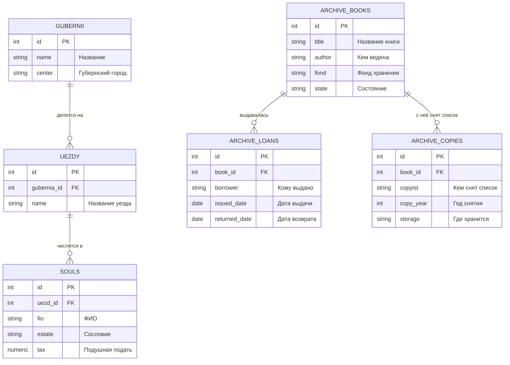

<script setup>
import Conversation from "../../../components/Conversation.vue";
</script>

# Резервное копирование и восстановление базы данных

## Введение: Что остаётся после пожара

**Июль 1788 года.**

След утраченной тетради привёл в Москву. По справке Могилёвской канцелярии, в 1771 году её отослали в Разрядный архив – одно из крупнейших хранилищ государственных бумаг, собранных со времён московских приказов.

Савва Лукич в самом начале поисков говорил о московском пожаре, после которого тетрадь считали пропавшей. Но даты не сходились: большой пожар был в 1737 году, а тетрадь привезли в Москву тридцатью четырьмя годами позже.

<Conversation :phrases="[
    {
        name: 'Савва Лукич',
        position: 'right',
        text: 'Так я, матушка, не про тот пожар говорил. В Москве горело не однажды. А в архивах дело такое: что не сгорит, то сгниёт, что не сгниёт, то мыши поедят, а что мыши не тронут, то переложат при перевозке и больше не сыщешь.'
    },
    {
        name: 'Варвара Схемина',
        position: 'right',
        text: 'Савва Лукич, а как же тогда вообще что-то сохраняется?'
    },
    {
        name: 'Савва Лукич',
        position: 'right',
        text: 'А так, что переписывают. У нас в Вотчинной коллегии как заведено было: пришло дело – сними список. Один список в дело, другой в особую книгу. Сгорит дело – список останется. Писарям это было нелюбо, работа двойная, да деды наши настояли.'
    },
    {
        name: 'Гаврила Индексов',
        position: 'right',
        text: '(медленно) То есть надо искать не тетрадь. Надо искать список с тетради.'
    }
]"/>

::: info Что мы изучаем в этом учебном вопросе
**Выгрузку и загрузку данных** – перенос содержимого таблиц между базой данных и файлами в текстовом формате и формате CSV.

**Логическое резервное копирование** – создание копии базы данных, схемы или таблицы в виде, из которого содержимое можно воссоздать.

**Восстановление** – воссоздание данных из копии, в том числе выборочное.

**Физическое резервное копирование** – обзор копирования файлов кластера и восстановления на произвольный момент времени.

Это последний учебный вопрос темы и, пожалуй, самый важный практически. Всё остальное, чему мы научились, определяет, насколько удобно работать с базой данных. Резервное копирование определяет, останется ли она вообще.
:::

## Рабочая среда

Задания этого учебного вопроса выполняются как средствами SQL, так и утилитами командной строки, а также мастерами pgAdmin. Разбираем все три пути, поскольку в разных обстоятельствах удобны разные.

::: warning Утилиты запускаются из командной строки, а не из базы данных
`pg_dump`, `pg_restore`, `pg_dumpall` и `pg_basebackup` – это **отдельные программы**, входящие в поставку PostgreSQL. Они не являются SQL-командами, и выполнить их из окна запросов нельзя.

Запускаются они из командной оболочки операционной системы и подключаются к серверу как обычные клиенты, принимая те же параметры подключения, что и `psql`: `-h`, `-p`, `-U`, `-d`, а также переменные окружения и файл `~/.pgpass`.

Важное следствие: утилиты можно запускать **не на сервере**, а на любой машине, с которой есть сетевой доступ. Это штатный способ снимать копии с удалённого сервера.
:::

## Классификация резервных копий

Прежде чем выполнять команды, разберём, какие бывают копии и для чего пригодна каждая.

### Логические и физические копии

**Логическая копия** содержит описание содержимого базы данных: команды создания объектов и данные. По сути это текст, из которого базу можно воссоздать, выполнив его. Снимается работающим сервером через обычное соединение.

**Физическая копия** содержит сами файлы кластера – побайтовую копию каталога данных. Снимается на уровне файловой системы.

| Признак | Логическая копия | Физическая копия |
| :--- | :--- | :--- |
| Что копируется | Описание объектов и данные | Файлы каталога данных |
| Чем снимается | `pg_dump`, `pg_dumpall` | `pg_basebackup`, средства файловой системы |
| Объект копирования | Отдельная таблица, схема, база | Только весь кластер целиком |
| Размер | Обычно меньше: нет индексов и пустот | Больше: включает индексы и свободное место |
| Время снятия | Дольше на больших объёмах | Быстрее: последовательное чтение файлов |
| Время восстановления | Дольше: объекты создаются заново, индексы перестраиваются | Быстрее: файлы копируются обратно |
| Перенос между версиями PostgreSQL | Возможен | **Невозможен** |
| Перенос между платформами | Возможен | Как правило невозможен |
| Выборочное восстановление | Возможно | Невозможно |
| Восстановление на момент времени | Невозможно | Возможно вместе с архивом журнала |

::: tip Какую выбрать
Выбор определяется не предпочтениями, а задачей.

**Логическая копия** нужна, когда требуется перенести данные между версиями сервера или на другую платформу, восстановить одну таблицу, передать данные разработчикам, либо когда база невелика.

**Физическая копия** нужна, когда база велика, время восстановления критично, требуется восстановление на произвольный момент времени или настраивается резервный сервер.

На рабочих системах обычно применяют **и то и другое**: физические копии как основное средство восстановления и логические как средство переноса и выборочного восстановления.
:::

### Согласованность копии

Отдельного внимания требует вопрос, на который начинающие не обращают внимания.

::: info Копия обязана быть внутренне согласованной
Снятие копии занимает время. Если за это время данные изменятся, копия может оказаться противоречивой: заказ попал в копию, а строки заказа – нет.

Утилита `pg_dump` решает это тем, что работает **внутри одной транзакции на уровне изоляции `REPEATABLE READ`**. Как мы разбирали в учебном вопросе о транзакциях, такая транзакция видит базу данных в состоянии на момент своего начала и не замечает последующих изменений. Поэтому копия соответствует одному моменту времени, даже если снималась час.

У этого есть обратная сторона: длительная транзакция `pg_dump` **мешает очистке мёртвых строк** во всей базе. На больших базах снятие копии в часы нагрузки приводит к заметному раздуванию, и копии снимают в периоды затишья.

При копировании файлов средствами файловой системы согласованность не обеспечивается автоматически: нужны либо остановка сервера, либо режим резервного копирования, либо моментальный снимок файловой системы.
:::

## Учебная база данных



::: details Данные для БД

```sql
DROP TABLE IF EXISTS archive_copies, archive_loans, archive_books, souls_demo,
                     souls, uezdy, gubernii, souls1 CASCADE;

CREATE TABLE gubernii (
    id SERIAL PRIMARY KEY,
    name VARCHAR(60) NOT NULL UNIQUE,
    center VARCHAR(60) NOT NULL
);

INSERT INTO gubernii (name, center) VALUES
('Санкт-Петербургская', 'Санкт-Петербург'),
('Московская',          'Москва'),
('Могилёвская',         'Могилёв'),
('Киевская',            'Киев'),
('Таврическая область', 'Симферополь');

CREATE TABLE uezdy (
    id SERIAL PRIMARY KEY,
    gubernia_id INT NOT NULL REFERENCES gubernii,
    name VARCHAR(60) NOT NULL,
    UNIQUE (gubernia_id, name)
);

INSERT INTO uezdy (gubernia_id, name) VALUES
(1, 'Шлиссельбургский'),
(1, 'Софийский'),
(2, 'Коломенский'),
(2, 'Серпуховский'),
(3, 'Оршанский'),
(4, 'Васильковский'),
(5, 'Перекопский');

CREATE TABLE souls (
    id SERIAL PRIMARY KEY,
    uezd_id INT REFERENCES uezdy,
    fio VARCHAR(60) NOT NULL,
    estate VARCHAR(30),
    tax NUMERIC(8, 2)
);

INSERT INTO souls (uezd_id, fio, estate, tax)
SELECT (n % 7) + 1,
       'Душа ревизская № ' || n,
       (ARRAY['Крестьянин', 'Мещанин', 'Мастеровой', 'Однодворец'])[1 + (n % 4)],
       (ARRAY[0.70, 1.20, 2.00])[1 + (n % 3)]
FROM generate_series(1, 2000) AS n;

CREATE TABLE archive_books (
    id SERIAL PRIMARY KEY,
    title VARCHAR(120) NOT NULL,
    author VARCHAR(60),
    fond VARCHAR(30),
    state VARCHAR(30) NOT NULL DEFAULT 'в наличии'
);

INSERT INTO archive_books (title, author, fond, state) VALUES
('Книга окладная Поместного приказа',       'Транзакциев А.', 'Фонд 1',  'в наличии'),
('Реестр судов воронежского строения',      'Запросов Ф.',    'Фонд 4',  'в наличии'),
('Сказки ревизские первой ревизии',         'Запросов Ф.',    'Фонд 7',  'в наличии'),
('Тетрадь о устроении хранилищ и допусках', 'Запросов Ф.',    'Фонд 7',  'утрачена'),
('Наказы Уложенной комиссии',               'Канцелярия',     'Фонд 12', 'в наличии');

CREATE TABLE archive_loans (
    id SERIAL PRIMARY KEY,
    book_id INT REFERENCES archive_books,
    borrower VARCHAR(80) NOT NULL,
    issued_date DATE NOT NULL,
    returned_date DATE
);

INSERT INTO archive_loans (book_id, borrower, issued_date, returned_date) VALUES
(1, 'Вотчинная коллегия',                          '1760-04-02', '1760-05-11'),
(3, 'Сенатская канцелярия',                        '1762-11-20', '1763-02-14'),
(4, 'Военная коллегия, департамент провиантский',  '1764-03-12', NULL),
(5, 'Академия наук',                               '1783-10-01', '1783-12-20');

CREATE TABLE archive_copies (
    id SERIAL PRIMARY KEY,
    book_id INT REFERENCES archive_books,
    copyist VARCHAR(80) NOT NULL,
    copy_year INT NOT NULL,
    storage VARCHAR(80) NOT NULL
);

INSERT INTO archive_copies (book_id, copyist, copy_year, storage) VALUES
(1, 'подьячий Пергаменов Лука',  1698, 'Вотчинная коллегия, книга списков'),
(3, 'писарь Козлов Ефим',        1726, 'Сенатский архив, фонд 2');

ANALYZE;
```

:::

## Выгрузка и загрузка данных

### Команда COPY и мета-команда \copy

Начнём с различия, о котором говорилось в первом занятии темы. Оно имеет практические последствия в каждой задаче этого раздела.

| | SQL-команда `COPY` | Мета-команда `\copy` |
| :--- | :--- | :--- |
| Кто выполняет | **Сервер** | **Клиент** `psql` |
| Где находится файл | В файловой системе **сервера** | В файловой системе **клиента** |
| Требуемые права | Суперпользователь или членство в `pg_read_server_files` / `pg_write_server_files` | Не требуется |
| Работает в pgAdmin и DBeaver | Да | Нет: это команда `psql` |
| Доступна приложению | Да | Нет |

::: danger Самая частая ошибка начинающего администратора
Человек подключается к удалённому серверу со своей машины, выполняет

```
COPY souls TO 'C:\temp\1.txt';
```

и либо получает отказ в правах, либо, что хуже, команда проходит, а файла на его машине нет. Файл создан **на сервере**, в каталоге `C:\temp` серверной машины, и чтобы его забрать, нужен доступ к ней.

Правильно в этом случае:

```
\copy souls TO 'C:\temp\1.txt'
```

Обратите внимание: у мета-команды `\copy` **нет точки с запятой в конце** и она должна быть записана в одну строку, потому что это команда `psql`, а не SQL.

Простое правило: если файл нужен там, где вы сидите, – `\copy`. Если на сервере – `COPY`.
:::

### Выгрузка в файл

Общая форма:

```sql
COPY { имя_таблицы [ ( столбец [, ...] ) ] | ( запрос ) }
    TO { 'имя_файла' | PROGRAM 'команда' | STDOUT }
    [ [ WITH ] ( параметр [, ...] ) ];
```

Простейшая выгрузка в текстовом формате:

```sql
COPY souls TO '/tmp/1.txt';
```

Выгрузка результата запроса, а не всей таблицы:

```sql
COPY (SELECT * FROM souls WHERE uezd_id = 4) TO '/tmp/2.txt';
```

::: info Возможность выгрузить результат запроса
Это существенная возможность, которой нет у графических мастеров. В скобках может стоять произвольный запрос, в том числе с соединениями, группировкой и оконными функциями.

Так формируют выгрузки для внешних потребителей, не создавая промежуточных таблиц:

```sql
COPY (
    SELECT g.name AS gubernia,
           u.name AS uezd,
           count(*) AS souls_count,
           round(sum(s.tax), 2) AS tax_total
    FROM souls s
    JOIN uezdy u    ON u.id = s.uezd_id
    JOIN gubernii g ON g.id = u.gubernia_id
    GROUP BY g.name, u.name
    ORDER BY g.name, u.name
) TO '/tmp/svod.csv' WITH (FORMAT csv, HEADER true);
```
:::

### Параметры формата

| Параметр | Назначение | Значение по умолчанию |
| :--- | :--- | :--- |
| `FORMAT` | `text`, `csv` или `binary` | `text` |
| `DELIMITER` | Разделитель столбцов | Табуляция для `text`, запятая для `csv` |
| `NULL` | Чем обозначать пустое значение | `\N` для `text`, пустая строка для `csv` |
| `HEADER` | Выводить и читать строку заголовка | `false` |
| `QUOTE` | Символ кавычек | Двойная кавычка, только для `csv` |
| `ESCAPE` | Символ экранирования кавычек | Совпадает с `QUOTE` |
| `ENCODING` | Кодировка файла | Кодировка клиента |
| `FORCE_QUOTE` | Всегда брать указанные столбцы в кавычки | – |
| `FORCE_NOT_NULL` | Не считать пустую строку значением `NULL` | – |

Выгрузка в формате CSV с заголовком и явной кодировкой:

```sql
COPY souls TO '/tmp/1.csv' WITH (FORMAT csv, HEADER true, ENCODING 'UTF8');
```

::: warning Кодировка при выгрузке и загрузке должна совпадать
Это источник трудноуловимых ошибок. Если выгрузить в кодировке `UTF8`, а загружать как `WIN1251`, русский текст либо превратится в нечитаемые символы, либо вызовет ошибку преобразования.

Методические указания предписывают `WIN1251` для совместимости со средствами, принятыми в организации. Современная практика – `UTF8` повсеместно. Главное – **указывать кодировку явно** в обеих операциях и не полагаться на умолчания, которые зависят от настроек клиента.

Проверить кодировку базы данных:

```sql
SHOW server_encoding;
SHOW client_encoding;
```
:::

### Загрузка из файла

```sql
COPY имя_таблицы [ ( столбец [, ...] ) ]
    FROM { 'имя_файла' | PROGRAM 'команда' | STDIN }
    [ [ WITH ] ( параметр [, ...] ) ]
    [ WHERE условие ];
```

Создадим таблицу-копию по образцу и загрузим в неё данные:

```sql
CREATE TABLE souls_demo (LIKE souls);

COPY souls_demo FROM '/tmp/1.txt';

SELECT count(*) FROM souls_demo;
```

::: info Предложение WHERE при загрузке
Начиная с PostgreSQL 12 загрузку можно фильтровать:

```sql
DELETE FROM souls_demo;

COPY souls_demo FROM '/tmp/1.txt' WHERE estate = 'Мещанин';

SELECT count(*) FROM souls_demo;
```

Строки, не прошедшие условие, пропускаются без ошибки. Это удобно при загрузке части большого файла, но следует помнить: файл всё равно читается целиком, экономится лишь запись.
:::

::: warning Загрузка добавляет, а не заменяет
`COPY ... FROM` **дописывает** строки к существующим. Повторный запуск удвоит содержимое таблицы.

Если нужна замена, перед загрузкой таблицу очищают:

```sql
TRUNCATE souls_demo;
```

либо, если очистка должна быть отменяемой:

```sql
DELETE FROM souls_demo;
```

Различие этих команд разбиралось в занятии о модификации данных.
:::

### Выгрузка и загрузка через внешнюю программу

Параметр `PROGRAM` позволяет направить данные в программу или получить из неё:

```sql
COPY souls TO PROGRAM 'gzip > /tmp/souls.txt.gz';
```

::: danger PROGRAM требует права запуска программ на сервере
Эта возможность выполняет произвольную команду операционной системы **от имени пользователя, под которым работает сервер**. Поэтому она доступна только суперпользователю или членам предопределённой роли `pg_execute_server_program`.

Выдавать это право следует с той же осторожностью, что и атрибут суперпользователя: роль, имеющая его, фактически получает доступ к операционной системе сервера.
:::

### Задание 3.1. Выгрузка и загрузка средствами pgAdmin

**А) Текстовый формат.**

Для выгрузки на панели Object Explorer в контекстном меню таблицы `souls` выберите «Import/Export Data». В открывшемся окне на вкладке «Общие» установите переключатель в положение «Экспорт», в поле «Имя файла» укажите полный путь и имя файла, в списке «Формат» выберите `text`, в списке «Кодировка» – `UTF8`. Нажмите «OK».

На вкладке «Параметры» доступны:

- переключатель «Заголовок» – выводить ли названия столбцов;
- список «Разделитель» – символ, разделяющий столбцы;
- список «Кавычки» – символ кавычек;
- список «Экранирование» – символ перед кавычкой;
- поле «Строки NULL» – чем обозначать пустые значения.

На вкладке «Столбцы» можно выбрать столбцы для выгрузки. Если список оставить пустым, выгружаются все.

Создайте таблицу-копию и загрузите в неё данные:

```sql
CREATE TABLE souls1 (LIKE souls);
```

Для загрузки в контекстном меню таблицы `souls1` выберите «Import/Export Data», установите переключатель в положение «Импорт», укажите тот же файл, формат и кодировку.

**Б) Формат CSV.**

Повторите обе операции, выбрав в списке «Формат» значение `csv`.

::: warning Данные будут дописаны
После второй загрузки в таблице `souls1` окажется вдвое больше строк, чем в исходной: первая загрузка добавила их из текстового файла, вторая – из файла CSV.

Это не ошибка мастера, а то самое свойство операции загрузки, о котором говорилось выше. Перед второй загрузкой таблицу следует очистить.
:::

::: tip Чем мастер уступает команде
Мастер pgAdmin работает только с **таблицей целиком или её столбцами**. Выгрузить результат запроса он не умеет.

Кроме того, мастер выполняет `COPY` на стороне сервера, то есть файл создаётся на серверной машине, если pgAdmin запущен не на ней. В новых версиях pgAdmin это обходится передачей через собственный серверный процесс, но путь к файлу всё равно указывается относительно машины, где работает pgAdmin.

Поэтому для регулярных задач применяют команды, а мастер оставляют для разовых операций.
:::

### Задание 3.2. Выгрузка и загрузка с помощью SQL-команд

**А) Текстовый формат.**

```sql
COPY souls TO '/tmp/2.txt';

DELETE FROM souls1;

COPY souls1 FROM '/tmp/2.txt';

SELECT count(*) FROM souls1;
```

**Б) С условием отбора.**

Выгружаем только души четвёртого уезда, а при загрузке отбираем из них только мещан:

```sql
COPY (SELECT * FROM souls WHERE uezd_id = 4) TO '/tmp/2.txt';

DELETE FROM souls1;

COPY souls1 FROM '/tmp/2.txt' WHERE estate = 'Мещанин';

SELECT count(*) FROM souls1;
```

Обратите внимание: отбор выполняется дважды и в разных местах. При выгрузке – запросом в скобках, на стороне источника. При загрузке – предложением `WHERE`, на стороне приёмника.

**В) Формат CSV.**

```sql
COPY souls TO '/tmp/2.csv' WITH (FORMAT csv, ENCODING 'UTF8');

DELETE FROM souls1;

COPY souls1 FROM '/tmp/2.csv' WITH (FORMAT csv, ENCODING 'UTF8');

SELECT count(*) FROM souls1;
```

Кодировка указана явно в обеих командах – именно так и следует поступать всегда.

## Логическое резервное копирование

### Утилита pg_dump

`pg_dump` снимает копию **одной базы данных**. Общая форма вызова:

```bash
pg_dump [параметры_подключения] [параметры_копирования] имя_базы
```

Основные параметры:

| Параметр | Назначение |
| :--- | :--- |
| `-f файл` | Куда записать копию |
| `-F формат` | Формат копии: `p`, `c`, `d`, `t` |
| `-s` | Только схема, без данных |
| `-a` | Только данные, без схемы |
| `-t таблица` | Только указанные таблицы |
| `-n схема` | Только указанные схемы |
| `-T`, `-N` | Исключить указанные таблицы или схемы |
| `-j число` | Выгружать в несколько потоков (только для формата `d`) |
| `-Z уровень` | Уровень сжатия |
| `--no-owner` | Не записывать команды смены владельца |
| `--no-privileges` | Не записывать команды выдачи прав |
| `-v` | Подробный вывод |

### Форматы копии

Выбор формата – первое и наиболее важное решение.

| Формат | Ключ | Что получается | Как восстанавливать |
| :--- | :--- | :--- | :--- |
| `plain` | `-Fp` | Текстовый файл с SQL-командами | `psql -f` |
| `custom` | `-Fc` | Сжатый двоичный файл | `pg_restore` |
| `directory` | `-Fd` | Каталог с файлом на каждую таблицу | `pg_restore` |
| `tar` | `-Ft` | Архив `tar` | `pg_restore` |

```bash
pg_dump -h 10.0.31.10 -U postgres -d archive_db -Fp -f /tmp/db.sql

pg_dump -h 10.0.31.10 -U postgres -d archive_db -Fc -f /tmp/db.dump

pg_dump -h 10.0.31.10 -U postgres -d archive_db -Fd -j 4 -f /tmp/db_dir
```

::: tip Какой формат выбирать
**`plain`** даёт обычный текстовый файл, который можно прочитать, отредактировать и выполнить любым клиентом. Удобен для небольших баз и для передачи схемы. Недостаток: восстановление только целиком и последовательно, без возможности выбора объектов.

**`custom`** – рабочий выбор по умолчанию. Файл сжат, восстанавливается утилитой `pg_restore`, допускает **выборочное** восстановление отдельных объектов и параллельное восстановление.

**`directory`** – единственный формат, поддерживающий **параллельную выгрузку** ключом `-j`. На больших базах это сокращает время снятия копии в разы. Внутри каталога лежит по файлу на таблицу, что также позволяет копировать копию по частям.

**`tar`** практически не применяется: он не сжат и не имеет преимуществ перед `custom`.

Простое правило: `custom` для обычных задач, `directory` для больших баз, `plain` для схемы и для передачи людям.
:::

### Выгрузка части базы

Только схема, без данных – то, что нужно для развёртывания тестового окружения:

```bash
pg_dump -d archive_db -s -f /tmp/schema.sql
```

Только данные, без описания объектов:

```bash
pg_dump -d archive_db -a -f /tmp/data.sql
```

Отдельные таблицы:

```bash
pg_dump -d archive_db -t souls -t uezdy -Fc -f /tmp/two_tables.dump
```

Отдельная схема:

```bash
pg_dump -d archive_db -n archive -Fc -f /tmp/archive_schema.dump
```

Всё, кроме крупной таблицы:

```bash
pg_dump -d archive_db -T souls -Fc -f /tmp/without_souls.dump
```

::: warning Выгрузка отдельной таблицы не включает зависимости
Ключ `-t` выгружает **только указанную таблицу**. Он не включает таблицы, на которые она ссылается внешними ключами, не включает последовательности, если они не указаны отдельно, и может не включать нужные типы и функции.

Поэтому восстановление такой копии в пустую базу, скорее всего, завершится ошибками зависимостей. Выгрузка отдельных таблиц предназначена для восстановления **в существующую базу**, где остальные объекты уже есть.
:::

### Утилита pg_dumpall

`pg_dump` копирует одну базу данных. Объекты, общие для всего кластера, в копию **не попадают**: роли, их пароли и атрибуты, табличные пространства, параметры, заданные через `ALTER ROLE` и `ALTER DATABASE`.

Эти объекты копирует утилита `pg_dumpall`:

```bash
pg_dumpall -h 10.0.31.10 -U postgres --globals-only -f /tmp/globals.sql
```

::: danger Без глобальных объектов восстановление неполно
Это умолчание, которое дорого обходится.

Представим: база восстановлена из копии `pg_dump`, все таблицы и данные на месте. Но роли, которым выданы права, в кластере отсутствуют. Команды выдачи прав из копии завершились ошибками, и приложение не может подключиться, потому что его роли не существует.

Полная схема логического копирования кластера состоит из двух частей:

```bash
pg_dumpall --globals-only -f /tmp/globals.sql

pg_dump -d archive_db -Fc -f /tmp/archive_db.dump
```

Восстановление – в том же порядке: сначала глобальные объекты, потом базы.

Утилита `pg_dumpall` без ключа `--globals-only` выгружает **весь кластер целиком**, включая все базы, но только в формате `plain`. На больших установках это неудобно, поэтому обычная практика – `pg_dumpall --globals-only` плюс отдельные `pg_dump` по базам.
:::

### Утилита pg_restore

Восстанавливает копии форматов `custom`, `directory` и `tar`. Копия формата `plain` восстанавливается через `psql`.

| Параметр | Назначение |
| :--- | :--- |
| `-d база` | База, в которую восстанавливать |
| `-C` | Создать базу данных перед восстановлением |
| `-c` | Удалить объекты перед восстановлением |
| `--if-exists` | Добавить проверку существования к командам удаления |
| `-s`, `-a` | Только схема или только данные |
| `-t`, `-n` | Только указанные таблицы или схемы |
| `-j число` | Восстанавливать в несколько потоков |
| `-l` | Вывести **список объектов** копии |
| `-L файл` | Восстановить только объекты из указанного списка |
| `-1` | Выполнить всё одной транзакцией |

Восстановление в существующую базу:

```bash
pg_restore -h 10.0.31.10 -U postgres -d archive_db /tmp/archive_db.dump
```

Создание базы и восстановление в неё:

```bash
pg_restore -h 10.0.31.10 -U postgres -d postgres -C /tmp/archive_db.dump
```

Обратите внимание: при ключе `-C` в параметре `-d` указывается **любая существующая база** для подключения, а создаваемая берётся из копии.

::: tip Выборочное восстановление: ключи -l и -L
Это наиболее ценная возможность формата `custom`, и о ней часто не знают.

Сначала получаем перечень всего, что есть в копии:

```bash
pg_restore -l /tmp/archive_db.dump > /tmp/toc.txt
```

Файл содержит по строке на объект:

```
224; 1259 18479 TABLE public souls postgres
3848; 0 18479 TABLE DATA public souls postgres
223; 1259 18478 SEQUENCE public souls_id_seq postgres
```

Открываем файл в редакторе и **закомментируем знаком точки с запятой** те строки, которые восстанавливать не нужно. Затем восстанавливаем по отредактированному перечню:

```bash
pg_restore -d archive_db -L /tmp/toc.txt /tmp/archive_db.dump
```

Так из копии целой базы восстанавливают одну таблицу, или схему без данных, или данные без индексов. Повторно снимать копию для этого не требуется.
:::

::: warning Ключ -1 и обработка ошибок
По умолчанию `pg_restore` выполняет команды по одной и при ошибке **продолжает работу**, сообщая об ошибках в конце. В результате база может оказаться восстановленной частично, и об этом легко не заметить.

Ключ `-1` выполняет всё восстановление одной транзакцией: либо восстановится всё, либо ничего. Это безопаснее, но несовместимо с параллельным восстановлением ключом `-j`.

Если `-1` не применяется, вывод утилиты надо читать и проверять код возврата, а не считать молчание признаком успеха.
:::

### Задание 3.3. Копирование и восстановление базы данных

**А) Создание копии.**

Через pgAdmin: на панели Object Explorer в контекстном меню базы данных выберите «Резервная копия». В окне на вкладке «General» в поле «Имя файла» укажите полный путь и имя файла, в списке «Формат» выберите «Специальный» (это и есть `custom`). Остальные параметры оставьте по умолчанию. Нажмите «Резервная копия».

Через командную строку то же самое:

```bash
pg_dump -h <адрес> -U postgres -d postgres -Fc -f /tmp/1.backup
```

**Б) Восстановление в новую базу.**

```sql
CREATE DATABASE db1;
```

Через pgAdmin: в контекстном меню базы `db1` выберите «Восстановить». В окне на вкладке «General» в списке «Формат» выберите «Специальный или tar», в поле «Имя файла» укажите путь к копии. Нажмите «Восстановить».

Через командную строку:

```bash
pg_restore -h <адрес> -U postgres -d db1 /tmp/1.backup
```

Проверьте результат, подключившись к `db1`:

```sql
SELECT count(*) FROM souls;
```

### Задание 3.4. Копирование и восстановление схемы

**А) Создание копии схемы.**

Через pgAdmin: в контекстном меню схемы `public` базы `db1` выберите «Резервная копия» и укажите имя файла.

Через командную строку:

```bash
pg_dump -h <адрес> -U postgres -d db1 -n public -Fc -f /tmp/2.backup
```

**Б) Восстановление.**

Удалите таблицы схемы:

```sql
DROP TABLE IF EXISTS souls1, souls_demo, archive_copies, archive_loans, archive_books,
                     souls, uezdy, gubernii CASCADE;
```

Восстановите:

```bash
pg_restore -h <адрес> -U postgres -d db1 /tmp/2.backup
```

::: warning Если таблицы не удалять
Восстановление в базу, где объекты уже существуют, завершится ошибками «объект уже существует». Данные при этом могут продублироваться: описание объекта не создастся, а данные допишутся.

В pgAdmin для этого случая на вкладке «Query Options» включают переключатели «Очистить перед восстановлением» и «Include IF EXISTS clause».

В командной строке им соответствуют ключи:

```bash
pg_restore -d db1 -c --if-exists /tmp/2.backup
```

Ключ `-c` добавляет команды удаления объектов перед созданием, `--if-exists` делает эти команды безопасными, если объекта нет.

Пользоваться ключом `-c` надо осознанно: он **удаляет существующие объекты**. На рабочей базе это необратимо.
:::

### Задание 3.5. Копирование и восстановление таблицы

**А) Создание копии таблицы.**

Через pgAdmin: в контекстном меню таблицы `souls1` выберите «Резервная копия».

Через командную строку:

```bash
pg_dump -h <адрес> -U postgres -d db1 -t souls1 -Fc -f /tmp/3.backup
```

**Б) Восстановление.**

Удалите все строки:

```sql
DELETE FROM souls1;

SELECT count(*) FROM souls1;
```

Восстановите только данные, не пересоздавая таблицу:

```bash
pg_restore -h <адрес> -U postgres -d db1 -a -t souls1 /tmp/3.backup
```

Проверьте:

```sql
SELECT count(*) FROM souls1;
```

Уберите учебную базу. Команды выполняются из другой базы данных:

```sql
SELECT pg_terminate_backend(pid)
FROM pg_stat_activity
WHERE datname = 'db1';
```

```sql
DROP DATABASE db1;
```

## Физическое резервное копирование

Логические копии удобны и универсальны, но на больших базах их время снятия и восстановления становится неприемлемым. Рассмотрим обзорно второй подход.

### Утилита pg_basebackup

Снимает побайтовую копию **всего кластера**, работая как обычный клиент по протоколу репликации:

```bash
pg_basebackup -h 10.0.31.10 -U postgres -D /backup/base -Ft -z -P
```

| Параметр | Назначение |
| :--- | :--- |
| `-D каталог` | Куда записать копию |
| `-F` | Формат: `p` – каталог как есть, `t` – архивы `tar` |
| `-z` | Сжатие |
| `-P` | Показывать хода выполнения |
| `-X метод` | Как включить журнал предзаписи |
| `-c fast` | Выполнить контрольную точку немедленно |
| `-R` | Создать файл настроек для резервного сервера |

Для работы утилиты сервер должен разрешать подключения в режиме репликации, что настраивается в `pg_hba.conf` строкой с базой данных `replication`, и иметь достаточное значение параметра `max_wal_senders`.

::: info Почему физическая копия согласованна
Копирование файлов работающего сервера само по себе даёт противоречивый результат: пока копируется один файл, другой меняется.

Решение в том, что копия включает **журнал предзаписи** за время своего снятия. При восстановлении сервер обнаруживает, что копия незавершённая, и доводит её до согласованного состояния, применяя записи журнала. Это тот же механизм, который восстанавливает базу после аварийного отключения питания.

Поэтому физическая копия, снятая `pg_basebackup`, пригодна к восстановлению, а копия, снятая простым копированием каталога работающего сервера без журнала, – нет.
:::

### Восстановление на момент времени

Физическая копия плюс непрерывный архив журнала предзаписи дают возможность, которой нет у логических копий: восстановление состояния базы **на произвольный момент в прошлом**.

Механизм называется **PITR** (Point-In-Time Recovery) и состоит из трёх частей.

**Первая: архивирование журнала.** Сервер настраивается так, чтобы каждый заполненный файл журнала копировался в отдельное хранилище:

```
wal_level = replica
archive_mode = on
archive_command = 'cp %p /archive/%f'
```

**Вторая: периодические базовые копии.** Снимаются утилитой `pg_basebackup` с интервалом, определяемым допустимым временем восстановления.

**Третья: восстановление.** Базовая копия разворачивается, задаётся целевой момент, и сервер применяет записи журнала из архива до указанной точки:

```
restore_command = 'cp /archive/%f %p'
recovery_target_time = '1788-07-15 14:30:00'
```

::: tip Зачем это нужно на практике
Главный сценарий – не отказ оборудования, а **ошибка человека**. Кто-то выполнил `DELETE` без условия или `DROP TABLE` на рабочей базе.

Логическая копия, снятая ночью, позволит вернуться к состоянию на момент её снятия, потеряв всю работу дня. PITR позволит вернуться к состоянию за минуту до ошибочной команды.

Настройка PITR существенно сложнее и требует отдельного хранилища под архив журнала, поэтому на практике чаще применяют готовые средства, построенные на этом механизме: `pgBackRest`, `WAL-G`, `Barman`. Они берут на себя управление архивом, проверку копий, сжатие, шифрование и удаление устаревших копий.
:::

## Правила организации резервного копирования

Завершим учебный вопрос положениями, которые к SQL не относятся, но определяют, окажется ли вся предыдущая работа полезной.

::: danger Непроверенной резервной копии не существует
Это главное правило, и нарушают его почти все.

Факт успешного завершения `pg_dump` **не означает**, что из копии можно восстановиться. Файл может оказаться повреждённым при передаче, усечённым из-за нехватки места, зашифрованным ключом, который утерян, или снятым без глобальных объектов.

Единственная проверка резервной копии – **восстановление из неё**. Проводить его следует регулярно, по расписанию, на отдельном сервере, и проверять результат запросами к восстановленным данным.

Организации, узнавшие об этом правиле на собственном опыте, обычно формулируют его резче: у вас нет резервных копий, у вас есть результаты восстановления.
:::

::: tip Правило трёх копий
Общепринятая схема, применимая и к базам данных:

- **три** копии данных: рабочая и две резервные;
- на **двух** разных носителях или в двух разных системах хранения;
- **одна** из них – вне помещения, где находится основной сервер.

Последний пункт существен: резервная копия, лежащая на том же диске или в той же серверной комнате, не защищает ни от отказа массива, ни от пожара, ни от шифровальщика, добравшегося до сетевой папки.
:::

::: info Два показателя, определяющие схему копирования
Прежде чем выбирать средства, отвечают на два вопроса, и ответы на них дают не администраторы, а владельцы данных.

**Допустимая потеря данных** – какой объём работы можно позволить себе потерять. Если ответ «не более пяти минут», ежесуточная логическая копия непригодна, нужен PITR или репликация.

**Допустимое время простоя** – за какое время база должна быть снова доступна. Если ответ «не более часа», а восстановление логической копии базы в два терабайта занимает шесть часов, схема непригодна независимо от того, насколько аккуратно снимаются копии.

Проверяются оба показателя не рассуждением, а измерением на учебных восстановлениях.
:::

## Задания для самостоятельной работы

**Задание 1.** Выгрузите таблицу `souls` в текстовом формате и в формате CSV с заголовком. Сравните первые строки обоих файлов и объясните различия в разделителях, обозначении пустых значений и наличии заголовка.

**Задание 2.** Выгрузите в файл CSV результат запроса, выводящего по каждой губернии число уездов, число душ и сумму подати. Объясните, почему такую выгрузку нельзя получить мастером pgAdmin.

**Задание 3.** Создайте таблицу-копию по образцу `souls`, загрузите в неё данные из файла, затем повторите загрузку и объясните результат. Приведите две команды, позволяющие избежать удвоения, и укажите различие между ними.

**Задание 4.** Выгрузите души только Таврической области, затем загрузите из этого файла только мещан. Объясните, в каком месте выполняется каждый из двух отборов и почему второй не уменьшает объём чтения файла.

**Задание 5.** Выполните выгрузку в файл командой `COPY` и мета-командой `\copy`, указав одинаковые пути. Определите, где оказался каждый файл, и объясните причину. Опишите, в каком случае следует применять каждую из двух форм.

**Задание 6.** Снимите копию учебной базы в форматах `plain` и `custom`. Сравните размеры файлов. Откройте текстовую копию и найдите в ней команды создания таблиц, вставки данных и выдачи прав.

**Задание 7.** Снимите копию только схемы базы, без данных, и копию только данных, без схемы. Объясните, в каких задачах применяется каждая.

**Задание 8.** Снимите копию двух таблиц, связанных внешним ключом, указав ключом `-t` только дочернюю. Попробуйте восстановить её в пустую базу и объясните результат.

**Задание 9.** Получите перечень объектов копии формата `custom` ключом `-l`. Отредактируйте перечень так, чтобы восстановить только одну таблицу с данными, и выполните восстановление по отредактированному перечню.

**Задание 10.** Выполните `pg_dumpall --globals-only` и изучите полученный файл. Найдите в нём команды создания ролей и выдачи им атрибутов. Объясните, почему без этого файла восстановление базы из копии `pg_dump` может оказаться неполным.

**Задание 11.** Восстановите копию базы в новую базу двумя способами: создав базу заранее и воспользовавшись ключом `-C`. Объясните, что указывается в параметре `-d` в каждом случае.

**Задание 12.** Восстановите копию в базу, где объекты уже существуют, без дополнительных ключей. Приведите текст ошибок. Повторите с ключами `-c` и `--if-exists` и объясните, что изменилось и чем это опасно.

**Задание 13.** Восстановите копию с ключом `-1`. Намеренно создайте условие, при котором восстановление не может завершиться (например, оставив в базе таблицу с тем же именем), и покажите, что при ключе `-1` база остаётся в исходном состоянии, а без него – в частично изменённом.

**Задание 14.** Опишите схему резервного копирования для учебного сервера, указав: что копируется, чем, с какой периодичностью, куда складывается, как проверяется и сколько копий хранится. Обоснуйте выбор, исходя из допустимой потери данных и допустимого времени простоя.

**Задание 15.** Проведите учебное восстановление: снимите копию, восстановите её в отдельную базу, сравните число строк в каждой таблице с исходной базой и зафиксируйте затраченное время. Сделайте вывод о применимости такой схемы к базе в сто раз большего объёма.

## Финал: список с тетради

**Август 1788 года, Москва.**

Разрядный архив занимал несколько палат в Кремле и часть строений за его стенами. Бумаги в нём лежали с XVI века, и описи были составлены не на всё.

<Conversation :phrases="[
    {
        name: 'Гаврила Индексов',
        position: 'right',
        text: 'Варвара Никитична, по описи седьмого фонда тетрадь поступила в семьдесят первом году и числится по сей день. А на полке её нет. Я проверил трижды.'
    },
    {
        name: 'Варвара Схемина',
        position: 'right',
        text: 'Значит, и здесь то же, что в Могилёве. В описи есть, на полке нет. Четвёртый архив, и везде одно.'
    },
    {
        name: 'Гаврила Индексов',
        position: 'right',
        text: '(после долгого молчания) Четыре месяца. Два архива, тысяча двести листов описи, девятнадцать дней на ответ из Могилёва. И всё это ради книги, которой нет нигде.'
    }
]"/>

Они собирались уезжать, когда Варвара Схемина вспомнила разговор у печки в академической канцелярии.

<Conversation :phrases="[
    {
        name: 'Варвара Схемина',
        position: 'right',
        text: 'Гаврила Прохорович. Савва Лукич говорил: в Вотчинной коллегии было заведено – пришло дело, сними список. Один в дело, другой в особую книгу списков.'
    },
    {
        name: 'Гаврила Индексов',
        position: 'right',
        text: 'Так Вотчинная коллегия упразднена при Петре Третьем, двадцать шесть лет назад.'
    },
    {
        name: 'Варвара Схемина',
        position: 'right',
        text: 'Упразднена коллегия. А книга списков куда девалась?'
    }
]"/>

Книгу списков Вотчинной коллегии нашли на третий день, в несортированном поступлении 1763 года – того самого года, когда коллегию расформировали и её бумаги свезли в Разрядный архив без разбора.

Список с тетради Фёдора Запросова был снят в 1726 году неизвестным писарем, через год после того, как Екатерина I велела тетрадь начать. Шестьдесят два листа, скоропись, местами выцветшая.

<Conversation :phrases="[
    {
        name: 'Гаврила Индексов',
        position: 'right',
        text: '(читает) «О устроении хранилищ и о допусках, записано Фёдором Иванычем Запросовым, обер-секретарём, по указу государыни Екатерины Алексеевны, лета 1725». Это она.'
    },
    {
        name: 'Варвара Схемина',
        position: 'right',
        text: 'Что в ней?'
    },
    {
        name: 'Гаврила Индексов',
        position: 'right',
        text: '(листает) Первые двадцать листов – вопросы. «Отчего справка идёт медленно, когда писарей втрое больше». «Как разделить книги по амбарам, чтобы не искать по всем». «Кого к какому фонду допускать и как сие записать, дабы не зависело от памяти одного человека». «Как уберечься от пожара».'
    },
    {
        name: 'Варвара Схемина',
        position: 'right',
        text: 'А ответы?'
    },
    {
        name: 'Гаврила Индексов',
        position: 'right',
        text: '(долго молчит, потом переворачивает лист) Дальше пусто. Сорок два листа чистой бумаги. Он задал вопросы и не успел на них ответить.'
    }
]"/>

::: info Историческая справка
Разрядный архив в Москве действительно существовал и был одним из важнейших хранилищ государственных бумаг. В 1852 году его фонды вошли в состав Московского архива Министерства юстиции, а в XX веке – в Российский государственный архив древних актов, где хранятся и поныне.

Судьба архивов екатерининской эпохи была различной. Многие фонды сохранились благодаря именно той практике, о которой говорил Савва Лукич: с важных документов снимали списки, и списки хранили отдельно от подлинников. Значительная часть того, что мы знаем о делопроизводстве XVII–XVIII веков, известна по копиям, а не по оригиналам.

Так выглядит на практике единственная настоящая защита от утраты: не сохранность одного экземпляра, а существование второго в другом месте.
:::

<Conversation :phrases="[
    {
        name: 'Екатерина Романовна',
        position: 'left',
        text: 'Итак. Четыре месяца, два архива, и вы привезли мне сорок два чистых листа.'
    },
    {
        name: 'Гаврила Индексов',
        position: 'right',
        text: 'И двадцать листов вопросов, ваше сиятельство.'
    },
    {
        name: 'Екатерина Романовна',
        position: 'left',
        text: 'Прочтите мне их ещё раз.'
    },
    {
        name: 'Варвара Схемина',
        position: 'right',
        text: '(читает) «Отчего справка идёт медленно, когда писарей втрое больше».'
    },
    {
        name: 'Гаврила Индексов',
        position: 'right',
        text: 'Оттого, что книги не приписаны к фондам, а в описи нет азбучного указателя. Мы это поправили в декабре.'
    },
    {
        name: 'Варвара Схемина',
        position: 'right',
        text: '«Кого к какому фонду допускать и как сие записать, дабы не зависело от памяти одного человека».'
    },
    {
        name: 'Гаврила Индексов',
        position: 'right',
        text: 'Разрядами и метками осведомлённости. Заведено в апреле.'
    },
    {
        name: 'Варвара Схемина',
        position: 'right',
        text: '«Как уберечься от пожара».'
    },
    {
        name: 'Гаврила Индексов',
        position: 'right',
        text: '(смотрит на список в своих руках) Снимать списки. И хранить их в другом месте.'
    },
    {
        name: 'Екатерина Романовна',
        position: 'left',
        text: '(после паузы) Фёдор Иваныч задал четыре вопроса и оставил сорок два листа под ответы. Вы на эти вопросы ответили за четыре месяца, сами того не зная. Садитесь и запишите ответы туда, где им место.'
    },
    {
        name: 'Гаврила Индексов',
        position: 'right',
        text: 'В его тетрадь, ваше сиятельство?'
    },
    {
        name: 'Екатерина Романовна',
        position: 'left',
        text: 'В его тетрадь. И список с неё снимите сразу, не откладывая. (поднимается) Вы ведь только что сами сказали, как уберечься от пожара.'
    }
]"/>

## Выводы по учебному вопросу

**Чему мы научились в этом разделе:**

1. **Различать виды резервных копий.** Логические и физические копии по одиннадцати признакам, и то, что выбор между ними определяется задачей, а не предпочтениями.
2. **Понимать требование согласованности.** Почему `pg_dump` работает в транзакции уровня `REPEATABLE READ`, какую цену это имеет для очистки мёртвых строк, и почему простое копирование файлов работающего сервера даёт непригодную копию.
3. **Различать `COPY` и `\copy`.** Кто выполняет, где оказывается файл, какие права требуются, и простое правило выбора между ними.
4. **Выгружать и загружать данные.** Выгрузка таблицы и результата произвольного запроса, все параметры формата, обязательность явного указания кодировки, предложение `WHERE` при загрузке, свойство дописывания строк, выгрузка через внешнюю программу и связанные с ней права.
5. **Пользоваться мастерами pgAdmin.** Вкладки окна импорта и экспорта, и чем мастер уступает командам.
6. **Снимать логические копии.** Утилита `pg_dump`, четыре формата и критерии выбора между ними, выгрузка только схемы, только данных, отдельных таблиц и схем, и ограничение ключа `-t` по зависимостям.
7. **Копировать глобальные объекты.** Утилита `pg_dumpall --globals-only`, полная схема логического копирования кластера из двух частей, и последствия пропуска глобальных объектов.
8. **Восстанавливать из копий.** Утилита `pg_restore`, восстановление в существующую и в новую базу, ключи `-c` и `--if-exists` и их опасность, ключ `-1` и обработка ошибок.
9. **Восстанавливать выборочно.** Ключи `-l` и `-L`, перечень объектов копии и восстановление отдельных объектов без повторного снятия копии.
10. **Представлять физическое копирование.** Утилита `pg_basebackup`, почему физическая копия согласованна благодаря включённому журналу, устройство восстановления на момент времени и готовые средства, построенные на этом механизме.
11. **Организовывать копирование.** Правило «непроверенной копии не существует», правило трёх копий, и два показателя – допустимая потеря данных и допустимое время простоя, – которые определяют схему и задаются владельцами данных, а не администраторами.

## Выводы по теме

Этим учебным вопросом завершается тема «Основы организации и администрирования СУБД PostgreSQL».

За шесть учебных вопросов мы прошли путь от физического устройства хранилища до правил, обеспечивающих его сохранность:

1. **Базы данных, схемы и табличные пространства.** Объектная природа PostgreSQL, иерархия уровней организации данных, физическое устройство таблицы, многоверсионность и обслуживание.
2. **Индексы и представления.** Ускорение доступа и его цена, чтение планов выполнения, сохранённые запросы и материализованные результаты.
3. **Управление транзакциями.** Атомарность, уровни изоляции, блокировки и правила построения устойчивых приложений.
4. **Управление доступом.** Роли, привилегии, передача прав, защита на уровне строк и шифрование.
5. **Конфигурирование сервера и удалённое подключение.** Параметры, их уровни и классы применимости, правила доступа к серверу.
6. **Резервное копирование и восстановление.** Виды копий, средства их снятия и восстановления, и правила организации.

::: info Что составляет работу администратора
Если свести тему к одному положению, оно будет таким.

Администрирование базы данных – это не набор команд, а **замена случайности предсказуемостью**. Пока порядок держится на памяти одного человека, система работает ровно до того дня, когда этот человек уйдёт, заболеет или ошибётся.

Каждый из шести разделов темы описывает один способ такой замены. Приписка объектов к схемам заменяет «я помню, где лежит». Индекс заменяет «я быстро пролистаю». Транзакция заменяет «я не забуду дописать во вторую книгу». Привилегия заменяет «ему можно, я его знаю». Запись в файле конфигурации заменяет «так было настроено, не помню кем». Резервная копия заменяет «авось не сгорит».
:::

В следующей теме курса – **нереляционные базы данных**: случаи, в которых реляционная модель оказывается не лучшим решением, и системы, построенные на иных принципах.
