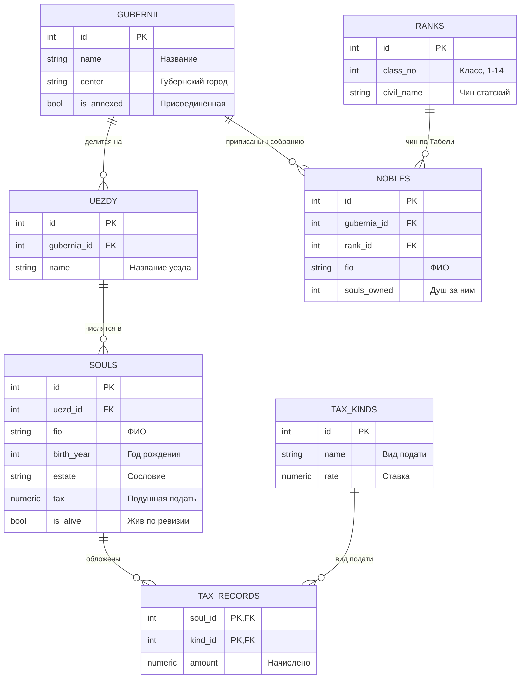

<script setup>
import Conversation from "../../../components/Conversation.vue";
</script>

# Индексы и представления

## Введение: Тысяча двести листов описи

**Декабрь 1783 года.**

Архив разобран по фондам, но тетрадь Фёдора Запросова не нашлась. Зато нашлась опись 1762 года, в которой тетрадь ещё числится на месте. Значит, пропала она позже, и след надо искать в записях о выдаче: кто брал книги из седьмого фонда и не вернул.

Беда в том, что этих записей тысяча двести листов, и ведены они в том порядке, в каком книги выдавали, то есть по дням. Чтобы найти все выдачи из одного фонда за двадцать лет, надо прочитать всё подряд.

<Conversation :phrases="[
    {
        name: 'Гаврила Индексов',
        position: 'right',
        text: 'Варвара Никитична, я считал. Если читать по сто листов в день и не отвлекаться, выйдет двенадцать дней. А отвлекаться придётся: Екатерина Романовна каждый день требует справки.'
    },
    {
        name: 'Варвара Схемина',
        position: 'right',
        text: 'И это только один раз. Через месяц понадобится другая выборка, и мы снова сядем читать тысячу двести листов.'
    },
    {
        name: 'Екатерина Романовна',
        position: 'left',
        text: '(входя) Я вторую неделю занята словарём, господа. Знаете, что делают со словарём, чтобы в нём можно было хоть что-то найти? К нему составляют азбучный указатель: отдельную книжечку, где слова стоят по алфавиту, а рядом проставлен номер страницы. Сам словарь при этом не трогают.'
    },
    {
        name: 'Гаврила Индексов',
        position: 'right',
        text: 'То есть завести вторую книгу, в которой только номера фондов и ссылки на листы описи?'
    },
    {
        name: 'Екатерина Романовна',
        position: 'left',
        text: 'Именно. И помните, Гаврила Прохорович: указатель надо переписывать всякий раз, как в опись вносят новую строку. Даровым он не бывает.'
    }
]"/>

Замечание княгини точно описывает природу индекса: это **отдельная структура, которая ускоряет поиск ценой затрат на поддержание в актуальном состоянии**. Всё содержание первого раздела этого занятия – развёртывание этой мысли.

Исторически Дашкова имела в виду вполне конкретную работу. «Словарь Академии Российской» выходил с 1789 по 1794 год и содержал около сорока трёх тысяч слов, расположенных по гнездовому принципу – по корням, а не по алфавиту. Это сильно затрудняло поиск, и вопрос об азбучном указателе действительно был предметом обсуждения: второе издание словаря, вышедшее в начале XIX века, было переработано именно в алфавитном порядке.

Была и вторая задача, стоявшая перед канцелярией тех лет. В **1767 году** Екатерина II созвала **Уложенную комиссию** – собрание депутатов от сословий и территорий, которому предстояло составить новый свод законов взамен Соборного уложения 1649 года. Депутаты привезли с собой **наказы** – письменные изложения нужд и жалоб от тех, кто их избрал. Наказов собралось более полутора тысяч. Комиссию распустили в 1768 году с началом турецкой войны, свод законов так и не составили, но колоссальный массив сведений о состоянии страны остался и требовал обработки.

Читать полторы тысячи наказов подряд ради ответа на один вопрос невозможно. Нужны либо указатели, либо заранее подготовленные выписки. Первому посвящена первая половина занятия, второму – вторая.

::: info Что мы изучаем в этом учебном вопросе
**Индексы** – вспомогательные структуры данных, ускоряющие поиск. Разберём, как они устроены, какими бывают, как убедиться, что запрос действительно ими пользуется, во что обходится их содержание и как находить бесполезные.

**Представления** – сохранённые запросы, которые выглядят как таблицы. Разберём обычные и материализованные представления, возможность изменять данные через представление и связанные с этим ловушки.
:::

## Учебная база данных

Работаем с той же базой Академии наук, дополненной сведениями о податях. Таблица `souls` по-прежнему содержит двадцать тысяч строк: на меньшем объёме разница между сканированием таблицы и поиском по индексу незаметна.



::: details Данные для БД

```sql
DROP TABLE IF EXISTS tax_records, tax_kinds, souls, nobles, ranks, uezdy, gubernii, archive_books CASCADE;

CREATE TABLE gubernii (
    id SERIAL PRIMARY KEY,
    name VARCHAR(60) NOT NULL UNIQUE,
    center VARCHAR(60) NOT NULL,
    established_year INT NOT NULL,
    is_annexed BOOLEAN NOT NULL DEFAULT false
);

INSERT INTO gubernii (name, center, established_year, is_annexed) VALUES
('Санкт-Петербургская', 'Санкт-Петербург', 1780, false),
('Московская',          'Москва',          1781, false),
('Новгородская',        'Новгород',        1776, false),
('Тверская',            'Тверь',           1775, false),
('Воронежская',         'Воронеж',         1779, false),
('Казанская',           'Казань',          1781, false),
('Курская',             'Курск',           1779, false),
('Псковская',           'Псков',           1772, true),
('Могилёвская',         'Могилёв',         1772, true),
('Полоцкая',            'Полоцк',          1776, true),
('Киевская',            'Киев',            1781, false),
('Таврическая область', 'Симферополь',     1784, true);

CREATE TABLE uezdy (
    id SERIAL PRIMARY KEY,
    gubernia_id INT NOT NULL REFERENCES gubernii,
    name VARCHAR(60) NOT NULL,
    town VARCHAR(60),
    UNIQUE (gubernia_id, name)
);

INSERT INTO uezdy (gubernia_id, name, town) VALUES
(1, 'Шлиссельбургский', 'Шлиссельбург'),
(1, 'Софийский',        'София'),
(2, 'Звенигородский',   'Звенигород'),
(2, 'Коломенский',      'Коломна'),
(2, 'Серпуховский',     'Серпухов'),
(3, 'Старорусский',     'Старая Русса'),
(4, 'Ржевский',         'Ржев'),
(5, 'Острогожский',     'Острогожск'),
(6, 'Чистопольский',    'Чистополь'),
(7, 'Рыльский',         'Рыльск'),
(8, 'Опочецкий',        'Опочка'),
(9, 'Оршанский',        'Орша'),
(10, 'Невельский',      'Невель'),
(11, 'Васильковский',   'Васильков'),
(12, 'Перекопский',     'Перекоп'),
(12, 'Евпаторийский',   'Евпатория');

CREATE TABLE ranks (
    id SERIAL PRIMARY KEY,
    class_no INT NOT NULL CHECK (class_no BETWEEN 1 AND 14),
    civil_name VARCHAR(50),
    military_name VARCHAR(50)
);

INSERT INTO ranks (class_no, civil_name, military_name) VALUES
(1,  'Канцлер',                          'Генерал-фельдмаршал'),
(2,  'Действительный тайный советник',   'Генерал-аншеф'),
(3,  'Тайный советник',                  'Генерал-поручик'),
(4,  'Действительный статский советник', 'Генерал-майор'),
(5,  'Статский советник',                'Бригадир'),
(6,  'Коллежский советник',              'Полковник'),
(7,  'Надворный советник',               'Подполковник'),
(8,  'Коллежский асессор',               'Премьер-майор'),
(9,  'Титулярный советник',              'Капитан'),
(10, 'Коллежский секретарь',             'Капитан-поручик'),
(11, 'Корабельный секретарь',            NULL),
(12, 'Губернский секретарь',             'Поручик'),
(13, 'Провинциальный секретарь',         'Подпоручик'),
(14, 'Коллежский регистратор',           'Прапорщик');

CREATE TABLE nobles (
    id SERIAL PRIMARY KEY,
    gubernia_id INT REFERENCES gubernii,
    rank_id INT REFERENCES ranks,
    fio VARCHAR(60) NOT NULL,
    souls_owned INT,
    joined_year INT
);

INSERT INTO nobles (gubernia_id, rank_id, fio, souls_owned, joined_year) VALUES
(2,  4, 'Нарышкин Семён Кириллович',     1240, 1785),
(2,  6, 'Карамзин Михаил Егорович',       310, 1786),
(2,  9, 'Сумароков Пётр Иванович',        180, 1787),
(1,  3, 'Воронцов Илья Романович',       2100, 1785),
(1,  9, 'Державин Гаврила Петрович',       85, 1787),
(1,  6, 'Олсуфьев Адам Васильевич',       740, 1785),
(3,  7, 'Муравьёв Никита Артамонович',    430, 1785),
(3,  9, 'Бестужев Яков Петрович',         120, 1788),
(4,  8, 'Бакунин Пётр Львович',           560, 1786),
(5,  6, 'Тевяшов Степан Иванович',        780, 1785),
(6,  5, 'Молоствов Лев Фёдорович',        920, 1786),
(7,  9, 'Анненков Фёдор Ильич',           140, 1788),
(9,  7, 'Голынский Антоний Казимирович',  640, 1789),
(10, 8, 'Корсак Юзеф Станиславович',      410, 1789),
(12, 6, 'Мордвинов Николай Семёнович',    350, 1790),
(12, 9, 'Габлиц Карл Иванович',            NULL, 1790);

CREATE TABLE souls (
    id SERIAL PRIMARY KEY,
    uezd_id INT REFERENCES uezdy,
    fio VARCHAR(60) NOT NULL,
    birth_year INT,
    estate VARCHAR(30),
    tax NUMERIC(8, 2),
    is_alive BOOLEAN NOT NULL DEFAULT true
);

INSERT INTO souls (uezd_id, fio, birth_year, estate, tax, is_alive)
SELECT
    (n % 16) + 1,
    'Душа ревизская № ' || n,
    1710 + (n % 60),
    (ARRAY['Крестьянин', 'Мещанин', 'Мастеровой', 'Однодворец'])[1 + (n % 4)],
    (ARRAY[0.70, 1.20, 2.00])[1 + (n % 3)],
    (n % 23) <> 0
FROM generate_series(1, 20000) AS n;

CREATE TABLE tax_kinds (
    id SERIAL PRIMARY KEY,
    name VARCHAR(40) NOT NULL UNIQUE,
    rate NUMERIC(8, 2)
);

INSERT INTO tax_kinds (name, rate) VALUES
('подушная',  0.70),
('оброчная',  1.50),
('постойная', 0.20),
('подводная', 0.15);

CREATE TABLE tax_records (
    soul_id INT REFERENCES souls,
    kind_id INT REFERENCES tax_kinds,
    amount NUMERIC(8, 2),
    PRIMARY KEY (soul_id, kind_id)
);

INSERT INTO tax_records (soul_id, kind_id, amount)
SELECT s.id,
       k.id,
       round((k.rate * (1 + ((s.id + k.id) % 7) / 10.0))::numeric, 2)
FROM souls s
JOIN tax_kinds k ON k.id <= 1 + (s.id % 4)
WHERE s.is_alive;

CREATE TABLE archive_books (
    id SERIAL PRIMARY KEY,
    title VARCHAR(120) NOT NULL,
    author VARCHAR(60),
    year_from INT,
    year_to INT,
    fond VARCHAR(30),
    is_lost BOOLEAN NOT NULL DEFAULT false
);

INSERT INTO archive_books (title, author, year_from, year_to, fond, is_lost) VALUES
('Книга окладная Поместного приказа',         'Транзакциев А.', 1649, 1676, 'Фонд 1',  false),
('Реестр судов воронежского строения',        'Запросов Ф.',    1695, 1700, 'Фонд 4',  false),
('Сказки ревизские первой ревизии',           'Запросов Ф.',    1719, 1724, 'Фонд 7',  false),
('Тетрадь о устроении хранилищ и допусках',   'Запросов Ф.',    1725, NULL, 'Фонд 7',  true),
('Наказы Уложенной комиссии',                 'Канцелярия',     1767, 1768, 'Фонд 12', false),
('Ведомости губернские по новому разделению', 'Канцелярия',     1775, 1783, 'Фонд 15', false);

ANALYZE;
```

:::

::: warning Команда ANALYZE в конце скрипта
Последняя строка скрипта не случайна. Планировщик запросов выбирает способ выполнения на основании **статистики**: сколько в таблице строк, как распределены значения в столбцах, сколько среди них различных.

Сразу после массовой вставки статистики ещё нет, и планировщик действует по умолчанию, предполагая, что таблица мала. Его решения будут неверными, а наблюдаемые планы запросов – не такими, как описано в занятии.

Если вы пропустили `ANALYZE` или изменили много строк по ходу работы, выполните его повторно:

```sql
ANALYZE souls;
```
:::

## Индексы

### Зачем нужен индекс

Рассмотрим задачу поиска одной конкретной души по имени:

```sql
SELECT * FROM souls WHERE fio = 'Душа ревизская № 777';
```

Без вспомогательных структур сервер вынужден прочитать **всю таблицу целиком**, проверяя каждую строку на соответствие условию. Эта операция называется **последовательным сканированием** (sequential scan). При двадцати тысячах строк она выполняется за доли секунды, при двадцати миллионах – минутами.

**Индекс** – отдельная структура данных, хранящая значения одного или нескольких столбцов в упорядоченном виде вместе со ссылками на строки таблицы. Поиск в упорядоченной структуре требует не перебора всех элементов, а нескольких шагов.

::: info Ключевое свойство индекса
Индекс – это **избыточная** структура. Он не содержит данных, которых не было бы в таблице, и его можно удалить и построить заново без потери информации.

Из избыточности следуют оба главных свойства индекса:

- он **ускоряет чтение**, потому что позволяет не просматривать таблицу целиком;
- он **замедляет запись**, потому что при каждом изменении таблицы его приходится обновлять, и занимает место на диске.

Индекс – всегда компромисс. Вопрос не в том, «нужны ли индексы», а в том, какие именно и сколько.
:::

### Создание индекса

Общая форма команды:

```sql
CREATE [ UNIQUE ] INDEX [ CONCURRENTLY ] [ имя_индекса ]
    ON имя_таблицы [ USING метод ]
    ( столбец [ , ... ] )
    [ INCLUDE ( столбец [ , ... ] ) ]
    [ WHERE условие ];
```

Простейший случай – индекс по одному столбцу:

```sql
CREATE INDEX index_1 ON souls (fio);
```

Поскольку индекс – такой же объект, как таблица, у него есть файл на диске, и функции из предыдущего учебного вопроса к нему применимы:

```sql
SELECT pg_relation_filenode('index_1');

SELECT pg_relation_filepath('index_1');
```

::: tip Соглашение об именовании
Имя индекса можно не указывать: сервер сгенерирует его сам по шаблону `таблица_столбец_idx`. Так появляются имена вида `souls_fio_idx`.

Автоматические имена удобны тем, что единообразны. Явные удобны тем, что в них можно отразить назначение: `idx_souls_fio_alive`, `uq_nobles_fio_gubernia`.

Главное – выбрать одно соглашение и держаться его. В большой базе через пару лет будет полторы сотни индексов, и разобраться в них можно только по именам.
:::

### Уникальный индекс

Добавление слова `UNIQUE` превращает индекс в ограничение целостности: сервер будет отвергать строки, нарушающие уникальность.

```sql
CREATE UNIQUE INDEX index_2 ON souls (fio, uezd_id);
```

::: info Уникальный индекс и ограничение UNIQUE
В занятии 2.6 мы задавали уникальность ограничением таблицы:

```
ALTER TABLE souls ADD CONSTRAINT uq_souls UNIQUE (fio, uezd_id);
```

Физически это **то же самое**: ограничение `UNIQUE` реализуется через автоматически создаваемый уникальный индекс. Разница в двух вещах.

Ограничение видно в `information_schema` как ограничение, на него можно сослаться внешним ключом, и оно удаляется командой `ALTER TABLE ... DROP CONSTRAINT`. Уникальный индекс, созданный напрямую, ограничением не считается, внешний ключ на него сослаться не сможет, и удаляется он командой `DROP INDEX`.

При этом только уникальный индекс, созданный напрямую, может быть **частичным** (с предложением `WHERE`) или **построенным по выражению**. Ограничение `UNIQUE` такого не умеет.

Практическое правило: если требуется выразить бизнес-правило целостности – ограничение. Если требуется уникальность с условием – уникальный индекс.
:::

Важная особенность касается пустых значений:

::: warning Уникальность и NULL
В стандартном поведении PostgreSQL значения `NULL` **не считаются равными друг другу**. Поэтому уникальный индекс по столбцу, допускающему пустые значения, пропустит сколько угодно строк с `NULL`.

Это логично с точки зрения трёхзначной логики (неизвестное не равно неизвестному), но почти всегда противоречит ожиданиям.

Начиная с PostgreSQL 15 поведение можно изменить:

```sql
CREATE UNIQUE INDEX idx_nobles_fio ON nobles (fio) NULLS NOT DISTINCT;
```

Теперь два `NULL` считаются одинаковыми, и вторая такая строка не пройдёт.
:::

### Методы доступа

Предложение `USING` задаёт **метод доступа** – внутреннее устройство индекса. По умолчанию применяется B-дерево, и в подавляющем большинстве случаев это верный выбор. Но существуют и другие методы, приспособленные к иным типам данных и иным видам запросов.

| Метод | Устройство | Для чего предназначен |
| :--- | :--- | :--- |
| `btree` | Сбалансированное дерево | Сравнения `=`, `<`, `>`, `BETWEEN`, `IN`, сортировка, поиск по префиксу строки. Метод по умолчанию |
| `hash` | Хеш-таблица | Только равенство `=`. Компактнее B-дерева на длинных значениях |
| `gist` | Обобщённое дерево поиска | Пересечение геометрических фигур, диапазоны, полнотекстовый поиск, поиск ближайших соседей |
| `spgist` | Дерево с разбиением пространства | Данные с естественной иерархией: телефонные номера, IP-адреса, точки |
| `gin` | Обобщённый обратный индекс | Поиск внутри составных значений: элементы массива, ключи `jsonb`, слова в тексте |
| `brin` | Поблочная сводка | Очень большие таблицы, в которых значения физически упорядочены: журналы по времени, архивы по дате |

Подробное изучение каждого метода выходит за рамки занятия, но несколько практических замечаний необходимы.

**B-дерево** хранит значения упорядоченно, поэтому единственное из всех умеет обслуживать сортировку: при наличии индекса по столбцу запрос с `ORDER BY` по нему может обойтись без отдельного шага сортировки. Оно же поддерживает поиск по префиксу (`LIKE 'Душа%'`), но **только при условии, что база создана в локали `C`**, либо при создании индекса указан специальный класс операторов `text_pattern_ops`.

**GIN** – тот самый метод, о котором шла речь в занятии про JSONB: именно он обслуживает операторы `@>`, `?`, `?|`, `?&`. Он строится дольше обычного и занимает больше места, зато позволяет искать по содержимому составного значения.

**BRIN** устроен принципиально иначе остальных: он хранит не ссылки на строки, а **минимальное и максимальное значение для каждого блока страниц**. Поэтому он в сотни раз компактнее B-дерева, но полезен только тогда, когда физический порядок строк соответствует порядку значений. Классический случай – журнальная таблица, в которую строки дописываются по времени.

```sql
CREATE INDEX idx_souls_brin ON souls USING brin (birth_year);
```

::: tip Как выбирать метод
Начинайте с B-дерева. Переходите к другому методу только тогда, когда у вас есть конкретный запрос, который B-дерево не обслуживает:

- ищете внутри `jsonb`, массива или полнотекстового документа – GIN;
- ищете пересечения диапазонов или геометрию – GiST;
- таблица огромна, запросы выбирают диапазон по столбцу, по которому строки физически упорядочены, и место на диске дорого – BRIN.

Хеш-индексы до версии 10 не журналировались и терялись при сбое, из-за чего заслужили дурную славу. Сейчас они полноценны, но выигрыш по сравнению с B-деревом невелик, а ограничений больше.
:::

### Наблюдение за планом выполнения

Главная ошибка при изучении индексов – создать индекс и поверить, что он работает. Проверять это надо инструментом, который показывает **план выполнения запроса**.

Команда `EXPLAIN` выводит план, не выполняя запрос:

```sql
EXPLAIN SELECT * FROM souls WHERE fio = 'Душа ревизская № 777';
```

Команда `EXPLAIN ANALYZE` **выполняет** запрос и показывает план вместе с фактическими показателями:

```sql
EXPLAIN ANALYZE SELECT * FROM souls WHERE fio = 'Душа ревизская № 777';
```

::: danger EXPLAIN ANALYZE действительно выполняет запрос
Для `SELECT` это безобидно. Для `UPDATE`, `DELETE` или `INSERT` команда **изменит данные**.

Чтобы посмотреть план изменяющего запроса, не меняя данных, его оборачивают в транзакцию с откатом:

```sql
BEGIN;
EXPLAIN ANALYZE UPDATE souls SET tax = tax + 0.1 WHERE uezd_id = 5;
ROLLBACK;
```
:::

Выполним опыт. Сначала удалим созданные ранее индексы, чтобы посмотреть на исходное состояние:

```sql
DROP INDEX IF EXISTS index_1, index_2;

EXPLAIN (ANALYZE, BUFFERS) SELECT * FROM souls WHERE fio = 'Душа ревизская № 777';
```

Результат будет примерно таким:

```
 Seq Scan on souls  (cost=0.00..470.00 rows=1 width=45)
                    (actual time=0.412..3.287 rows=1 loops=1)
   Filter: ((fio)::text = 'Душа ревизская № 777'::text)
   Rows Removed by Filter: 19999
   Buffers: shared hit=270
 Planning Time: 0.089 ms
 Execution Time: 3.310 ms
```

Разберём вывод по строкам.

| Элемент | Что означает |
| :--- | :--- |
| `Seq Scan on souls` | Способ доступа: последовательное сканирование таблицы |
| `cost=0.00..470.00` | Оценка стоимости в условных единицах: до первой строки и до последней |
| `rows=1` | Сколько строк планировщик **ожидал** получить |
| `width=45` | Средняя ширина строки в байтах |
| `actual time=0.412..3.287` | Фактическое время в миллисекундах |
| `rows=1 loops=1` | Сколько строк получено фактически и сколько раз выполнялся узел |
| `Rows Removed by Filter: 19999` | Сколько строк прочитано и отброшено |
| `Buffers: shared hit=270` | Сколько страниц прочитано из буферного кэша |

Самая красноречивая строка здесь – `Rows Removed by Filter: 19999`. Сервер прочитал двадцать тысяч строк, чтобы вернуть одну.

Теперь создадим индекс и повторим:

```sql
CREATE INDEX index_1 ON souls (fio);

ANALYZE souls;

EXPLAIN (ANALYZE, BUFFERS) SELECT * FROM souls WHERE fio = 'Душа ревизская № 777';
```

```
 Index Scan using index_1 on souls  (cost=0.29..8.31 rows=1 width=45)
                                    (actual time=0.031..0.033 rows=1 loops=1)
   Index Cond: ((fio)::text = 'Душа ревизская № 777'::text)
   Buffers: shared hit=4
```

Изменилось три вещи. Способ доступа стал `Index Scan`. Строка `Rows Removed by Filter` исчезла: лишних строк не читалось вовсе. Число прочитанных страниц упало с 270 до 4.

::: tip Как читать план
План – это дерево, которое выполняется **снизу вверх и изнутри наружу**. Отступы показывают вложенность: узел со стрелкой `->` является входом для узла уровнем выше.

На что смотреть в первую очередь:

1. **Расхождение `rows` ожидаемых и фактических.** Если планировщик ожидал 10 строк, а получил 100 000, он почти наверняка выбрал неверный план. Причина обычно в устаревшей статистике: нужен `ANALYZE`.
2. **`Rows Removed by Filter`.** Большое число означает, что сервер читает много лишнего.
3. **Узлы `Sort` и `Hash` с пометкой `Disk`.** Означают, что операции не хватило памяти, заданной параметром `work_mem`, и она ушла во временные файлы.
4. **`Buffers`.** Наиболее объективный показатель работы: он не зависит от загруженности машины, в отличие от времени.
:::

### Основные способы доступа в планах

В планах встречаются три основных узла доступа к данным, и различать их важно.

**`Seq Scan`** – последовательное сканирование. Читается вся таблица. Это не всегда плохо: если запрос выбирает большую часть строк, последовательное чтение быстрее, чем тысячи обращений по индексу.

**`Index Scan`** – поиск по индексу с последующим обращением к таблице за остальными столбцами. Выгоден при высокой избирательности условия.

**`Bitmap Heap Scan`** в сочетании с `Bitmap Index Scan` – промежуточный вариант. Сервер сначала по индексу собирает битовую карту нужных страниц, затем читает эти страницы по порядку. Применяется, когда строк многовато для `Index Scan`, но маловато для полного сканирования. Этот способ умеет объединять несколько индексов в одном запросе.

**`Index Only Scan`** – чтение только из индекса, без обращения к таблице. Самый быстрый вариант, о нём отдельно ниже.

### Составные индексы

Индекс можно построить по нескольким столбцам:

```sql
CREATE INDEX idx_souls_uezd_estate ON souls (uezd_id, estate);
```

::: warning Порядок столбцов в составном индексе имеет значение
Составной индекс упорядочен сначала по первому столбцу, внутри равных значений – по второму, и так далее. Отсюда **правило левого префикса**: индекс пригоден для условий, задающих значения начиная с первого столбца и далее без пропусков.

Для индекса по `(uezd_id, estate)`:

| Условие запроса | Индекс применим |
| :--- | :--- |
| `WHERE uezd_id = 5` | Да |
| `WHERE uezd_id = 5 AND estate = 'Мещанин'` | Да, наиболее эффективно |
| `WHERE estate = 'Мещанин'` | Как правило нет |
| `WHERE estate = 'Мещанин' AND uezd_id = 5` | Да: порядок условий в `WHERE` не важен, важен порядок столбцов в индексе |

Заметьте разницу между третьей и четвёртой строкой: значение имеет не порядок записи условий в запросе, а то, задано ли значение первого столбца индекса.

Отсюда практическое правило: **первым ставят столбец, по которому чаще всего задаётся точное равенство**, а столбцы с условиями диапазона – последними.
:::

### Покрывающие индексы и сканирование только по индексу

Обычный `Index Scan` работает в два шага: найти запись в индексе, затем обратиться к таблице за остальными столбцами. Второй шаг можно исключить, если все нужные запросу столбцы есть в самом индексе.

```sql
CREATE INDEX idx_cov ON souls (birth_year) INCLUDE (tax);

VACUUM ANALYZE souls;

EXPLAIN ANALYZE SELECT birth_year, tax FROM souls WHERE birth_year = 1750;
```

```
 Index Only Scan using idx_cov on souls  (actual rows=333 loops=1)
   Index Cond: (birth_year = 1750)
   Heap Fetches: 0
```

Столбцы в предложении `INCLUDE` не участвуют в упорядочении и не могут использоваться в условиях поиска – они просто хранятся в индексе «за компанию», чтобы запрос мог взять их оттуда.

::: info Почему понадобился VACUUM и что такое Heap Fetches
Здесь сходятся воедино две темы предыдущего учебного вопроса.

Индекс не хранит сведений о **видимости** версий строк: неизвестно, видна ли конкретная версия текущей транзакции. Поэтому в общем случае сервер обязан заглянуть в таблицу даже тогда, когда все данные есть в индексе.

Исключение делается для страниц, отмеченных в **карте видимости** как содержащих только строки, видимые всем. Карту видимости обновляет `VACUUM`. Вот почему перед опытом понадобилась очистка и почему сразу после массового изменения данных сканирование только по индексу перестаёт работать.

Строка `Heap Fetches: 0` показывает, сколько раз всё-таки пришлось обратиться к таблице. Ноль означает, что оптимизация сработала полностью. Если это число велико, таблице не хватает очистки.
:::

### Частичные индексы

Индекс можно построить не по всей таблице, а только по строкам, удовлетворяющим условию:

```sql
CREATE INDEX idx_dead_souls ON souls (uezd_id) WHERE NOT is_alive;
```

Такой индекс занимает место пропорционально числу подходящих строк, а не всей таблице. В нашей базе умерших душ около пяти процентов, и индекс получается в двадцать раз компактнее полного.

```sql
EXPLAIN SELECT * FROM souls WHERE uezd_id = 5 AND NOT is_alive;
```

Планировщик применит частичный индекс только тогда, когда сможет доказать, что условие запроса **влечёт** условие индекса. Условие `NOT is_alive` в запросе совпадает с условием индекса буквально, и этого достаточно.

Частичные индексы особенно полезны в двух сценариях:

1. **Редкое состояние в большой таблице.** Необработанные заявки среди миллионов обработанных, неоплаченные счета, ошибочные записи.
2. **Исключение частого значения.** Если девяносто процентов строк имеют `NULL` в столбце, индекс `WHERE столбец IS NOT NULL` будет в десять раз меньше.

### Индексы по выражению

Если в условии запроса к столбцу применяется функция, обычный индекс бесполезен:

```sql
EXPLAIN SELECT * FROM souls WHERE upper(fio) = 'ДУША РЕВИЗСКАЯ № 777';
```

```
 Seq Scan on souls
   Filter: (upper((fio)::text) = 'ДУША РЕВИЗСКАЯ № 777'::text)
```

Индекс по `fio` хранит исходные значения, а сравнивается результат функции. Сервер не может воспользоваться индексом, не вычислив функцию для каждой строки, то есть не прочитав всю таблицу.

Решение – построить индекс **по тому же выражению**:

```sql
CREATE INDEX idx_upper_fio ON souls (upper(fio));

ANALYZE souls;

EXPLAIN SELECT * FROM souls WHERE upper(fio) = 'ДУША РЕВИЗСКАЯ № 777';
```

```
 Index Scan using idx_upper_fio on souls
   Index Cond: (upper((fio)::text) = 'ДУША РЕВИЗСКАЯ № 777'::text)
```

::: warning Требование к функции
Индекс по выражению возможен только для **неизменяемых** (`IMMUTABLE`) функций, то есть таких, которые при одних и тех же аргументах всегда возвращают один результат.

Построить индекс по выражению с `now()` или `random()` нельзя: значение менялось бы со временем, и индекс мгновенно стал бы неверным. Попытка завершится ошибкой о том, что функции в индексном выражении должны быть помечены как `IMMUTABLE`.
:::

### Когда индекс не используется

Созданный индекс – ещё не гарантия его применения. Перечислим типовые причины, по которым планировщик его игнорирует.

**Низкая избирательность условия.** Если запрос выбирает значительную часть таблицы, читать её последовательно дешевле:

```sql
EXPLAIN SELECT * FROM souls WHERE is_alive;
```

Условие истинно примерно для 95 % строк, и никакой индекс тут не поможет. Это **правильное** решение планировщика, а не ошибка.

**Функция или приведение типа над столбцом.** Разобрано выше. Сюда же относится неявное приведение типов: если столбец имеет тип `varchar`, а сравнивается с числом, индекс может не примениться.

**Малый размер таблицы.** На таблице в сто строк последовательное чтение быстрее любого индекса. Поэтому опыты с индексами на маленьких таблицах бессмысленны.

**Устаревшая статистика.** Планировщик опирается на данные, собранные `ANALYZE`. Если после массовой загрузки статистика не обновлена, он считает таблицу пустой и выбирает последовательное сканирование.

**Несоответствие порядка столбцов.** Разобрано в разделе о составных индексах.

**Несоответствие класса операторов.** Для поиска по префиксу `LIKE 'Душа%'` в базе с русской локалью нужен индекс с классом операторов `text_pattern_ops`:

```sql
CREATE INDEX idx_fio_pattern ON souls (fio text_pattern_ops);
```

::: tip Как проверить гипотезу
Планировщик можно **попросить** не использовать последовательное сканирование, чтобы увидеть, какой план он выбрал бы вторым:

```sql
SET enable_seqscan = off;

EXPLAIN ANALYZE SELECT * FROM souls WHERE is_alive;

RESET enable_seqscan;
```

Если план с индексом окажется медленнее – планировщик был прав. Если быстрее – стоит разбираться со статистикой и настройками стоимости.

Этот приём предназначен **только для диагностики**. Отключать способы доступа в рабочей системе нельзя: план, оптимальный сегодня, завтра окажется катастрофическим.
:::

### Цена индексов

Вернёмся к замечанию княгини Дашковой: указатель надо переписывать всякий раз, как в опись вносят строку.

Каждый индекс – это дополнительная работа при **каждой** операции записи:

- при `INSERT` новая запись добавляется во все индексы таблицы;
- при `DELETE` записи помечаются удалёнными во всех индексах;
- при `UPDATE` в общем случае создаются новые записи во всех индексах.

Оговорка «в общем случае» относится к оптимизации HOT, разобранной в предыдущем учебном вопросе. Напомним её суть: если при обновлении **не изменился ни один проиндексированный столбец** и новая версия строки поместилась на ту же страницу, индексы не трогаются вовсе.

::: warning Практическое следствие
Каждый лишний индекс снижает вероятность срабатывания HOT и тем самым удорожает **все** обновления таблицы, а не только те, что затрагивают проиндексированный столбец.

Десять индексов на активно обновляемой таблице – верный способ получить и медленную запись, и быстрое раздувание.
:::

Измерить суммарную стоимость можно так:

```sql
SELECT relname AS таблица,
       pg_size_pretty(pg_table_size(relid))   AS данные,
       pg_size_pretty(pg_indexes_size(relid)) AS индексы,
       round(100.0 * pg_indexes_size(relid) /
             NULLIF(pg_table_size(relid), 0), 1) AS процент
FROM pg_statio_user_tables
ORDER BY pg_indexes_size(relid) DESC;
```

### Поиск бесполезных индексов

Индекс, которым никто не пользуется, – чистый убыток: он занимает место и замедляет запись, ничего не давая взамен. Сервер ведёт счётчики обращений к каждому индексу:

```sql
SELECT relname            AS таблица,
       indexrelname       AS индекс,
       idx_scan           AS обращений,
       pg_size_pretty(pg_relation_size(indexrelid)) AS размер
FROM pg_stat_user_indexes
ORDER BY idx_scan, pg_relation_size(indexrelid) DESC;
```

Индексы с нулём обращений – кандидаты на удаление.

::: danger Три оговорки перед удалением
**Первая: счётчики накапливаются с момента последнего сброса статистики.** Если сервер перезапускали неделю назад, ноль обращений не значит ничего: квартальный отчёт за это время просто не запускался. Смотреть надо на длительном промежутке и сверяться со временем сброса:

```sql
SELECT stats_reset FROM pg_stat_database WHERE datname = current_database();
```

**Вторая: индексы, обслуживающие ограничения, удалять нельзя.** Уникальный индекс за ограничением `UNIQUE` или первичным ключом может иметь ноль обращений на чтение, но он работает при каждой вставке, проверяя уникальность.

**Третья: индекс может использоваться на реплике.** Если с сервера-реплики выполняются отчётные запросы, их обращения не попадут в статистику главного сервера.
:::

### Построение индекса без блокировки

Обычная команда `CREATE INDEX` удерживает блокировку, запрещающую изменение таблицы на всё время построения. На большой таблице это означает остановку записи на десятки минут.

```sql
CREATE INDEX CONCURRENTLY idx_souls_estate ON souls (estate);
```

Вариант `CONCURRENTLY` строит индекс в два прохода, не мешая записи. Платой служат ограничения:

- команда выполняется дольше обычной, иногда вдвое;
- её **нельзя выполнить внутри транзакции**;
- при неудаче остаётся **нерабочий индекс**, который надо найти и удалить.

Найти нерабочие индексы:

```sql
SELECT indexrelid::regclass AS индекс, indrelid::regclass AS таблица
FROM pg_index
WHERE NOT indisvalid;
```

Удаление тоже имеет неблокирующую форму:

```sql
DROP INDEX CONCURRENTLY idx_souls_estate;
```

### Перестроение индексов

Индексы, как и таблицы, подвержены **раздуванию**. При интенсивном изменении или удалении значений в индексе накапливаются страницы, заполненные частично или пустые. Индекс продолжает работать, но занимает больше места и требует больше чтений.

Перестроение возвращает индекс в компактное состояние:

```sql
REINDEX INDEX index_1;
```

Можно перестроить все индексы таблицы или всей базы:

```sql
REINDEX TABLE souls;

REINDEX DATABASE имя_базы;
```

::: warning REINDEX блокирует
Обычный `REINDEX` удерживает блокировку, запрещающую запись в таблицу, а при перестроении таблицы целиком – и чтение.

Начиная с PostgreSQL 12 доступен неблокирующий вариант, и на рабочем сервере следует пользоваться именно им:

```sql
REINDEX INDEX CONCURRENTLY index_1;
```
:::

### Удаление индексов

```sql
DROP INDEX index_1;
```

Несколько индексов удаляются одной командой:

```sql
DROP INDEX IF EXISTS index_1, index_2;
```

### Просмотр сведений об индексах

Определения всех индексов базы:

```sql
SELECT schemaname AS схема,
       tablename  AS таблица,
       indexname  AS индекс,
       indexdef   AS определение
FROM pg_indexes
WHERE schemaname = 'public'
ORDER BY tablename, indexname;
```

Свойства индексов из каталога `pg_index`:

```sql
SELECT indexrelid::regclass AS индекс,
       indrelid::regclass   AS таблица,
       indisunique          AS уникальный,
       indisprimary         AS первичный_ключ,
       indisvalid           AS рабочий,
       indpred IS NOT NULL  AS частичный
FROM pg_index
WHERE indrelid = 'souls'::regclass;
```

В `psql`:

```
\di
\di+
\d souls
```

### Задание 2.1. Управление индексами

**А)** Разработка индексов.

```sql
CREATE INDEX index_1 ON souls (fio);

SELECT pg_relation_filenode('index_1');

SELECT pg_relation_filepath('index_1');

CREATE UNIQUE INDEX index_2 ON souls (fio, uezd_id);
```

Убедитесь, что индекс действительно применяется:

```sql
ANALYZE souls;

EXPLAIN ANALYZE SELECT * FROM souls WHERE fio = 'Душа ревизская № 777';
```

**Б)** Определение размера индексов и перестроение.

```sql
SELECT pg_indexes_size('souls');

SELECT pg_size_pretty(pg_indexes_size('souls'));

REINDEX INDEX index_1;

DROP INDEX index_1, index_2;
```

## Представления

<Conversation :phrases="[
    {
        name: 'Екатерина Романовна',
        position: 'left',
        text: 'Указатель помог, благодарю. Теперь другая забота. Ко мне ходят трое: казначей, губернский стряпчий и профессор Паллас. И каждому нужна выписка из одних и тех же книг, но своя. Казначею – суммы, стряпчему – имена и уезды, Палласу – года рождения для его таблиц народонаселения.'
    },
    {
        name: 'Варвара Схемина',
        position: 'right',
        text: 'И каждый раз мы выписываем заново, Екатерина Романовна. Третьего дня я для казначея считала средние подати по уездам четыре часа.'
    },
    {
        name: 'Екатерина Романовна',
        position: 'left',
        text: 'Вот и заведите три готовые формы. Чтобы спросивший получал свою выписку, не зная, из каких книг она сложена, и не имея нужды в них копаться.'
    }
]"/>

### Что такое представление

**Представление (view)** – именованный сохранённый запрос, к которому можно обращаться как к таблице.

Представление **не хранит данных**. При обращении к нему сервер подставляет сохранённый текст запроса в то место, где упомянуто имя представления, и выполняет получившийся запрос целиком. Эта операция называется **развёртыванием** представления.

Отсюда главное свойство: данные в представлении **всегда актуальны**, потому что вычисляются заново при каждом обращении.

Назначение представлений:

1. **Сокрытие сложности.** Запрос с пятью соединениями и двумя подзапросами превращается в простое имя. Тот, кто им пользуется, не обязан знать устройство базы.
2. **Разграничение доступа.** Роли выдаётся право на представление, а не на базовую таблицу. Она увидит только те столбцы и строки, которые попали в запрос представления. Это один из основных приёмов защиты данных, и мы вернёмся к нему в занятии об управлении доступом.
3. **Стабильный интерфейс.** Если структура таблиц изменится, можно переписать запрос представления так, чтобы обращающиеся к нему приложения ничего не заметили.
4. **Повторное использование.** Логика, выраженная один раз, применяется во многих запросах, и исправлять её надо в одном месте.

### Создание представления

```sql
CREATE [ OR REPLACE ] VIEW имя_представления [ ( имена_столбцов ) ]
    AS запрос
    [ WITH [ CASCADED | LOCAL ] CHECK OPTION ];
```

Создадим представление со средними податями по уездам и видам сборов:

```sql
CREATE VIEW v1 AS
SELECT s.uezd_id,
       k.name AS tax_kind,
       round(avg(t.amount), 2) AS avg_amount
FROM souls s
JOIN tax_records t ON t.soul_id = s.id
JOIN tax_kinds k ON k.id = t.kind_id
GROUP BY s.uezd_id, k.name;
```

Обращение ничем не отличается от обращения к таблице:

```sql
SELECT * FROM v1;

SELECT * FROM v1 WHERE uezd_id = 4;
```

::: info Как выполняется запрос к представлению
Второй запрос не означает «вычислить всё представление, а потом отобрать строки». Сервер подставляет текст представления внутрь запроса и оптимизирует получившееся целиком, поэтому условие `uezd_id = 4` будет применено **до** группировки, а не после.

Убедиться можно командой `EXPLAIN`:

```sql
EXPLAIN SELECT * FROM v1 WHERE uezd_id = 4;
```

В плане вы не увидите упоминания `v1`: там будет план по базовым таблицам. Это важное свойство – оно означает, что обращение к представлению не влечёт автоматических издержек.

Оговорка: так происходит не всегда. Если в представлении есть `DISTINCT`, оконные функции или предложение `LIMIT`, перенос условия внутрь был бы неверен, и оптимизатор его не сделает. Такое представление вычисляется целиком, а условие применяется к результату.
:::

### Представление не хранится на диске

Поскольку представление не содержит данных, у него нет файла:

```sql
SELECT pg_relation_filenode('v1');

SELECT pg_relation_filepath('v1');
```

Обе функции вернут `NULL`. Это прямое подтверждение того, что представление – не хранилище, а описание.

При этом в каталоге `pg_class` запись о представлении есть, со значением `relkind = 'v'`. У представления есть владелец, права доступа и описание столбцов – всё как у обычного объекта, кроме собственно данных.

### Представление над представлением

Представления можно строить друг над другом:

```sql
CREATE VIEW v2 AS
SELECT * FROM v1 WHERE uezd_id = 4;

SELECT * FROM v2;
```

Развёртывание происходит рекурсивно: обращение к `v2` раскрывается в `v1`, а то – в запрос по базовым таблицам.

::: warning Глубина вложенности
Технически ограничений почти нет, но практически цепочка из пяти-шести представлений превращается в проблему. Планировщику приходится разворачивать и оптимизировать запрос чудовищного размера, а человеку – выяснять, откуда взялся тот или иной столбец.

Отдельная неприятность: при развёртывании вложенных представлений один и тот же набор данных может оказаться прочитан несколько раз, и планировщик не всегда способен это заметить.

Разумный предел – два уровня.
:::

### Изменение представления

Команда `CREATE OR REPLACE VIEW` создаёт представление, если его нет, или заменяет определение, если оно есть:

```sql
CREATE OR REPLACE VIEW v1 AS
SELECT s.uezd_id,
       k.name AS tax_kind,
       round(avg(t.amount), 2) AS avg_amount
FROM souls s
JOIN tax_records t ON t.soul_id = s.id
JOIN tax_kinds k ON k.id = t.kind_id
GROUP BY s.uezd_id, k.name
ORDER BY round(avg(t.amount), 2) DESC;
```

::: warning Ограничения CREATE OR REPLACE
Заменить определение можно **только при сохранении набора столбцов**. Новый запрос обязан выдавать те же столбцы, с теми же именами, тех же типов и в том же порядке. Разрешается лишь **дописать новые столбцы в конец списка**.

Попытка убрать или переименовать столбец завершится ошибкой:

```
ERROR:  cannot drop columns from view
```

Причина в том, что на столбцы представления могут ссылаться другие объекты: иные представления, функции, права доступа на уровне столбцов.

Если состав столбцов надо изменить, представление придётся удалить и создать заново. А вместе с ним – пересоздать все зависящие от него объекты и заново выдать права.

Отсюда практический вывод: **состав столбцов представления стоит продумывать заранее**, особенно если представление является интерфейсом для внешних потребителей.
:::

Отдельно существует команда `ALTER VIEW`, но она меняет не запрос, а свойства объекта: владельца, имя, схему, значения по умолчанию для столбцов:

```sql
ALTER VIEW v1 OWNER TO CURRENT_USER;
ALTER VIEW v1 RENAME TO v_tax_by_uezd;
ALTER VIEW v_tax_by_uezd RENAME TO v1;
```

### Удаление представления

```sql
DROP VIEW v1;
```

Если на представление ссылается другое представление, удаление не пройдёт:

```
ERROR:  cannot drop view v1 because other objects depend on it
DETAIL:  view v2 depends on view v1
```

::: tip Как узнать зависимости заранее
Прежде чем удалять, полезно посмотреть, что от представления зависит:

```sql
SELECT dependent.relname AS зависимый_объект,
       dependent.relkind AS вид
FROM pg_depend d
JOIN pg_rewrite r ON r.oid = d.objid
JOIN pg_class dependent ON dependent.oid = r.ev_class
WHERE d.refobjid = 'v1'::regclass
  AND dependent.oid <> 'v1'::regclass;
```
:::

Есть два способа удалить представление вместе с зависимостями. Выполните **один из них**.

Первый – каскадное удаление: уберёт `v1` вместе со всеми зависящими объектами, включая `v2`:

```sql
DROP VIEW v1 CASCADE;
```

Второй – перечислить всё явно:

```
DROP VIEW v1, v2;
```

### Задание 2.2. Разработка представлений

**А)** Создайте представление `v1` со средними размерами податей по уездам и видам сборов.

```sql
CREATE VIEW v1 AS
SELECT s.uezd_id,
       k.name AS tax_kind,
       round(avg(t.amount), 2) AS avg_amount
FROM souls s
JOIN tax_records t ON t.soul_id = s.id
JOIN tax_kinds k ON k.id = t.kind_id
GROUP BY s.uezd_id, k.name;
```

**Б)** Выведите данные: всю информацию и только по уезду 4.

```sql
SELECT * FROM v1;

SELECT * FROM v1 WHERE uezd_id = 4;
```

**В)** Определите имя и путь к файлу представления.

```sql
SELECT pg_relation_filenode('v1');

SELECT pg_relation_filepath('v1');
```

Обе функции возвращают `NULL`, поскольку представления на диске не хранятся.

**Г)** Создайте представление `v2` поверх `v1`.

```sql
CREATE VIEW v2 AS
SELECT * FROM v1 WHERE uezd_id = 4;

SELECT * FROM v2;
```

**Д)** Измените `v1`, добавив сортировку по убыванию средней суммы.

```sql
CREATE OR REPLACE VIEW v1 AS
SELECT s.uezd_id,
       k.name AS tax_kind,
       round(avg(t.amount), 2) AS avg_amount
FROM souls s
JOIN tax_records t ON t.soul_id = s.id
JOIN tax_kinds k ON k.id = t.kind_id
GROUP BY s.uezd_id, k.name
ORDER BY round(avg(t.amount), 2) DESC;
```

**Е)** Удалите представления.

```sql
DROP VIEW v1 CASCADE;
```

## Изменение данных через представление

### Автоматически обновляемые представления

Поскольку представление выглядит как таблица, возникает естественный вопрос: можно ли в него вставлять, изменять и удалять строки? В ряде случаев – да.

PostgreSQL делает представление **автоматически обновляемым**, если выполнены все условия:

1. В предложении `FROM` ровно **одна** таблица или одно обновляемое представление.
2. В запросе нет `WITH`, `DISTINCT`, `GROUP BY`, `HAVING`, `LIMIT`, `OFFSET`.
3. Нет теоретико-множественных операций `UNION`, `INTERSECT`, `EXCEPT`.
4. В списке выборки нет агрегатных и оконных функций, а также функций, возвращающих множества.
5. Все столбцы списка выборки – простые ссылки на столбцы таблицы, а не выражения (вычисляемые столбцы допустимы, но изменять их нельзя).

Проверить, считает ли сервер представление обновляемым, можно через стандартное представление метаданных:

```sql
SELECT table_name,
       is_insertable_into AS можно_вставлять,
       is_updatable       AS можно_изменять
FROM information_schema.views
WHERE table_schema = 'public';
```

Создадим обновляемое представление – выписку по одному уезду:

```sql
CREATE OR REPLACE VIEW v3 AS
SELECT fio, birth_year, uezd_id, estate, tax
FROM souls
WHERE uezd_id = 4;
```

Представление `v1` из предыдущего задания обновляемым не было: в нём есть и соединение трёх таблиц, и группировка, и агрегатная функция – нарушены сразу три условия.

### Вставка, изменение и удаление

```sql
INSERT INTO v3 (fio, birth_year, uezd_id, estate, tax)
VALUES ('Шишкин Елисей Карпович', 1754, 4, 'Мещанин', 1.20);
```

::: info Данные попадают в базовую таблицу
Проверим:

```sql
SELECT * FROM souls WHERE fio = 'Шишкин Елисей Карпович';
```

Строка появилась в таблице `souls`. Представление ничего не хранит, и записывать ему некуда: команда преобразуется в операцию над базовой таблицей.
:::

Изменение и удаление работают так же:

```sql
UPDATE v3 SET tax = 1.25
WHERE fio = 'Шишкин Елисей Карпович';

DELETE FROM v3
WHERE fio = 'Шишкин Елисей Карпович';
```

### Парадокс исчезнувших данных

А теперь важнейшая ловушка. Вставим через то же представление строку, относящуюся к **другому** уезду:

```sql
INSERT INTO v3 (fio, birth_year, uezd_id, estate, tax)
VALUES ('Мышкин Прохор Савельевич', 1760, 9, 'Крестьянин', 0.70);

SELECT * FROM v3 WHERE fio = 'Мышкин Прохор Савельевич';
```

Запрос возвращает **ноль строк**. Проверим базовую таблицу:

```sql
SELECT * FROM souls WHERE fio = 'Мышкин Прохор Савельевич';
```

Строка есть. Уберём её, чтобы не мешала дальнейшим опытам:

```sql
DELETE FROM souls WHERE fio = 'Мышкин Прохор Савельевич';
```

::: danger Парадокс исчезнувших данных
Строка **вставилась в таблицу**, но **не видна в представлении**, через которое вставлялась: представление отбирает строки с `uezd_id = 4`, а мы записали девятый уезд.

С точки зрения приложения это выглядит так: команда вставки выполнилась без ошибки, вернула «вставлена 1 строка», а последующее чтение показывает, что данных нет. Отладка такой ситуации может занять часы, потому что подозрение падает на что угодно, кроме представления.

Хуже того: если представление использовалось для разграничения доступа, роль, имеющая доступ только к четвёртому уезду, только что записала данные в девятый – и не может их ни увидеть, ни исправить, ни удалить.
:::

### Предложение WITH CHECK OPTION

Защита от описанного поведения – предложение `WITH CHECK OPTION`. Оно требует, чтобы вставляемые и изменяемые строки **удовлетворяли условию представления**:

```sql
CREATE OR REPLACE VIEW v3 AS
SELECT fio, birth_year, uezd_id, estate, tax
FROM souls
WHERE uezd_id = 4
WITH CHECK OPTION;
```

Повторим попытку:

```sql
INSERT INTO v3 (fio, birth_year, uezd_id, estate, tax)
VALUES ('Фишкин Антип Лукич', 1762, 9, 'Крестьянин', 0.70);
```

Теперь сервер отвергает команду:

```
ERROR:  new row violates check option for view "v3"
DETAIL:  Failing row contains (..., 9, ...).
```

::: info Варианты LOCAL и CASCADED
У предложения есть две формы, различающиеся поведением при вложенных представлениях.

**`LOCAL`** – проверяется только условие **этого** представления.

**`CASCADED`** – проверяются условия этого представления **и всех представлений, на которых оно построено**.

По умолчанию применяется `CASCADED`. Это более строгий и, как правило, более правильный вариант: при построении представления над представлением странно обеспечивать одно условие и игнорировать другое.

Разница проявляется так. Пусть `v_base` отбирает живые души, а `v_top` построено над ним и дополнительно отбирает четвёртый уезд. С `LOCAL` через `v_top` можно вставить умершую душу четвёртого уезда – условие самого `v_top` выполнено. С `CASCADED` нельзя: нарушается условие `v_base`.
:::

::: tip Когда представление не удаётся сделать обновляемым
Если нужно писать через представление, не удовлетворяющее условиям автоматической обновляемости (например, с соединением нескольких таблиц), применяют **триггеры `INSTEAD OF`**. Такой триггер перехватывает операцию записи и выполняет вместо неё произвольные действия: например, вставляет строки сразу в две таблицы.

Триггеры – отдельная большая тема, и подробно мы будем изучать их позже. Сейчас достаточно знать, что ограничение автоматической обновляемости обходится и что обход этот – не хитрость, а штатный механизм.
:::

### Задание 2.3. Редактирование данных в представлении

**А)** Создайте представление `v3` с выборкой по уезду 4.

```sql
CREATE OR REPLACE VIEW v3 AS
SELECT fio, birth_year, uezd_id, estate, tax
FROM souls
WHERE uezd_id = 4;
```

**Б)** Вставьте строку через представление.

```sql
INSERT INTO v3 (fio, birth_year, uezd_id, estate, tax)
VALUES ('Шишкин Елисей Карпович', 1754, 4, 'Мещанин', 1.20);

SELECT * FROM souls WHERE fio = 'Шишкин Елисей Карпович';
```

**В)** Измените данные через представление.

```sql
UPDATE v3 SET tax = 1.25
WHERE fio = 'Шишкин Елисей Карпович';
```

**Г)** Удалите строку через представление.

```sql
DELETE FROM v3
WHERE fio = 'Шишкин Елисей Карпович';
```

### Задание 2.4. Проверка перед редактированием данных

**А)** Вставьте через `v3` строку, относящуюся к другому уезду, и убедитесь в парадоксе.

```sql
INSERT INTO v3 (fio, birth_year, uezd_id, estate, tax)
VALUES ('Мышкин Прохор Савельевич', 1760, 9, 'Крестьянин', 0.70);

SELECT * FROM v3 WHERE fio = 'Мышкин Прохор Савельевич';

SELECT * FROM souls WHERE fio = 'Мышкин Прохор Савельевич';
```

**Б)** Добавьте проверку.

```sql
CREATE OR REPLACE VIEW v3 AS
SELECT fio, birth_year, uezd_id, estate, tax
FROM souls
WHERE uezd_id = 4
WITH CHECK OPTION;
```

**В)** Повторите попытку и убедитесь, что теперь она отвергается.

```sql
INSERT INTO v3 (fio, birth_year, uezd_id, estate, tax)
VALUES ('Фишкин Антип Лукич', 1762, 9, 'Крестьянин', 0.70);
```

Уберите за собой строку, вставленную в пункте А:

```sql
DELETE FROM souls WHERE fio = 'Мышкин Прохор Савельевич';
```

## Материализованные представления

### Назначение

Обычное представление вычисляется при каждом обращении. Если запрос тяжёлый, а данные меняются редко, это расточительно: сто обращений за день означают сто одинаковых вычислений.

**Материализованное представление** – объект, который хранит **результат** запроса на диске. Обращение к нему равносильно чтению таблицы, а пересчёт производится отдельной командой по требованию.

| | Представление | Материализованное представление |
| :--- | :--- | :--- |
| Хранит данные | Нет | Да |
| Файл на диске | Нет | Есть |
| Актуальность данных | Всегда актуальны | На момент последнего обновления |
| Скорость чтения | Как у исходного запроса | Как у таблицы |
| Можно ли индексировать | Нет | Да |
| Запись через него | Иногда возможна | Невозможна |

### Создание и чтение

```sql
CREATE MATERIALIZED VIEW mv_uezd AS
SELECT uezd_id,
       count(*)                  AS souls_count,
       round(avg(tax), 2)        AS avg_tax,
       count(*) FILTER (WHERE NOT is_alive) AS dead_count
FROM souls
GROUP BY uezd_id;

SELECT * FROM mv_uezd ORDER BY uezd_id;
```

В отличие от обычного представления, файл на диске есть:

```sql
SELECT pg_relation_filenode('mv_uezd');

SELECT pg_relation_filepath('mv_uezd');

SELECT pg_size_pretty(pg_total_relation_size('mv_uezd'));
```

::: info Создание без наполнения
Если материализованное представление строится по тяжёлому запросу, а наполнить его нужно позже, применяют:

```
CREATE MATERIALIZED VIEW mv_big AS <запрос> WITH NO DATA;
```

До первого обновления обращаться к нему нельзя: попытка завершится ошибкой о том, что представление не наполнено.
:::

### Запись невозможна

```sql
INSERT INTO mv_uezd (uezd_id, souls_count) VALUES (99, 1);
```

```
ERROR:  cannot change materialized view "mv_uezd"
```

Материализованное представление доступно только для чтения. Это логично: его содержимое определяется запросом, и запись в него создала бы данные, которые исчезнут при первом же обновлении.

### Данные не обновляются сами

Это главное свойство, которое надо запомнить. Изменим базовую таблицу:

```sql
INSERT INTO souls (uezd_id, fio, birth_year, estate, tax)
VALUES (4, 'Пробная душа для опыта', 1758, 'Крестьянин', 1.20);

SELECT * FROM mv_uezd WHERE uezd_id = 4;
```

Число душ в четвёртом уезде **не изменилось**. Материализованное представление продолжает показывать данные на момент своего создания.

Обновление выполняется явной командой:

```sql
REFRESH MATERIALIZED VIEW mv_uezd;

SELECT * FROM mv_uezd WHERE uezd_id = 4;
```

Теперь данные учтены.

::: warning REFRESH блокирует чтение
Обычная команда `REFRESH` удерживает блокировку, запрещающую обращения к представлению на всё время пересчёта. Если запрос тяжёлый, а представление читают постоянно, это заметный простой.

Неблокирующий вариант:

```sql
REFRESH MATERIALIZED VIEW CONCURRENTLY mv_uezd;
```

Он требует выполнения **обязательного условия**: у представления должен существовать хотя бы один **уникальный индекс без предложения `WHERE`**, покрывающий все строки. Без него команда завершится ошибкой:

```
ERROR:  cannot refresh materialized view "public.mv_uezd" concurrently
HINT:  Create a unique index with no WHERE clause on one or more columns of the materialized view.
```

Создаём индекс и повторяем:

```sql
CREATE UNIQUE INDEX idx_mv_uezd_key ON mv_uezd (uezd_id);

REFRESH MATERIALIZED VIEW CONCURRENTLY mv_uezd;
```

Уникальный индекс нужен для того, чтобы сервер мог сопоставить старые и новые строки и применить только различия, а не заменять содержимое целиком.

Плата за неблокирующее обновление – оно медленнее обычного и требует дополнительного места.
:::

### Индексы на материализованном представлении

Поскольку материализованное представление физически хранит данные, его можно индексировать как обычную таблицу:

```sql
CREATE INDEX idx_mv_uezd_avg ON mv_uezd (avg_tax);
```

Это важное преимущество: тяжёлая агрегация выполняется один раз, а результат становится быстро доступным по любому разрезу.

### Когда применять

| Применять | Не применять |
| :--- | :--- |
| Тяжёлая агрегация по большому объёму | Данные нужны строго актуальными |
| Данные меняются редко или обновление по расписанию допустимо | Базовые таблицы меняются постоянно |
| Одни и те же вычисления повторяются многократно | Запрос и так быстрый |
| Отчётность и аналитические витрины | Оперативные операции |

::: tip Обновление по расписанию
В PostgreSQL нет встроенного планировщика заданий. Обновление материализованных представлений обычно ставят в системный планировщик (`cron` в Linux, «Планировщик заданий» в Windows) либо применяют расширение `pg_cron`.

Типичная схема для отчётности: тяжёлые витрины пересчитываются ночью, когда нагрузка минимальна.
:::

### Просмотр сведений

```sql
SELECT schemaname, matviewname, ispopulated, definition
FROM pg_matviews;
```

Столбец `ispopulated` показывает, наполнено ли представление данными.

В `psql`:

```
\dm
\dm+
```

Уберём учебные объекты, созданные в этом разделе:

```sql
DELETE FROM souls WHERE fio = 'Пробная душа для опыта';

DROP MATERIALIZED VIEW mv_uezd;
```

### Задание 2.5. Разработка материализованных представлений

**А)** Создайте материализованное представление с данными по четвёртому уезду и выведите их.

```sql
CREATE MATERIALIZED VIEW mv1 AS
SELECT id, fio, birth_year, uezd_id, estate, tax
FROM souls
WHERE uezd_id = 4;

SELECT count(*) FROM mv1;
```

**Б)** Определите имя и путь к файлу.

```sql
SELECT pg_relation_filenode('mv1');

SELECT pg_relation_filepath('mv1');
```

В отличие от обычного представления, функции возвращают не `NULL`: файл существует.

**В)** Попытайтесь вставить строку.

```sql
INSERT INTO mv1 (fio, uezd_id) VALUES ('Тишкин Мирон Фомич', 4);
```

Команда завершается ошибкой: изменять материализованное представление нельзя.

**Г)** Вставьте строку в базовую таблицу и посмотрите, что произойдёт.

```sql
INSERT INTO souls (fio, uezd_id, birth_year, estate, tax)
VALUES ('Тишкин Мирон Фомич', 4, 1758, 'Крестьянин', 1.20);

SELECT count(*) FROM mv1;
```

Число не изменилось. Обновляем и проверяем снова:

```sql
REFRESH MATERIALIZED VIEW mv1;

SELECT count(*) FROM mv1;
```

**Д)** Удалите материализованное представление.

```sql
DROP MATERIALIZED VIEW mv1;
```

## Задание 2.6. Разработка представлений (самостоятельно)

Задания выполняются самостоятельно. Во всех трёх применяются оконные функции, изученные в теме 2.

**А)** Создайте представление `v4`, выводящее: губернию, фамилию дворянина, число душ за ним, среднее число душ по губернии, разность между числом душ дворянина и средним по губернии, а также текстовое сообщение:

- «ниже среднего по губернии», если разность меньше нуля;
- «выше среднего по губернии», если разность больше нуля;
- «равно среднему по губернии», если разность равна нулю;
- «число душ не известно», если значение не задано.

Решение:

```sql
CREATE OR REPLACE VIEW v4 AS
WITH s1 AS (
    SELECT g.name AS gubernia,
           n.fio,
           n.souls_owned,
           round(AVG(n.souls_owned) OVER (PARTITION BY n.gubernia_id)::numeric, 2)
               AS avg_in_gubernia,
           round((n.souls_owned - AVG(n.souls_owned)
               OVER (PARTITION BY n.gubernia_id))::numeric, 2) AS diff
    FROM nobles n
    JOIN gubernii g ON g.id = n.gubernia_id
)
SELECT *,
       CASE
           WHEN diff < 0 THEN 'ниже среднего по губернии'
           WHEN diff > 0 THEN 'выше среднего по губернии'
           WHEN diff = 0 THEN 'равно среднему по губернии'
           ELSE 'число душ не известно'
       END AS message
FROM s1;

SELECT * FROM v4 ORDER BY gubernia, fio;
```

Обратите внимание на ветвь `ELSE`. Она срабатывает, когда `diff` равно `NULL`, то есть у дворянина не указано число душ: все три сравнения с `NULL` дают неопределённый результат, и ни одно условие `WHEN` не выполняется. В нашей базе такая запись есть – Габлиц Карл Иванович.

**Б)** Создайте представление `v5`, выводящее губернию, фамилию дворянина и число душ за ним только для тех, у кого **наибольшее** число душ в своей губернии.

```sql
CREATE OR REPLACE VIEW v5 AS
WITH s1 AS (
    SELECT g.name AS gubernia,
           n.fio,
           n.souls_owned,
           RANK() OVER (PARTITION BY n.gubernia_id
                        ORDER BY n.souls_owned DESC NULLS LAST) AS rank_noble
    FROM nobles n
    JOIN gubernii g ON g.id = n.gubernia_id
)
SELECT gubernia, fio, souls_owned
FROM s1
WHERE rank_noble = 1;

SELECT * FROM v5 ORDER BY gubernia;
```

Указание `NULLS LAST` существенно: по умолчанию при сортировке по убыванию значения `NULL` считаются наибольшими и оказались бы на первом месте, из-за чего в выборку попал бы дворянин с неизвестным числом душ.

Функция `RANK` выбрана намеренно: при равенстве значений она даст одинаковый ранг, и в выборку попадут **все** дворяне с максимальным числом душ, а не произвольный один.

**В)** Создайте представление `v6`, выводящее уезд, имя души, её среднюю подать по всем видам сборов, среднюю подать по уезду и разность между ними. Отсортируйте по разности в порядке убывания.

```sql
CREATE OR REPLACE VIEW v6 AS
WITH s1 AS (
    SELECT s.uezd_id,
           s.fio,
           round(AVG(t.amount), 2) AS avg_tax_soul
    FROM souls s
    JOIN tax_records t ON t.soul_id = s.id
    GROUP BY s.id, s.uezd_id, s.fio
)
SELECT s1.*,
       round(AVG(avg_tax_soul) OVER (PARTITION BY s1.uezd_id), 2) AS avg_tax_uezd,
       round(avg_tax_soul - AVG(avg_tax_soul)
             OVER (PARTITION BY s1.uezd_id), 2) AS diff
FROM s1
ORDER BY diff DESC;

SELECT * FROM v6 LIMIT 20;
```

Здесь применены **оба** механизма агрегации сразу, и важно понимать разницу. Обычная агрегация с `GROUP BY` в подзапросе `s1` схлопывает строки: по многим записям о податях получается одна строка на душу. Оконная функция `AVG(...) OVER (PARTITION BY ...)` в основном запросе ничего не схлопывает: она добавляет к каждой строке среднее по её уезду, сохраняя все строки.

## Задания для самостоятельной работы

**Задание 1.** Выполните запрос поиска души по имени без индекса, зафиксировав план и время. Создайте индекс, выполните `ANALYZE` и повторите. Сравните способ доступа, число прочитанных буферов и значение `Rows Removed by Filter`. Объясните, почему изменилось каждое из трёх.

**Задание 2.** Постройте составной индекс по `(uezd_id, estate)` таблицы `souls`. Проверьте командой `EXPLAIN`, применяется ли он для четырёх условий: только по `uezd_id`; по обоим столбцам; только по `estate`; по обоим, но записанным в обратном порядке. Объясните результаты, опираясь на правило левого префикса.

**Задание 3.** Создайте частичный индекс по умершим душам. Сравните его размер с размером полного индекса по тому же столбцу. Проверьте, применяется ли частичный индекс для запроса без условия `NOT is_alive`, и объясните результат.

**Задание 4.** Напишите запрос, выбирающий души, у которых имя в верхнем регистре равно заданному значению. Убедитесь, что обычный индекс не применяется. Создайте индекс по выражению и убедитесь, что план изменился.

**Задание 5.** Создайте покрывающий индекс по `birth_year` с включением `tax`. Выполните `VACUUM ANALYZE`, затем запрос, выбирающий только эти два столбца. Убедитесь, что получен `Index Only Scan` и `Heap Fetches` равно нулю. Затем измените тысячу строк таблицы, повторите запрос и объясните, почему `Heap Fetches` стало больше нуля.

**Задание 6.** Выведите отчёт по всем индексам базы: таблица, индекс, число обращений, размер. Отсортируйте по числу обращений. Определите, какие индексы являются кандидатами на удаление, и перечислите три причины, по которым решение об удалении нельзя принимать только по этому отчёту.

**Задание 7.** Для каждой таблицы базы выведите размер данных, суммарный размер индексов и их отношение в процентах. Определите таблицу с наибольшей долей индексов.

**Задание 8.** Создайте представление `v_tavrida`, выводящее имя, год рождения и подать всех душ Таврической области, с соединением трёх таблиц. Проверьте через `information_schema.views`, считается ли оно обновляемым, и объясните результат.

**Задание 9.** Создайте обновляемое представление по душам одного уезда без `WITH CHECK OPTION`. Воспроизведите парадокс исчезнувших данных. Затем добавьте проверку и убедитесь, что повторная попытка отвергается. Приведите текст сообщения об ошибке.

**Задание 10.** Создайте представление `v_base`, отбирающее живые души, и представление `v_top` над ним, дополнительно отбирающее один уезд, с `WITH LOCAL CHECK OPTION`. Проверьте, можно ли через `v_top` вставить умершую душу нужного уезда. Пересоздайте с `CASCADED` и повторите опыт. Объясните разницу.

**Задание 11.** Создайте материализованное представление со сводкой по губерниям: число уездов, число душ, средняя подать, число умерших. Измерьте время выполнения того же запроса напрямую и чтения из материализованного представления. Для измерения используйте `\timing` в `psql`.

**Задание 12.** Попробуйте выполнить `REFRESH MATERIALIZED VIEW CONCURRENTLY` для представления из предыдущего задания. Приведите текст ошибки, устраните причину и повторите. Объясните, зачем требуется уникальный индекс.

**Задание 13.** Создайте цепочку из трёх представлений, каждое над предыдущим. Выполните `EXPLAIN` для запроса к верхнему и найдите в плане базовые таблицы. Попытайтесь удалить нижнее представление без `CASCADE`, приведите текст ошибки.

**Задание 14.** Напишите запрос, который по каталогу `pg_indexes` генерирует команды `REINDEX INDEX CONCURRENTLY` для всех индексов схемы `public`. Воспользуйтесь приёмом генерации команд из предыдущего учебного вопроса.

## Выводы по учебному вопросу

Указатель к описи выдач строили три дня. На четвёртый Гаврила Индексов получил нужную выборку за несколько секунд.

<Conversation :phrases="[
    {
        name: 'Гаврила Индексов',
        position: 'right',
        text: 'Есть, Екатерина Романовна. Выдача от двенадцатого марта тысяча семьсот шестьдесят четвёртого года. Седьмой фонд, тетрадь Запросова. Выдана на руки, расписка имеется.'
    },
    {
        name: 'Екатерина Романовна',
        position: 'left',
        text: 'Кому?'
    },
    {
        name: 'Гаврила Индексов',
        position: 'right',
        text: 'А вот тут странность. В графе «кому выдано» записано: «в Военную коллегию, для надобностей провиантских». Без имени. И графа «возвращено» пуста.'
    },
    {
        name: 'Варвара Схемина',
        position: 'right',
        text: 'Двадцать лет пуста. Выходит, книгу взяли и не вернули, а запись так и висит незакрытой. Ни туда ни сюда.'
    },
    {
        name: 'Савва Лукич',
        position: 'right',
        text: '(из угла) В шестьдесят четвёртом году в Военной коллегии провиантский департамент заводили. Тогда много чего по канцеляриям растащили и не вернули. Война была на носу, не до книг.'
    },
    {
        name: 'Екатерина Романовна',
        position: 'left',
        text: 'Значит, след ведёт в провиантское ведомство. Туда я вас и направлю: там как раз сейчас полный беспорядок со снабжением армии, и мне всё равно нужен оттуда отчёт.'
    }
]"/>

**Чему мы научились в этом разделе:**

1. **Понимать природу индекса.** Индекс – избыточная структура, ускоряющая чтение ценой замедления записи и места на диске. Решение о его создании всегда является компромиссом.
2. **Создавать индексы.** Обычные и уникальные, по одному и нескольким столбцам, с соглашениями об именовании. Различие уникального индекса и ограничения `UNIQUE`, поведение уникальности при пустых значениях и указание `NULLS NOT DISTINCT`.
3. **Выбирать метод доступа.** Назначение B-дерева, хеша, GiST, SP-GiST, GIN и BRIN; почему по умолчанию берут B-дерево и в каких конкретных случаях переходят к другому методу.
4. **Читать планы выполнения.** Команды `EXPLAIN` и `EXPLAIN ANALYZE`, опасность второй для изменяющих запросов, значение полей плана, различие `Seq Scan`, `Index Scan`, `Bitmap Heap Scan` и `Index Only Scan`, на что смотреть в первую очередь.
5. **Строить составные индексы.** Правило левого префикса, влияние порядка столбцов, почему порядок условий в `WHERE` не важен.
6. **Применять покрывающие индексы.** Предложение `INCLUDE`, сканирование только по индексу, связь с картой видимости и очисткой, значение показателя `Heap Fetches`.
7. **Строить частичные индексы и индексы по выражению.** Когда они дают выигрыш, требование неизменяемости функции.
8. **Понимать, почему индекс не используется.** Шесть типовых причин и приём диагностики через `enable_seqscan`.
9. **Оценивать и сокращать издержки.** Влияние числа индексов на обновление через механизм HOT, поиск неиспользуемых индексов по `pg_stat_user_indexes` и три оговорки перед удалением.
10. **Обслуживать индексы.** Раздувание и перестроение, построение и удаление без блокировки через `CONCURRENTLY`, поиск нерабочих индексов.
11. **Создавать представления.** Их назначение, развёртывание запроса при обращении, отсутствие файла на диске, вложенные представления, ограничения `CREATE OR REPLACE`, удаление с учётом зависимостей.
12. **Изменять данные через представление.** Пять условий автоматической обновляемости, проверка через `information_schema.views`, парадокс исчезнувших данных, предложение `WITH CHECK OPTION` и различие его форм `LOCAL` и `CASCADED`.
13. **Применять материализованные представления.** Отличие от обычных по всем признакам, невозможность записи, отсутствие автоматического обновления, `REFRESH` и его неблокирующая форма с требованием уникального индекса, индексирование результата, критерии применимости.

### Что дальше

След утраченной тетради ведёт в провиантское ведомство, и это удачно совпадает с тем, что происходит в стране.

Идёт **1787 год**. Началась вторая война с Османской империей, а через год к ней добавилась война со Швецией на севере. Империя воюет на два фронта, и снабжение армии превращается в главную задачу государства. Провиант из магазинов перебрасывают с места на место, деньги переводят между казначействами, и каждая такая операция обязана быть либо выполненной полностью, либо не выполненной вовсе: хлеб, списанный с одного склада и не принятый на другом, – это пропавший хлеб.

В следующем учебном вопросе – **управление транзакциями**: как обеспечить, чтобы несколько изменений происходили как одно целое, что случается, когда два писаря правят одну и ту же запись одновременно, и почему одна из транзакций иногда обязана проиграть.
