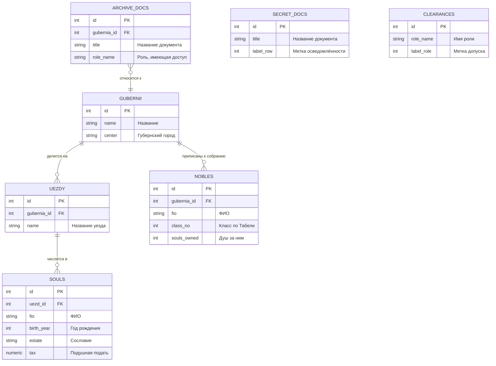

<script setup>
import Conversation from "../../../components/Conversation.vue";
</script>

# Управление доступом к объектам базы данных

## Введение: Кому что дозволено

**Апрель 1785 года.**

Екатерина II подписывает два документа, определивших устройство русского общества на следующее столетие.

**«Грамота на права, вольности и преимущества благородного российского дворянства»**, известная как Жалованная грамота дворянству, закрепила за дворянским сословием права, которых оно прежде не имело в писаном виде: освобождение от обязательной службы и от подушной подати, неприкосновенность имения, право судиться только собственным сословным судом, право не подвергаться телесным наказаниям. В каждой губернии учреждались **дворянские собрания** со своими выборными предводителями и родословными книгами.

В тот же день вышла **«Грамота на права и выгоды городам Российской империи»**, разделившая городское население на шесть разрядов с разными правами и обязанностями, от именитых граждан до посадских.

::: info Исторический смысл обеих грамот
На первый взгляд речь идёт о расширении прав. На деле замысел был сложнее.

Прежде права сословий существовали как обычай и как череда отдельных указов, противоречивших друг другу. Грамоты впервые **свели их в систему**: записали, кто к какому разряду относится, что ему дозволено и кто это удостоверяет. Неопределённость, в которой каждый вопрос решался личным усмотрением начальника, сменилась писаным порядком.

Историки отмечают парадокс: даровав сословиям права, Екатерина II тем самым **укрепила собственную власть**, а не ослабила её. Абсолютизм, опирающийся на сословия с понятными правами, устойчивее абсолютизма, где всё решается произволом. Дворянство, получившее гарантии, стало надёжной опорой трона.

Для нас эта история важна как точная аналогия тому, чем мы займёмся. Разграничение доступа в базе данных – не ограничение возможностей, а **замена произвола системой**. Пока «можно всё», никто не знает, что именно можно; как только права записаны, работа становится предсказуемой.
:::

А у наших героев дело застопорилось. След утраченной тетради привёл в провиантский департамент Военной коллегии, но дальше хода нет.

<Conversation :phrases="[
    {
        name: 'Гаврила Индексов',
        position: 'right',
        text: 'Не пускают, Екатерина Романовна. Фонд закрытый. Говорят, к делам провиантского департамента допуск по чину, а я коллежский регистратор, четырнадцатый класс. Для меня там всё закрыто.'
    },
    {
        name: 'Варвара Схемина',
        position: 'right',
        text: 'А меня и вовсе ни о чём не спросили. Женщина в чине не состоит, стало быть, и допуска никакого.'
    },
    {
        name: 'Екатерина Романовна',
        position: 'left',
        text: 'Положим, это я поправлю. Но прежде скажите мне другое. У нас в Академии как устроено? Кто к каким бумагам имеет доступ?'
    },
    {
        name: 'Гаврила Индексов',
        position: 'right',
        text: '(помолчав) Все ко всем, ваше сиятельство. Кто в архив вошёл, тот любую книгу взять может.'
    },
    {
        name: 'Екатерина Романовна',
        position: 'left',
        text: 'То есть у нас не порядок, а везение. Прекрасно. Заводите разряды: кто читает, кто пишет, кто допускается к закрытым фондам. И прежде чем требовать допуска от Военной коллегии, устройте его у себя.'
    }
]"/>

::: info Что мы изучаем в этом учебном вопросе
**Роли** – субъекты, от имени которых выполняются действия в базе данных. Разберём их создание, атрибуты, удаление и объединение в группы.

**Привилегии** – разрешения на операции с объектами. Разберём выдачу и отзыв прав на таблицы, на отдельные столбцы, на базы данных и схемы, передачу прав другим ролям и правила каскадного отзыва.

**Защита на уровне строк** – механизм, позволяющий ограничить доступ не целыми таблицами, а отдельными записями.

**Шифрование данных** – хранение сведений в таблице в зашифрованном виде.

Это самый объёмный учебный вопрос курса: в нём двадцать два учебных задания.
:::

## Рабочая среда

Как и в предыдущем занятии, все задания выполняются на учебном сервере через [pgAdmin](https://www.pgadmin.org/), [DBeaver](https://dbeaver.io/) или [psql](https://postgrespro.ru/docs/postgresql/16/app-psql). Подробный разбор инструментов и мета-команд `psql` приведён в занятии [Базы данных, схемы и табличные пространства](./databases-schemas-tablespaces.md).

Для этого вопроса особенно пригодятся две мета-команды `psql`:

| Команда | Что показывает |
| :--- | :--- |
| `\du` | Список ролей с их атрибутами и членством |
| `\dp` или `\z` | Привилегии доступа к объектам |

Большинство заданий выполняется от имени суперпользователя, который переключается на другие роли командой `SET ROLE`. Отдельного подключения под каждой ролью не требуется, хотя там, где это принципиально, мы будем на это указывать.

## Учебная база данных

Работаем с базой Академии наук, дополненной таблицами для разбора защиты на уровне строк.



::: details Данные для БД

```sql
DROP TABLE IF EXISTS secret_docs, clearances, archive_docs, souls, nobles, uezdy, gubernii CASCADE;

CREATE TABLE gubernii (
    id SERIAL PRIMARY KEY,
    name VARCHAR(60) NOT NULL UNIQUE,
    center VARCHAR(60) NOT NULL
);

INSERT INTO gubernii (name, center) VALUES
('Санкт-Петербургская', 'Санкт-Петербург'),
('Московская',          'Москва'),
('Могилёвская',         'Могилёв'),
('Киевская',            'Киев'),
('Таврическая область', 'Симферополь');

CREATE TABLE uezdy (
    id SERIAL PRIMARY KEY,
    gubernia_id INT NOT NULL REFERENCES gubernii,
    name VARCHAR(60) NOT NULL,
    UNIQUE (gubernia_id, name)
);

INSERT INTO uezdy (gubernia_id, name) VALUES
(1, 'Шлиссельбургский'),
(1, 'Софийский'),
(2, 'Коломенский'),
(2, 'Серпуховский'),
(3, 'Оршанский'),
(4, 'Васильковский'),
(5, 'Перекопский');

CREATE TABLE souls (
    id SERIAL PRIMARY KEY,
    uezd_id INT REFERENCES uezdy,
    fio VARCHAR(60) NOT NULL,
    birth_year INT,
    estate VARCHAR(30),
    tax NUMERIC(8, 2)
);

INSERT INTO souls (uezd_id, fio, birth_year, estate, tax) VALUES
(1, 'Алексеев Иван Петрович',    1750, 'Крестьянин', 0.70),
(1, 'Борисов Фёдор Лукич',       1748, 'Мещанин',    1.20),
(2, 'Васильев Макар Ильич',      1755, 'Крестьянин', 0.70),
(3, 'Григорьев Пётр Савельевич', 1742, 'Мастеровой', 2.00),
(4, 'Денисов Семён Фомич',       1760, 'Крестьянин', 0.70),
(5, 'Ефимов Прохор Карпович',    1758, 'Однодворец', 1.20),
(6, 'Жуков Назар Егорович',      1751, 'Крестьянин', 0.70),
(7, 'Зотов Кузьма Гаврилович',   1746, 'Мещанин',    1.20);

CREATE TABLE nobles (
    id SERIAL PRIMARY KEY,
    gubernia_id INT REFERENCES gubernii,
    fio VARCHAR(60) NOT NULL,
    class_no INT CHECK (class_no BETWEEN 1 AND 14),
    souls_owned INT
);

INSERT INTO nobles (gubernia_id, fio, class_no, souls_owned) VALUES
(1, 'Воронцов Илья Романович',       3, 2100),
(1, 'Державин Гаврила Петрович',     9,   85),
(2, 'Нарышкин Семён Кириллович',     4, 1240),
(3, 'Голынский Антоний Казимирович', 7,  640),
(5, 'Мордвинов Николай Семёнович',   6,  350);

CREATE TABLE archive_docs (
    id INT GENERATED ALWAYS AS IDENTITY PRIMARY KEY,
    gubernia_id INT REFERENCES gubernii,
    title TEXT NOT NULL,
    role_name TEXT NOT NULL
);

CREATE TABLE secret_docs (
    id INT GENERATED ALWAYS AS IDENTITY PRIMARY KEY,
    title TEXT NOT NULL,
    label_row INT NOT NULL
);

CREATE TABLE clearances (
    id INT GENERATED ALWAYS AS IDENTITY PRIMARY KEY,
    role_name TEXT NOT NULL,
    label_role INT NOT NULL
);

ANALYZE;
```

:::

## Модель безопасности PostgreSQL

Прежде чем выполнять команды, разберём устройство системы доступа. Она состоит из четырёх независимых механизмов, и путаница между ними – источник большинства недоумений.

### Четыре механизма

**Первый: подключение к серверу.** Прежде чем роль получит возможность что-либо сделать, ей надо подключиться. Это решается не привилегиями, а файлом `pg_hba.conf` и атрибутом `LOGIN` роли. Разбирается в следующем учебном вопросе.

**Второй: атрибуты роли.** Это свойства самой роли, не привязанные к объектам: может ли она входить на сервер, создавать базы данных, управлять другими ролями, обходить защиту на уровне строк. Атрибуты действуют на уровне всего кластера.

**Третий: привилегии на объекты.** Разрешения на конкретные действия с конкретными объектами: читать таблицу, изменять её, создавать объекты в схеме. Выдаются командой `GRANT`, отзываются командой `REVOKE`.

**Четвёртый: защита на уровне строк.** Правила, ограничивающие доступ к отдельным записям таблицы, а не к таблице целиком.

::: warning Механизмы проверяются последовательно
Роль получит доступ к данным только если **все** проверки пройдены. Выданная привилегия `SELECT` на таблицу бесполезна, если:

- роль не может подключиться (нет `LOGIN` или не разрешено в `pg_hba.conf`);
- у роли нет права `USAGE` на схему, в которой лежит таблица;
- защита на уровне строк не пропускает ни одной записи.

Отсюда практическое правило разбора жалобы «у меня нет доступа»: проверять надо по порядку, от подключения к строкам, а не начинать с привилегий на таблицу.
:::

### Роль, пользователь и группа

В PostgreSQL существует единое понятие **роли**. Исторически различались «пользователи» и «группы», но с версии 8.1 это одна сущность.

| Термин | Что означает сегодня |
| :--- | :--- |
| Роль | Единственное реальное понятие. Субъект прав |
| Пользователь | Роль с атрибутом `LOGIN`, то есть способная подключиться |
| Групповая роль | Роль без атрибута `LOGIN`, используемая как контейнер привилегий |

Команда `CREATE USER` сохранена для совместимости и равносильна `CREATE ROLE ... LOGIN`.

::: info Почему это объединение удобно
Поскольку роль может быть одновременно и субъектом входа, и контейнером прав, одна и та же роль может быть членом другой. Это позволяет строить иерархии любой глубины: роль `отчёты_чтение` входит в `аналитик`, та – в `руководитель_отдела`.

Привилегии при этом **наследуются**: роль обладает не только собственными правами, но и правами всех ролей, членом которых является.
:::

### Владелец объекта

У каждого объекта есть **владелец** – роль, создавшая его или назначенная владельцем впоследствии.

Владелец обладает всеми привилегиями на свой объект **неявно**, без всякого `GRANT`, и может:

- выполнять любые операции с объектом;
- выдавать и отзывать привилегии на него другим ролям;
- изменять и удалять объект;
- передать владение другой роли.

::: warning Привилегии владельца нельзя отозвать навсегда
Формально `REVOKE` на владельца подействует, но владелец может в любой момент выдать права себе обратно. Поэтому ограничить владельца средствами привилегий невозможно.

Отсюда важное следствие для проектирования: **объекты не должны принадлежать роли, от имени которой работает приложение.** Иначе приложение, даже лишённое прав на изменение схемы, сможет их себе вернуть.

Правильная схема: владельцем объектов делают отдельную роль без права входа, а приложение работает от имени роли, которой выданы только нужные привилегии.
:::

### Роль PUBLIC

`PUBLIC` – не настоящая роль, а обозначение «все роли, существующие и будущие». Привилегия, выданная `PUBLIC`, автоматически действует для всякой роли.

Некоторые привилегии выданы `PUBLIC` **изначально**, и об этом надо знать:

| Объект | Что выдано PUBLIC по умолчанию |
| :--- | :--- |
| Любая база данных | Право `CONNECT` |
| Любая схема | Право `USAGE` |
| Схема `public` до версии 15 | Права `USAGE` и `CREATE` |
| Любая функция и процедура | Право `EXECUTE` |
| Любой тип данных и домен | Право `USAGE` |

::: danger Первое, что делают при настройке безопасности
Из таблицы следует, что только что созданная база данных **открыта для подключения любой роли**, а до версии 15 – ещё и для создания в ней объектов.

Стандартный набор действий при подготовке базы к работе:

```
REVOKE ALL ON DATABASE <имя_базы> FROM PUBLIC;
REVOKE ALL ON SCHEMA public FROM PUBLIC;
```

После этого права выдаются осознанно, тем ролям, которым они нужны.

Посмотреть текущие права на схему можно так:

```sql
SELECT nspname, nspacl FROM pg_namespace WHERE nspname = 'public';
```

В PostgreSQL 15 и новее вывод будет содержать `{pg_database_owner=UC/pg_database_owner,=U/pg_database_owner}`. Запись без имени слева от знака равенства – это и есть `PUBLIC`: ему оставлено только `U`, то есть `USAGE`.
:::

### Формат записи привилегий

Привилегии хранятся в системных каталогах в компактном текстовом виде. Чтение этого формата – необходимый навык.

```sql
SELECT relname, relacl FROM pg_class WHERE relname = 'souls';
```

Результат имеет вид:

```
{postgres=arwdDxt/postgres,reader=r/postgres}
```

Каждый элемент читается по схеме **`получатель=права/выдавший`**:

| Буква | Привилегия |
| :--- | :--- |
| `r` | `SELECT` (read) |
| `w` | `UPDATE` (write) |
| `a` | `INSERT` (append) |
| `d` | `DELETE` |
| `D` | `TRUNCATE` |
| `x` | `REFERENCES` |
| `t` | `TRIGGER` |
| `C` | `CREATE` |
| `c` | `CONNECT` |
| `T` | `TEMPORARY` |
| `U` | `USAGE` |
| `X` | `EXECUTE` |
| `*` | Право передавать предшествующую привилегию другим |

Таким образом, `postgres=arwdDxt/postgres` означает «роль `postgres` имеет все привилегии на таблицу, и выдала их себе сама», а `reader=r/postgres` – «роль `reader` имеет право чтения, выданное ролью `postgres`».

Пустое имя слева от `=` означает `PUBLIC`. Значение `NULL` в столбце `relacl` означает, что привилегии по умолчанию не изменялись.

## Управление ролями

### Создание роли

Простейшая форма:

```
CREATE ROLE <имя_роли>;
```

Такая роль существует, но ничего не может: у неё нет права входить на сервер и нет ни одной привилегии.

### Задание 1.1. Создание и удаление простой роли

Убедимся в этом на опыте.

```sql
CREATE ROLE r1;
```

Переключаемся на неё:

```sql
SET ROLE r1;
```

И пробуем прочитать таблицу:

```sql
SELECT * FROM souls;
```

Команда завершится ошибкой:

```
ERROR:  permission denied for table souls
```

::: warning Выполняйте команды по одной
Здесь и далее в заданиях этого занятия встречаются команды, которые **должны** завершиться ошибкой. Если выполнить весь блок целиком в одном окне запросов, ошибка прервёт выполнение остальных команд блока, и состояние базы окажется не тем, которое описано дальше.

Поэтому команды, за которыми следует уборка, приводятся отдельными блоками, и выполнять их следует по одной, читая результат каждой.
:::

Возвращаемся к исходной роли и удаляем созданную:

```sql
RESET ROLE;

DROP ROLE r1;
```

::: info Команды SET ROLE и RESET ROLE
`SET ROLE имя` переключает **текущую роль** сеанса. Все последующие команды выполняются от её имени и с её правами. Это основной способ проверить, что роль действительно видит то, что должна.

`RESET ROLE` возвращает роль, под которой было выполнено подключение к базе данных.

Важное ограничение: переключиться можно только на роль, **членом которой вы являетесь**, либо если вы суперпользователь. Поэтому в учебных заданиях переключение работает: мы выполняем их от имени суперпользователя.

Есть и вторая команда – `SET SESSION AUTHORIZATION`, доступная только суперпользователю. В отличие от `SET ROLE`, она меняет не только текущую роль, но и роль сеанса, что влияет на результат функции `session_user`.

Различие проверяется так:

```
SET ROLE <роль>;
SELECT current_user, session_user;
RESET ROLE;
```

`current_user` покажет `r1`, а `session_user` – исходную роль. Именно `current_user` проверяется при доступе к объектам.
:::

::: warning Перед удалением роли
Роль нельзя удалить, пока:

- она владеет хотя бы одним объектом базы данных;
- ей выданы привилегии на какие-либо объекты.

В обоих случаях команда завершится ошибкой с перечислением препятствий. Как с этим быть, разберём в задании 1.4.
:::

### Атрибуты роли

Атрибуты задаются при создании и изменяются впоследствии. Перечислим основные.

| Атрибут | Противоположность | Что разрешает |
| :--- | :--- | :--- |
| `LOGIN` | `NOLOGIN` | Подключаться к серверу |
| `SUPERUSER` | `NOSUPERUSER` | Обходить все проверки прав |
| `CREATEDB` | `NOCREATEDB` | Создавать базы данных |
| `CREATEROLE` | `NOCREATEROLE` | Создавать, изменять и удалять другие роли |
| `INHERIT` | `NOINHERIT` | Автоматически пользоваться правами ролей, членом которых является |
| `REPLICATION` | `NOREPLICATION` | Подключаться в режиме репликации |
| `BYPASSRLS` | `NOBYPASSRLS` | Обходить защиту на уровне строк |
| `PASSWORD 'строка'` | `PASSWORD NULL` | Задать пароль |
| `VALID UNTIL 'дата'` | `VALID UNTIL 'infinity'` | Срок действия пароля |
| `CONNECTION LIMIT n` | `CONNECTION LIMIT -1` | Предел одновременных подключений |

По умолчанию роль создаётся со всеми отрицательными атрибутами, кроме `INHERIT`.

::: danger Атрибут SUPERUSER
Суперпользователь обходит **все** проверки прав, включая привилегии, защиту на уровне строк и права на схемы. Единственное, что его ограничивает, – право подключения в `pg_hba.conf`.

Выдавать этот атрибут рабочим приложениям нельзя ни при каких обстоятельствах. Для задач, требующих отдельных повышенных возможностей, существуют **предопределённые роли**, дающие ровно одну способность:

| Роль | Что даёт |
| :--- | :--- |
| `pg_read_all_data` | Чтение всех таблиц во всех схемах |
| `pg_write_all_data` | Запись во все таблицы |
| `pg_read_all_settings` | Чтение всех параметров конфигурации |
| `pg_stat_scan_tables` | Доступ к статистике по всем таблицам |
| `pg_signal_backend` | Отправка сигналов чужим сеансам |
| `pg_monitor` | Совокупность прав для систем наблюдения |
| `pg_read_server_files` | Чтение файлов на сервере |
| `pg_write_server_files` | Запись файлов на сервере |
| `pg_execute_server_program` | Выполнение программ на сервере |

Роль наблюдения создают так, а не выдачей суперпользователя:

```
CREATE ROLE monitoring LOGIN PASSWORD '...';
GRANT pg_monitor TO monitoring;
```
:::

::: warning Атрибут CREATEROLE опаснее, чем кажется
Роль с атрибутом `CREATEROLE` может создавать и изменять другие роли. До PostgreSQL 16 это означало, что она могла изменить пароль **любой** роли, не являющейся суперпользователем, и войти под ней.

Фактически `CREATEROLE` был почти равносилен `SUPERUSER`. В версии 16 поведение исправлено: теперь роль может управлять только теми ролями, которые создала сама.

Если вы администрируете сервер версии 15 или младше, относитесь к `CREATEROLE` как к привилегии, почти равной суперпользовательской.
:::

### Задание 1.2. Предоставление прав роли при её создании

```sql
CREATE ROLE r1 LOGIN PASSWORD '1';

CREATE ROLE r2 LOGIN PASSWORD '2' VALID UNTIL '2030-10-30';

CREATE ROLE r3 CREATEROLE CREATEDB;
```

Проверим результат:

```sql
SELECT rolname    AS роль,
       rolcanlogin AS может_входить,
       rolcreatedb AS создаёт_базы,
       rolcreaterole AS управляет_ролями,
       rolvaliduntil AS пароль_действует_до
FROM pg_roles
WHERE rolname IN ('r1', 'r2', 'r3');
```

В `psql` то же самое даёт мета-команда:

```
\du
```

::: info Где хранятся пароли
Каталог `pg_roles` – представление, в котором поле пароля всегда показано как `********`. Сами хеши паролей лежат в каталоге `pg_authid`, доступном только суперпользователю.

```sql
SELECT rolname, rolpassword FROM pg_authid WHERE rolname = 'r1';
```

Пароль хранится не в открытом виде, а в виде хеша. Способ хеширования задаётся параметром `password_encryption`:

```sql
SHOW password_encryption;
```

Современное значение – `scram-sha-256`. Устаревшее `md5` следует считать небезопасным: оно уязвимо к атаке по перехваченному хешу. Подробно вернёмся к этому в разделе о методах аутентификации следующего учебного вопроса.

Отдельно отметим: при указании пароля в команде `CREATE ROLE` он попадает **открытым текстом** в журнал сервера, если включено протоколирование команд. На рабочем сервере пароли задают из клиента, умеющего передавать уже вычисленный хеш, либо потом меняют.
:::

### Задание 1.3. Предоставление и отзыв прав при изменении роли

Команда `ALTER ROLE` изменяет атрибуты существующей роли.

```sql
ALTER ROLE r1 PASSWORD '11';

ALTER ROLE r2 VALID UNTIL 'infinity';

ALTER ROLE r2 NOLOGIN;

ALTER ROLE r2 LOGIN;

ALTER ROLE r3 NOCREATEROLE;

ALTER ROLE r3 CREATEROLE;

DROP ROLE r1, r2, r3;
```

Разберём отдельные случаи.

Значение `'infinity'` для `VALID UNTIL` снимает ограничение срока действия пароля. Это не то же самое, что указать далёкую дату: `'infinity'` – особое значение типа `timestamp`, означающее «никогда».

Отзыв атрибута `LOGIN` через `NOLOGIN` – мягкий способ временно заблокировать роль, не удаляя её и не трогая выданных ей привилегий. Существующие соединения при этом **не разрываются**: атрибут проверяется только при подключении. Чтобы выгнать уже подключившихся, нужен `pg_terminate_backend`.

::: tip Блокировка роли
Полная блокировка роли состоит из трёх шагов:

```
ALTER ROLE <роль> NOLOGIN;

SELECT pg_terminate_backend(pid)
FROM pg_stat_activity
WHERE usename = '<роль>';
```

Первая команда запрещает новые подключения, вторая разрывает существующие. Проверить, что никого не осталось, можно повторным запросом к `pg_stat_activity`.
:::

Кроме атрибутов, `ALTER ROLE` умеет задавать для роли **значения параметров конфигурации**, применяемые при каждом её подключении:

```
ALTER ROLE <роль> SET statement_timeout = '30s';
ALTER ROLE <роль> SET search_path = 'archive, public';
```

Это рабочий приём: ограничить время запроса для роли приложения, задать путь поиска для отчётной роли. Подробно иерархию параметров разберём в следующем учебном вопросе.

### Задание 1.4. Удаление роли

Как отмечалось, роль нельзя удалить, пока она владеет объектами или имеет выданные привилегии. Существуют две команды для разрешения этой ситуации, и выбор между ними принципиален.

**А) Удаление вместе с объектами.**

```sql
CREATE ROLE r1;

CREATE TABLE test (id INT);

ALTER TABLE test OWNER TO r1;
```

Попытка удалить роль сейчас завершится ошибкой:

```sql
DROP ROLE r1;
```

```
ERROR:  role "r1" cannot be dropped because some objects depend on it
DETAIL:  owner of table test
```

Команда `DROP OWNED BY` удаляет все объекты, принадлежащие роли, и отзывает все выданные ей привилегии:

```sql
DROP OWNED BY r1;

DROP ROLE r1;
```

Проверим, что таблица исчезла:

```sql
SELECT to_regclass('test') IS NULL AS таблицы_нет;
```

**Б) Удаление со сменой владельца.**

```sql
CREATE ROLE r1;

CREATE TABLE test (id INT);

ALTER TABLE test OWNER TO r1;
```

Команда `REASSIGN OWNED BY` передаёт владение объектами другой роли:

```sql
REASSIGN OWNED BY r1 TO CURRENT_USER;
```

После этого объекты сохранились, но роль всё ещё может иметь **выданные ей привилегии** на чужие объекты. Их снимает `DROP OWNED BY`, который после переназначения владения уже не найдёт объектов для удаления:

```sql
DROP OWNED BY r1;

DROP ROLE r1;
```

Таблица на месте:

```sql
SELECT to_regclass('test') IS NOT NULL AS таблица_есть;

DROP TABLE test;
```

::: danger Различие двух команд
`DROP OWNED BY роль` – **удаляет** объекты роли. Данные теряются.

`REASSIGN OWNED BY роль TO другая_роль` – **передаёт** объекты. Данные сохраняются.

Ошибка в выборе команды при увольнении сотрудника обходится дорого: `DROP OWNED BY` молча уничтожит все созданные им таблицы.

Правильная последовательность при удалении роли, если данные нужно сохранить:

```
REASSIGN OWNED BY <уходящая_роль> TO <новый_владелец>;
DROP OWNED BY <уходящая_роль>;
DROP ROLE <уходящая_роль>;
```

Второй шаг обязателен: после переназначения владения у роли остаются выданные ей привилегии на чужие объекты, и без их отзыва удаление не пройдёт.
:::

::: warning Обе команды действуют только в текущей базе данных
Это неочевидно и приводит к ошибкам. `DROP OWNED BY` и `REASSIGN OWNED BY` обрабатывают объекты **только той базы данных, в которой выполнены**.

Если роль владела объектами в трёх базах кластера, команды надо выполнить в каждой из трёх, подключаясь к ним по очереди. Иначе `DROP ROLE` продолжит выдавать ошибку, и причина будет выглядеть загадочной.
:::

## Привилегии на таблицы

### Команда GRANT

```sql
GRANT { привилегия [, ...] | ALL [ PRIVILEGES ] }
    ON { [ TABLE ] имя_таблицы [, ...]
       | ALL TABLES IN SCHEMA имя_схемы [, ...] }
    TO роль [, ...]
    [ WITH GRANT OPTION ];
```

Привилегии, применимые к таблицам:

| Привилегия | Что разрешает |
| :--- | :--- |
| `SELECT` | Читать данные |
| `INSERT` | Вставлять строки |
| `UPDATE` | Изменять строки |
| `DELETE` | Удалять строки |
| `TRUNCATE` | Полностью очищать таблицу |
| `REFERENCES` | Создавать внешний ключ, ссылающийся на эту таблицу |
| `TRIGGER` | Создавать триггеры на таблице |
| `ALL PRIVILEGES` | Все перечисленные |

::: info Почему TRUNCATE отделён от DELETE
Это разные по последствиям операции, и права на них разведены осознанно.

`DELETE` выполняется построчно, подчиняется условию `WHERE`, срабатывают триггеры и правила защиты на уровне строк. `TRUNCATE` очищает таблицу целиком, не позволяет условий, не вызывает строчных триггеров и игнорирует защиту на уровне строк.

Поэтому роли, которой разрешено удалять свои записи, нельзя давать `TRUNCATE`: этим правом она сможет уничтожить и чужие.
:::

### Задание 1.5. Наделение роли привилегиями доступа

```sql
CREATE ROLE r1 LOGIN PASSWORD '1';

GRANT SELECT, DELETE ON souls TO r1;
```

Проверим, что получилось:

```sql
SELECT relname, relacl FROM pg_class WHERE relname = 'souls';
```

Проверим от имени роли:

```sql
SET ROLE r1;

SELECT count(*) FROM souls;

RESET ROLE;
```

Чтение прошло. А вот изменение не пройдёт:

```sql
SET ROLE r1;
```

```sql
UPDATE souls SET tax = 1.00 WHERE id = 1;
```

```
ERROR:  permission denied for table souls
```

Возвращаемся:

```sql
RESET ROLE;
```

Удаляем роль:

```sql
DROP OWNED BY r1;

DROP ROLE r1;
```

::: tip Зачем DROP OWNED BY, если роль ничем не владеет
Роль `r1` не создавала объектов, но ей была **выдана привилегия** на таблицу `souls`. Это и есть зависимость, препятствующая удалению.

`DROP OWNED BY` в данном случае не удаляет ничего, а лишь отзывает выданные привилегии. Поэтому команда перед `DROP ROLE` нужна практически всегда, и привыкать к этой паре стоит сразу.

Альтернатива – отозвать привилегии вручную:

```
REVOKE ALL ON <таблица> FROM <роль>;
```

Но если роли были выданы права на двадцать объектов, перечислять их все утомительно и легко что-то пропустить.
:::

### Команда REVOKE

```sql
REVOKE [ GRANT OPTION FOR ]
    { привилегия [, ...] | ALL [ PRIVILEGES ] }
    ON имя_таблицы [, ...]
    FROM роль [, ...]
    [ CASCADE | RESTRICT ];
```

### Задание 1.6. Отзыв у ролей привилегий доступа

```sql
CREATE ROLE r1 LOGIN PASSWORD '1';

GRANT SELECT, UPDATE ON souls TO r1;

REVOKE UPDATE ON souls FROM r1;
```

Проверим, что осталось только чтение:

```sql
SELECT has_table_privilege('r1', 'souls', 'SELECT') AS чтение,
       has_table_privilege('r1', 'souls', 'UPDATE') AS изменение;

DROP OWNED BY r1;

DROP ROLE r1;
```

::: tip Функции проверки привилегий
Семейство функций `has_*_privilege` – самый надёжный способ ответить на вопрос «а есть ли у этой роли такое право». В отличие от чтения `relacl`, они учитывают **и наследование через групповые роли, и привилегии `PUBLIC`**.

| Функция | Что проверяет |
| :--- | :--- |
| `has_table_privilege(роль, таблица, право)` | Право на таблицу |
| `has_column_privilege(роль, таблица, столбец, право)` | Право на столбец |
| `has_database_privilege(роль, база, право)` | Право на базу данных |
| `has_schema_privilege(роль, схема, право)` | Право на схему |
| `has_function_privilege(роль, функция, право)` | Право на функцию |
| `pg_has_role(роль, другая_роль, право)` | Членство в роли |

Если роль не указана, проверяется текущая. Это удобно для самопроверки изнутри приложения.
:::

## Групповые роли

### Назначение

Выдавать привилегии каждой роли по отдельности непрактично: при двадцати сотрудниках и тридцати таблицах получается шестьсот выдач, и любое изменение правил требует их пересмотра.

Решение – **групповые роли**. Привилегии выдаются группе, а роли сотрудников делаются её членами. Изменение правил сводится к одной команде.

```
CREATE ROLE <имя_группы>;
```

Групповая роль – обычная роль без атрибута `LOGIN`. Технически она ничем не отличается от прочих.

Включение роли в группу:

```
GRANT <имя_группы> TO <имя_роли>;
```

Обратите внимание на синтаксис: здесь та же команда `GRANT`, но вместо привилегии указано **имя роли**. Это две разные по смыслу операции с одинаковым именем, и путать их не стоит:

| Команда | Смысл |
| :--- | :--- |
| `GRANT SELECT ON souls TO r1` | Выдать привилегию на объект |
| `GRANT reader TO r1` | Включить роль в группу |

### Задание 1.7. Наделение роли другими ролями

```sql
CREATE ROLE reader;

CREATE ROLE r1 LOGIN PASSWORD '1';

GRANT SELECT ON souls TO reader;

GRANT reader TO r1;
```

Проверим, что роль `r1` получила доступ, хотя ей лично ничего не выдавалось:

```sql
SET ROLE r1;

SELECT count(*) FROM souls;

RESET ROLE;
```

Проверим формально:

```sql
SELECT has_table_privilege('r1', 'souls', 'SELECT') AS доступ_есть;

SELECT pg_has_role('r1', 'reader', 'MEMBER') AS член_группы;
```

Удаляем:

```sql
DROP OWNED BY reader;

DROP ROLE r1, reader;
```

::: info Атрибут INHERIT и его отсутствие
Автоматическое наследование прав работает благодаря атрибуту `INHERIT`, который присваивается роли по умолчанию.

Если роль создана с `NOINHERIT`, она **не пользуется** правами своих групп автоматически. Чтобы ими воспользоваться, надо явно переключиться:

```
CREATE ROLE <роль> LOGIN PASSWORD '...' NOINHERIT;
GRANT <группа> TO <роль>;
```

Роль `r2` при подключении прав группы `reader` не имеет, но может выполнить `SET ROLE reader` и получить их.

Зачем так: это способ работать с повышенными правами **только когда они нужны**, по аналогии с переключением на администратора в операционной системе. Обычные операции выполняются с минимальными правами, а для отдельных действий роль явно переключается.
:::

### Задание 1.8. Отзыв у ролей других ролей

```sql
CREATE ROLE reader;

CREATE ROLE r1 LOGIN PASSWORD '1';

GRANT SELECT ON souls TO reader;

GRANT reader TO r1;

REVOKE reader FROM r1;
```

Проверим, что доступ пропал:

```sql
SELECT has_table_privilege('r1', 'souls', 'SELECT') AS доступ_остался;

DROP OWNED BY reader;

DROP ROLE r1, reader;
```

### Задание 1.10. Наделение привилегиями при создании роли

Членство в группе можно задать сразу при создании роли, причём с двух сторон.

**А) Предложение `IN ROLE`** – создаваемая роль становится членом указанной:

```sql
CREATE ROLE reader;

GRANT SELECT ON souls TO reader;

CREATE ROLE r1 LOGIN PASSWORD '1' IN ROLE reader;

DROP OWNED BY reader;

DROP ROLE r1, reader;
```

Команда

```
CREATE ROLE r1 LOGIN PASSWORD '1' IN ROLE reader;
```

равносильна двум командам:

```
CREATE ROLE r1 LOGIN PASSWORD '1';
GRANT reader TO r1;
```

**Б) Предложение `ROLE`** – создаваемая роль становится группой для указанных:

```sql
CREATE ROLE r1 LOGIN PASSWORD '1';

CREATE ROLE reader ROLE r1;

GRANT SELECT ON souls TO reader;

DROP OWNED BY reader;

DROP ROLE r1, reader;
```

Команда

```
CREATE ROLE reader ROLE r1;
```

равносильна двум командам:

```
CREATE ROLE reader;
GRANT reader TO r1;
```

::: tip Как не перепутать
`IN ROLE` читается как «внутри роли»: создаваемая роль помещается внутрь указанной группы.

`ROLE` читается как «включает роли»: создаваемая роль становится группой, в которую помещаются указанные.

В PostgreSQL 16 добавлено более ясное написание `IN ROLE` через `ADMIN` и `MEMBER`, но `IN ROLE` и `ROLE` сохранены.
:::

## Особенности привилегий на изменение данных

### Задание 1.9. Что на самом деле требуется для UPDATE

Привилегия `UPDATE` сама по себе разрешает меньше, чем кажется. Разберём на опыте.

```sql
CREATE ROLE r1 LOGIN PASSWORD '1';

GRANT UPDATE ON souls TO r1;

SET ROLE r1;
```

Проанализируем, какие из четырёх команд роль сможет выполнить.

**Команда первая:**

```sql
UPDATE souls SET tax = 1.25 WHERE id = 1;
```

Завершится **ошибкой**. Казалось бы, роль имеет право изменять таблицу, а изменение – ровно то, что она делает. Но условие `WHERE id = 1` требует **прочитать** столбец `id`, чтобы понять, какие строки подходят. Права на чтение нет.

```
ERROR:  permission denied for table souls
```

**Команда вторая:**

```sql
UPDATE souls SET tax = tax WHERE id = 1;
```

Завершится **ошибкой** по двум причинам сразу: и условие требует чтения `id`, и выражение `tax = tax` требует чтения `tax`.

**Команда третья:**

```sql
UPDATE souls SET tax = tax;
```

Завершится **ошибкой**. Условия нет, но выражение в предложении `SET` вычисляется на основе текущего значения столбца, то есть требует его прочитать.

**Команда четвёртая:**

```sql
UPDATE souls SET tax = 1.25;
```

**Выполнится успешно.** Ни условия, ни чтения столбцов: во все строки записывается константа.

```sql
RESET ROLE;

DROP OWNED BY r1;

DROP ROLE r1;
```

::: info Правило
Привилегия `UPDATE` разрешает **запись** в столбцы. Всякое **чтение** данных, даже промежуточное, требует привилегии `SELECT`.

Чтение возникает в трёх местах:

1. **В условии `WHERE`** – надо определить, какие строки изменять.
2. **В выражениях предложения `SET`**, если они ссылаются на столбцы таблицы.
3. **В предложении `RETURNING`**, если оно возвращает значения столбцов.

Ровно то же верно для `DELETE`: удаление с условием требует права на чтение столбцов условия.

Отсюда практический вывод: **привилегия `UPDATE` без `SELECT` почти бесполезна.** Запись константы во всю таблицу – не та операция, которую выдают сознательно. На практике всегда выдают пару:

```
GRANT SELECT, UPDATE ON <таблица> TO <роль>;
```

Единственное осмысленное применение `UPDATE` без `SELECT` – запись в столбец, значение которого роль не должна видеть. Например, роль может установить новый хеш пароля, но не может прочитать текущий. И даже в этом случае требуется привилегия `SELECT` на столбец-идентификатор, по которому отбирается строка.
:::

## Привилегии на столбцы

### Назначение

Привилегии можно выдавать не на таблицу целиком, а на отдельные столбцы. Это основной способ скрыть часть сведений, не создавая отдельного представления.

```sql
GRANT SELECT (список_столбцов), UPDATE (список_столбцов)
    ON имя_таблицы TO роль;
```

::: warning Не все привилегии применимы к столбцам
На уровне столбцов доступны только `SELECT`, `INSERT`, `UPDATE` и `REFERENCES`.

Привилегию `DELETE` к столбцу привязать невозможно, и это логично: удаление затрагивает строку целиком, нельзя удалить «часть строки».
:::

### Задание 1.11. Наделение привилегиями доступа к столбцам

```sql
CREATE ROLE r1 LOGIN PASSWORD '1';

GRANT SELECT (id, fio), UPDATE (tax) ON souls TO r1;
```

Проверим от имени роли. Отбор перечисленных столбцов работает:

```sql
SET ROLE r1;
```

```sql
SELECT id, fio FROM souls;
```

А вот звёздочка не сработает:

```sql
SELECT * FROM souls;
```

```
ERROR:  permission denied for table souls
```

::: warning Почему SELECT * не работает
Это важная и неочевидная деталь. Звёздочка раскрывается во **все** столбцы таблицы, включая те, на которые права нет. Поэтому при правах на уровне столбцов приложение обязано перечислять столбцы явно.

Сообщение об ошибке при этом говорит про таблицу, а не про конкретный столбец, что затрудняет диагностику. Проверять надо функцией `has_column_privilege`.
:::

Проверим права формально:

```sql
RESET ROLE;

SELECT has_column_privilege('r1', 'souls', 'id',  'SELECT') AS id_чтение,
       has_column_privilege('r1', 'souls', 'fio', 'SELECT') AS fio_чтение,
       has_column_privilege('r1', 'souls', 'tax', 'SELECT') AS tax_чтение,
       has_column_privilege('r1', 'souls', 'tax', 'UPDATE') AS tax_запись,
       has_table_privilege('r1',  'souls', 'SELECT')        AS таблица_чтение;
```

Результат: чтение разрешено для `id` и `fio`, но не для `tax`; запись в `tax` разрешена; права на таблицу целиком нет.

Привилегии на столбцы хранятся в отдельном каталоге:

```sql
SELECT attrelid::regclass AS таблица,
       attname            AS столбец,
       attacl             AS привилегии
FROM pg_attribute
WHERE attrelid = 'souls'::regclass AND attacl IS NOT NULL;
```

```sql
DROP OWNED BY r1;

DROP ROLE r1;
```

### Задание 1.12. Отзыв привилегий доступа к столбцам

```sql
CREATE ROLE r1 LOGIN PASSWORD '1';

GRANT SELECT (id, fio), UPDATE (estate, tax) ON souls TO r1;

REVOKE SELECT (id), UPDATE (estate) ON souls FROM r1;
```

Проверим остаток:

```sql
SELECT has_column_privilege('r1', 'souls', 'id',     'SELECT') AS id_чтение,
       has_column_privilege('r1', 'souls', 'fio',    'SELECT') AS fio_чтение,
       has_column_privilege('r1', 'souls', 'estate', 'UPDATE') AS estate_запись,
       has_column_privilege('r1', 'souls', 'tax',    'UPDATE') AS tax_запись;

DROP OWNED BY r1;

DROP ROLE r1;
```

Осталось чтение `fio` и запись в `tax`.

### Задание 1.13. Взаимодействие прав на таблицу и на столбцы

Самое тонкое место этого раздела. Права двух уровней ведут себя **несимметрично**.

```sql
CREATE ROLE r1 LOGIN PASSWORD '1';
```

**Опыт первый: отзыв права на таблицу убирает и права на столбцы.**

```sql
GRANT SELECT (id, fio) ON souls TO r1;

SELECT has_column_privilege('r1', 'souls', 'fio', 'SELECT') AS до_отзыва;

REVOKE SELECT ON souls FROM r1;

SELECT has_column_privilege('r1', 'souls', 'fio', 'SELECT') AS после_отзыва;
```

Результат: было `true`, стало `false`. Роль не может выбирать **никакие** данные из таблицы.

**Опыт второй: отзыв права на столбцы не затрагивает право на таблицу.**

```sql
GRANT SELECT ON souls TO r1;

REVOKE SELECT (id, fio) ON souls FROM r1;

SELECT has_table_privilege('r1',  'souls', 'SELECT')        AS право_на_таблицу,
       has_column_privilege('r1', 'souls', 'id',  'SELECT') AS id_чтение,
       has_column_privilege('r1', 'souls', 'tax', 'SELECT') AS tax_чтение;
```

Результат: право на таблицу осталось, и роль по-прежнему может читать **все** столбцы, включая те, права на которые формально отозваны.

```sql
DROP OWNED BY r1;

DROP ROLE r1;
```

::: danger Почему так и как с этим жить
Объяснение в том, что право на таблицу и право на столбец – **две независимые записи** в системных каталогах, а проверка доступа к столбцу выполняется по правилу «разрешено, если есть право на таблицу **или** право на этот столбец».

Отсюда:

- отзыв права на таблицу убирает один из двух источников разрешения, и если второго не было, доступ пропадает;
- отзыв права на столбец убирает второй источник, но первый продолжает действовать, и доступ сохраняется.

Команда `REVOKE SELECT (столбец) ...` **не является** способом спрятать столбец от роли, у которой есть право на таблицу. Единственный верный способ – не выдавать право на таблицу вовсе, а выдавать только права на нужные столбцы.

Типичная ошибка выглядит так: роли выдали `SELECT` на таблицу, потом решили скрыть столбец с окладом и выполнили `REVOKE SELECT (tax)`. Команда прошла без ошибок, в каталоге изменения видны, а столбец по-прежнему читается. Проверять результат надо функцией `has_column_privilege`, а не фактом успешного выполнения `REVOKE`.
:::

## Передача права выдавать привилегии

### Предложение WITH GRANT OPTION

По умолчанию роль, получившая привилегию, не может передать её дальше. Разрешение на передачу даётся отдельно:

```
GRANT SELECT ON <таблица> TO <роль> WITH GRANT OPTION;
```

Теперь `r1` может выдавать право чтения этой таблицы другим ролям.

### Задание 1.14. Наделение привилегиями с правом передачи

```sql
CREATE ROLE r1 LOGIN PASSWORD '1';
CREATE ROLE r2 LOGIN PASSWORD '2';

GRANT SELECT ON souls TO r1 WITH GRANT OPTION;

SET ROLE r1;

GRANT SELECT ON souls TO r2;

RESET ROLE;
```

Посмотрим на результат в каталоге:

```sql
SELECT relacl FROM pg_class WHERE relname = 'souls';
```

В списке появятся две записи:

```
r1=r*/postgres,r2=r/r1
```

Звёздочка после `r` у роли `r1` означает право передачи. Запись `r2=r/r1` означает, что право роли `r2` выдано **ролью `r1`**, а не суперпользователем. Это существенно для последующего отзыва.

```sql
DROP OWNED BY r1, r2;

DROP ROLE r1, r2;
```

### Задание 1.15. Отзыв права передачи привилегий

```sql
CREATE ROLE r1 LOGIN PASSWORD '1';
CREATE ROLE r2 LOGIN PASSWORD '2';

GRANT SELECT ON souls TO r1 WITH GRANT OPTION;

SET ROLE r1;

GRANT SELECT ON souls TO r2;

RESET ROLE;

REVOKE GRANT OPTION FOR SELECT ON souls FROM r1 CASCADE;
```

Проверим, что осталось:

```sql
SELECT has_table_privilege('r1', 'souls', 'SELECT') AS r1_читает,
       has_table_privilege('r2', 'souls', 'SELECT') AS r2_читает;
```

Результат: `r1` по-прежнему читает, `r2` – уже нет.

```sql
DROP OWNED BY r1, r2;

DROP ROLE r1, r2;
```

::: info Каскадный откат зависимых привилегий
Мы отозвали у роли `r1` только **право передачи**, а саму привилегию чтения оставили. Тем не менее привилегия роли `r2` пропала.

Причина в понятии **зависимой привилегии**. Привилегия роли `r2` была выдана ролью `r1` и существует лишь до тех пор, пока `r1` имеет право её выдавать. Как только право передачи отозвано, основание исчезает, и зависимая привилегия отзывается автоматически.

Ключевое слово `CASCADE` обязательно: без него команда завершится ошибкой, поскольку сервер отказывается оставлять привилегии без основания.

```
ERROR:  dependent privileges exist
HINT:  Use CASCADE to revoke them too.
```

Альтернатива `RESTRICT` (поведение по умолчанию) означает «не отзывать, если есть зависимые».

Механизм работает на любую глубину: если `r2` успела передать право роли `r3`, при отзыве у `r1` исчезнут привилегии и у `r2`, и у `r3`.
:::

### Предложение WITH ADMIN OPTION

Для членства в группах существует аналогичный механизм, но с другим ключевым словом:

```
GRANT <группа> TO <роль> WITH ADMIN OPTION;
```

Теперь `r1` может включать в группу `reader` другие роли.

| Что передаётся | Ключевое слово |
| :--- | :--- |
| Привилегия на объект | `WITH GRANT OPTION` |
| Членство в роли | `WITH ADMIN OPTION` |

### Задание 1.16. Наделение роли другими ролями с правом передачи

```sql
CREATE ROLE reader;

GRANT SELECT ON souls TO reader;

CREATE ROLE r1 LOGIN PASSWORD '1';
CREATE ROLE r2 LOGIN PASSWORD '2';

GRANT reader TO r1 WITH ADMIN OPTION;

SET ROLE r1;

GRANT reader TO r2;

RESET ROLE;
```

Проверим, что `r2` получила доступ через группу:

```sql
SELECT has_table_privilege('r2', 'souls', 'SELECT') AS доступ_через_группу,
       pg_has_role('r2', 'reader', 'MEMBER')        AS член_группы;

DROP OWNED BY reader;

DROP ROLE reader, r1, r2;
```

### Задание 1.17. Отзыв права передачи членства

```sql
CREATE ROLE reader;

GRANT SELECT ON souls TO reader;

CREATE ROLE r1 LOGIN PASSWORD '1';
CREATE ROLE r2 LOGIN PASSWORD '2';

GRANT reader TO r1 WITH ADMIN OPTION;

SET ROLE r1;

GRANT reader TO r2;

RESET ROLE;

REVOKE ADMIN OPTION FOR reader FROM r1 CASCADE;
```

Проверим результат:

```sql
SELECT pg_has_role('r1', 'reader', 'MEMBER') AS r1_в_группе,
       pg_has_role('r2', 'reader', 'MEMBER') AS r2_в_группе;

DROP OWNED BY reader;

DROP ROLE reader, r1, r2;
```

Роль `r1` осталась членом группы и сохранила доступ к таблице, а `r2` членства лишилась. Логика та же, что и для привилегий: членство роли `r2` было зависимым.

### Задание 1.18. Особенности отзыва привилегий

Последнее задание этой группы демонстрирует правило, которое удивляет даже опытных администраторов.

```sql
CREATE ROLE reader;

GRANT SELECT ON souls TO reader;

CREATE ROLE r1 LOGIN PASSWORD '1';
CREATE ROLE r2 LOGIN PASSWORD '2';

GRANT SELECT ON souls TO r1, r2;

GRANT reader TO r1 WITH ADMIN OPTION;

SET ROLE r1;

GRANT reader TO r2;

RESET ROLE;
```

Теперь роль `r2` имеет доступ к таблице **двумя путями**: напрямую (выдал суперпользователь) и через группу `reader` (включила роль `r1`).

Отзываем все привилегии напрямую:

```sql
REVOKE ALL ON souls FROM r2;

SELECT has_table_privilege('r2', 'souls', 'SELECT') AS доступ_остался;
```

Результат – `true`. Доступ остался.

```sql
DROP OWNED BY reader, r1;

DROP ROLE reader, r1, r2;
```

::: danger Правило отзыва
Команда `REVOKE`, выполненная некоторой ролью, отзывает **только те привилегии, которые эта роль выдала сама**.

Суперпользователь выдал роли `r2` привилегию напрямую и этим же `REVOKE` её забрал. Но вторая привилегия роли `r2` получена через членство в группе `reader`, которое выдала роль `r1`. Суперпользователь её не выдавал – и отозвать этой командой не может.

Практическое следствие важнее формулировки. Команда вида

```
REVOKE ALL ON <таблица> FROM <роль>;
```

**не гарантирует**, что роль лишилась доступа. Она гарантирует лишь, что вы отозвали то, что выдавали сами.

Правильный порядок действий при закрытии доступа:

1. Проверить фактический доступ функцией `has_table_privilege`, а не доверять успешному выполнению `REVOKE`.
2. Если доступ остался, выяснить его источник: посмотреть членство роли в группах.
3. Отозвать членство или обратиться к той роли, которая его выдала.

Выяснить все группы, в которые входит роль, включая вложенные, можно так:

```sql
SELECT r.rolname AS группа
FROM pg_roles r
WHERE pg_has_role('r2', r.oid, 'MEMBER') AND r.rolname <> 'r2';
```
:::

## Привилегии на базы данных и схемы

### Привилегии на базу данных

| Привилегия | Что разрешает |
| :--- | :--- |
| `CONNECT` | Подключаться к базе данных |
| `CREATE` | Создавать в ней схемы |
| `TEMPORARY` | Создавать временные таблицы |

Как отмечалось, `CONNECT` и `TEMPORARY` выданы роли `PUBLIC` по умолчанию.

### Привилегии на схему

| Привилегия | Что разрешает |
| :--- | :--- |
| `USAGE` | Обращаться к объектам схемы по имени |
| `CREATE` | Создавать в схеме новые объекты |

::: warning Привилегия USAGE на схему обязательна
Это причина номер один в жалобах «я выдал права на таблицу, а доступа нет».

Без права `USAGE` на схему роль не увидит в ней **ни одного объекта**, какие бы привилегии на сами таблицы ей ни выдали. Схема действует как дверь: пока она заперта, содержимое недоступно.

Полный набор для выдачи доступа на чтение выглядит так:

```
GRANT CONNECT ON DATABASE <имя_базы>  TO <роль>;
GRANT USAGE   ON SCHEMA   <имя_схемы> TO <роль>;
GRANT SELECT  ON ALL TABLES IN SCHEMA <имя_схемы> TO <роль>;
```

Три команды, а не одна. Пропуск любой из них даёт ошибку доступа, причём сообщения в трёх случаях разные, и по ним можно понять, чего именно не хватает.
:::

### Задание 1.19. Наделение привилегиями доступа к базам данных и схемам

Это задание объединяет всё изученное: четыре роли выстраивают цепочку, в которой каждая создаёт объект следующего уровня и выдаёт права дальше.

Создаём роли. Первой нужен атрибут для создания баз данных:

```sql
CREATE ROLE r1 LOGIN PASSWORD '1' CREATEDB;
CREATE ROLE r2 LOGIN PASSWORD '2';
CREATE ROLE r3 LOGIN PASSWORD '3';
CREATE ROLE r4 LOGIN PASSWORD '4';
```

Под ролью `r1` создаём базу данных и разрешаем роли `r2` создавать в ней схемы:

```sql
SET ROLE r1;

CREATE DATABASE db1;

GRANT CREATE ON DATABASE db1 TO r2;

RESET ROLE;
```

Дальнейшие команды выполняются **в базе данных `db1`**. В `psql` переключение делается так:

```
\c db1
```

В pgAdmin или DBeaver откройте для `db1` отдельное окно запросов.

Под ролью `r2` создаём схему и выдаём права на неё:

```sql
SET ROLE r2;

CREATE SCHEMA s1;

GRANT CREATE, USAGE ON SCHEMA s1 TO r3;

GRANT USAGE ON SCHEMA s1 TO r4;

RESET ROLE;
```

Под ролью `r3` создаём таблицу, наполняем её и выдаём право чтения роли `r4`:

```sql
SET ROLE r3;

CREATE TABLE s1.test1 (id INT);

INSERT INTO s1.test1 VALUES (1), (2), (3);

GRANT SELECT ON s1.test1 TO r4;

RESET ROLE;
```

Проверим, что роль `r4` действительно читает таблицу:

```sql
SET ROLE r4;

SELECT * FROM s1.test1;

RESET ROLE;
```

Обратите внимание на цепочку прав, которая для этого потребовалась: `CONNECT` на базу от `PUBLIC`, `USAGE` на схему от `r2`, `SELECT` на таблицу от `r3`. Выпадение любого звена ломает доступ.

Уборка. Возвращаемся в базу `postgres` и удаляем всё:

```
\c postgres
```

```sql
SELECT pg_terminate_backend(pid)
FROM pg_stat_activity
WHERE datname = 'db1';

DROP DATABASE db1;

DROP OWNED BY r1, r2, r3, r4;

DROP ROLE r1, r2, r3, r4;
```

::: warning Почему DROP OWNED BY выполняется после DROP DATABASE
Как отмечалось в задании 1.4, `DROP OWNED BY` действует только в текущей базе данных. Объекты, созданные ролями `r2` и `r3`, находились в базе `db1`, и к моменту выполнения команды эта база уже удалена вместе со всем содержимым.

Если бы базу удалять не требовалось, пришлось бы подключиться к `db1` и выполнить `DROP OWNED BY` там, а затем вернуться и повторить в `postgres`.
:::

## Привилегии по умолчанию

### Задача

Команда `GRANT SELECT ON ALL TABLES IN SCHEMA archive TO reader` выдаёт права на таблицы, существующие **в момент её выполнения**. Таблица, созданная завтра, прав не получит, и команду придётся повторять.

На практике это приводит к постоянным жалобам «вчера работало, сегодня нет»: появилась новая таблица, а права на неё никто не выдал.

### Решение

Команда `ALTER DEFAULT PRIVILEGES` задаёт привилегии, которые будут **автоматически выдаваться на вновь создаваемые объекты**:

```sql
ALTER DEFAULT PRIVILEGES IN SCHEMA public
    GRANT SELECT ON TABLES TO reader;
```

Проверим на опыте:

```sql
CREATE ROLE reader;

ALTER DEFAULT PRIVILEGES IN SCHEMA public
    GRANT SELECT ON TABLES TO reader;

CREATE TABLE new_table (id INT);

SELECT has_table_privilege('reader', 'new_table', 'SELECT') AS право_выдалось_само;
```

Результат – `true`, хотя никакого `GRANT` на эту таблицу мы не выполняли.

Посмотреть заданные правила:

```sql
SELECT defaclnamespace::regnamespace AS схема,
       defaclobjtype                 AS вид_объекта,
       defaclacl                     AS привилегии
FROM pg_default_acl;
```

Значения столбца `defaclobjtype`: `r` – таблицы, `S` – последовательности, `f` – функции, `T` – типы, `n` – схемы.

Отмена правила:

```sql
ALTER DEFAULT PRIVILEGES IN SCHEMA public
    REVOKE SELECT ON TABLES FROM reader;

DROP TABLE new_table;

DROP OWNED BY reader;

DROP ROLE reader;
```

::: danger Главная тонкость: правила привязаны к создающей роли
Привилегии по умолчанию действуют **только для объектов, создаваемых той ролью, от имени которой выполнена команда** `ALTER DEFAULT PRIVILEGES`.

Иначе говоря, правило читается так: «когда *я* создам таблицу в этой схеме, выдать на неё право чтения роли `reader`». Если таблицу создаст кто-то другой, правило не сработает.

Это самая частая причина недоумения при настройке. Если объекты создают несколько ролей, правило надо задать для каждой:

```
ALTER DEFAULT PRIVILEGES FOR ROLE <создающая_роль> IN SCHEMA <схема>
    GRANT SELECT ON TABLES TO <роль_читателя>;
```

Предложение `FOR ROLE` указывает, для чьих будущих объектов действует правило. Выполнить команду может либо сама эта роль, либо суперпользователь, либо роль, членом которой она является.

Правильная практика – иметь **одну роль-владельца схемы**, от имени которой создаются все объекты, и задать правила для неё.
:::

## Просмотр сведений о правах

Сведём воедино средства наблюдения, которыми мы пользовались по частям.

**Роли и их атрибуты:**

```sql
SELECT rolname        AS роль,
       rolsuper       AS суперпользователь,
       rolcanlogin    AS может_входить,
       rolcreatedb    AS создаёт_базы,
       rolcreaterole  AS управляет_ролями,
       rolinherit     AS наследует_права,
       rolbypassrls   AS обходит_защиту_строк,
       rolconnlimit   AS предел_подключений,
       rolvaliduntil  AS пароль_до
FROM pg_roles
WHERE rolname NOT LIKE 'pg\_%'
ORDER BY rolname;
```

**Членство в группах:**

```sql
SELECT member.rolname AS роль,
       grantor.rolname AS выдал,
       grouprole.rolname AS группа,
       m.admin_option AS с_правом_передачи
FROM pg_auth_members m
JOIN pg_roles member    ON member.oid    = m.member
JOIN pg_roles grouprole ON grouprole.oid = m.roleid
JOIN pg_roles grantor   ON grantor.oid   = m.grantor
ORDER BY группа, роль;
```

**Привилегии на таблицы в удобном виде:**

```sql
SELECT grantee  AS роль,
       table_schema AS схема,
       table_name   AS таблица,
       string_agg(privilege_type, ', ' ORDER BY privilege_type) AS привилегии
FROM information_schema.table_privileges
WHERE table_schema = 'public'
GROUP BY grantee, table_schema, table_name
ORDER BY таблица, роль;
```

**Привилегии на столбцы:**

```sql
SELECT grantee AS роль,
       table_name AS таблица,
       column_name AS столбец,
       privilege_type AS привилегия
FROM information_schema.column_privileges
WHERE table_schema = 'public'
ORDER BY таблица, столбец, роль;
```

В `psql` быстрее всего:

```
\du
\dp souls
\z souls
```

::: tip Как разбирать жалобу на отсутствие доступа
Последовательность проверок, соответствующая четырём механизмам из начала раздела:

```
-- 1. Может ли роль вообще входить
SELECT rolcanlogin, rolvaliduntil FROM pg_roles WHERE rolname = '<роль>';

-- 2. Может ли подключиться к базе
SELECT has_database_privilege('<роль>', '<база>', 'CONNECT');

-- 3. Видит ли схему
SELECT has_schema_privilege('<роль>', '<схема>', 'USAGE');

-- 4. Имеет ли право на таблицу
SELECT has_table_privilege('<роль>', '<схема>.<таблица>', 'SELECT');

-- 5. Не отсекает ли её защита на уровне строк
SELECT relrowsecurity, relforcerowsecurity
FROM pg_class WHERE relname = '<таблица>';
```

Первая проверка, вернувшая отрицательный результат, и указывает причину. Начинать с конца – значит тратить время.
:::

## Шифрование данных

### Задание 1.20. Шифрование данных таблицы

Привилегии защищают данные от того, кто обращается к ним через СУБД. Но они бессильны против того, кто получил доступ к файлам базы данных или к резервной копии: содержимое таблиц в файлах хранится открытым текстом.

Для сведений, требующих защиты и в этом случае, применяют шифрование на стороне базы данных. Соответствующие функции предоставляет дополнительно поставляемый модуль **pgcrypto**.

**А)** Установка расширения:

```sql
CREATE EXTENSION IF NOT EXISTS pgcrypto;
```

Проверим, что расширение установлено:

```sql
SELECT extname, extversion FROM pg_extension WHERE extname = 'pgcrypto';
```

**Б)** Создание таблицы. Зашифрованные данные имеют двоичный тип:

```sql
CREATE TABLE secret_persons (
    id SERIAL PRIMARY KEY,
    my_secret BYTEA
);
```

**В)** Вставка данных с шифрованием:

```sql
INSERT INTO secret_persons (my_secret) VALUES
(pgp_sym_encrypt('Воронцов, тайный советник, 1735 г.р.', 'key1')),
(pgp_sym_encrypt('Державин, титулярный советник, 1743 г.р.', 'key1')),
(pgp_sym_encrypt('Мордвинов, коллежский советник, 1754 г.р.', 'key1'));
```

Посмотрим, что лежит в таблице:

```sql
SELECT id, my_secret FROM secret_persons;
```

В столбце будет двоичный мусор – именно это и увидит тот, кто получит доступ к файлу таблицы или к резервной копии.

**Г)** Чтение с расшифровкой:

```sql
SELECT id, pgp_sym_decrypt(my_secret, 'key1') AS сведения
FROM secret_persons;
```

::: info Функции симметричного шифрования
`pgp_sym_encrypt(text, text)` шифрует данные. Первый аргумент – открытый текст, второй – симметричный ключ. Возвращает значение типа `bytea`.

`pgp_sym_decrypt(bytea, text)` расшифровывает. Первый аргумент – зашифрованные данные, второй – тот же ключ. Возвращает `text`.

Симметричное шифрование означает, что один и тот же ключ используется и для зашифровывания, и для расшифровывания. В `pgcrypto` есть и функции асимметричного шифрования – `pgp_pub_encrypt` и `pgp_pub_decrypt`, работающие с парой ключей.
:::

Проверим, что с неверным ключом прочитать не удастся:

```sql
SELECT pgp_sym_decrypt(my_secret, 'key2') FROM secret_persons;
```

```
ERROR:  Wrong key or corrupt data
```

```sql
DROP TABLE secret_persons;
```

::: danger Главная проблема этого подхода: где хранить ключ
Шифрование само по себе не защищает – защищает сохранность ключа. А ключ в приведённых командах передан **открытым текстом в составе SQL-запроса**, и это означает, что он:

- попадёт в журнал сервера, если включено протоколирование запросов;
- будет видно в столбце `query` представления `pg_stat_activity` во время выполнения;
- останется в истории команд клиента, в файле `~/.psql_history`;
- пройдёт по сети, если соединение не защищено.

Хранить ключ в самой базе данных бессмысленно: тот, кто получил файлы базы, получит и ключ.

Практические решения располагаются вне СУБД: ключ держат в приложении и шифруют данные **до** отправки в базу, либо применяют внешнее хранилище ключей, либо шифруют не отдельные столбцы, а весь носитель средствами операционной системы.

Поэтому `pgcrypto` уместен в узком круге задач: когда надо защитить несколько полей от просмотра человеком, имеющим доступ к файлам, и когда ключ находится у приложения, а не в запросе. Для шифрования всей базы применяют шифрование диска.

Отдельно отметим: зашифрованный столбец **невозможно проиндексировать** для поиска по значению и невозможно использовать в условиях сравнения. Каждое обращение требует расшифровки всех строк. Это делает подход неприменимым к данным, по которым выполняется отбор.
:::

## Защита на уровне строк

### Назначение

Привилегии действуют на таблицу или столбец целиком. Но часто требуется, чтобы разные роли видели в одной таблице **разные строки**: каждый губернатор – дела своей губернии, каждый чиновник – документы своего уровня допуска.

Традиционное решение – отдельные представления с условиями для каждой роли. Оно работает, но плохо масштабируется: при двадцати ролях нужно двадцать представлений, и любое изменение структуры таблицы требует переделки всех.

**Защита на уровне строк** (Row Level Security, RLS) решает задачу иначе: правила отбора задаются один раз для таблицы, и сервер применяет их автоматически ко всем запросам.

### Команда CREATE POLICY

```sql
CREATE POLICY имя_политики ON имя_таблицы
    [ AS { PERMISSIVE | RESTRICTIVE } ]
    [ FOR { ALL | SELECT | INSERT | UPDATE | DELETE } ]
    [ TO { имя_роли [, ...] | PUBLIC } ]
    [ USING ( условие ) ]
    [ WITH CHECK ( условие ) ];
```

Разберём составные части.

**`USING ( условие )`** применяется к **существующим** строкам. Строки, для которых условие ложно, становятся невидимыми: они не попадают в выборку, не изменяются и не удаляются. Важно, что это не ошибка, а именно невидимость: команда выполняется успешно, просто затрагивает меньше строк.

**`WITH CHECK ( условие )`** применяется к **новым** значениям строк при вставке и изменении. Если условие ложно, команда завершается ошибкой. При отсутствии этого предложения для новых строк используется условие из `USING`.

**`FOR`** ограничивает политику конкретной командой. По умолчанию `ALL`.

**`TO`** ограничивает политику конкретными ролями. По умолчанию `PUBLIC`, то есть все.

**`AS PERMISSIVE | RESTRICTIVE`** задаёт способ объединения нескольких политик:

| Вид | Как объединяются | Смысл |
| :--- | :--- | :--- |
| `PERMISSIVE` (по умолчанию) | Логическим `ИЛИ` | Политики **расширяют** доступ: достаточно, чтобы сработала одна |
| `RESTRICTIVE` | Логическим `И` | Политики **сужают** доступ: должны сработать все |

::: info Как это применяют на практике
Разделение на разрешительные и ограничительные политики позволяет строить правила из двух слоёв.

Разрешительными политиками описывают, кто к чему имеет доступ: «губернатор видит свою губернию», «ревизор видит все губернии». Их несколько, и они складываются: роль получает доступ, если подходит хотя бы под одну.

Ограничительными политиками описывают запреты, действующие поверх всего: «никто не видит документы с пометкой об уничтожении». Такая политика добавляется к любому результату через `И` и отменить её разрешительной невозможно.
:::

### Включение защиты

Создание политики само по себе ничего не меняет: её надо включить для таблицы.

```sql
ALTER TABLE имя_таблицы ENABLE ROW LEVEL SECURITY;
```

::: danger Две роли, которые политику не видят
**Владелец таблицы** по умолчанию обходит защиту на уровне строк. Это сделано для удобства обслуживания, но нередко становится неожиданностью: администратор включает политику, проверяет её от своего имени, видит все строки и делает вывод, что защита не работает.

Отменяется это так:

```sql
ALTER TABLE имя_таблицы FORCE ROW LEVEL SECURITY;
```

**Суперпользователь и роли с атрибутом `BYPASSRLS` обходят защиту всегда**, и указание `FORCE` на них не действует. Поэтому проверять политику надо обязательно от имени обычной роли через `SET ROLE`, а не от имени администратора.

Если при проверке вы видите все строки, первое, что следует выяснить, – не являетесь ли вы суперпользователем:

```sql
SELECT current_user, usesuper FROM pg_user WHERE usename = current_user;
```
:::

### Задание 1.21. Политика доступа по владельцу строки

Реализуем правило: каждая роль имеет доступ только к своим строкам, и к одной строке может иметь доступ только одна роль.

**А)** Создаём роли:

```sql
CREATE ROLE r1;
CREATE ROLE r2;
```

**Б)** Наполняем таблицу. Столбец `role_name` содержит имя роли, которой принадлежит строка:

```sql
INSERT INTO archive_docs (gubernia_id, title, role_name) VALUES
(1, 'Опись дел Шлиссельбургского уезда',  'r1'),
(1, 'Ведомость подушной подати за 1784',  'r1'),
(3, 'Опись дел Оршанского уезда',         'r2'),
(3, 'Донесение о недоборе подати',        'r2');

SELECT * FROM archive_docs;
```

**В)** Создаём политику:

```sql
CREATE POLICY archive_docs_policy ON archive_docs
    USING (role_name = CURRENT_USER);
```

**Г)** Включаем защиту:

```sql
ALTER TABLE archive_docs ENABLE ROW LEVEL SECURITY;
```

**Д)** Выдаём роли привилегии. Без них политика бесполезна: привилегии и защита строк проверяются независимо:

```sql
GRANT SELECT, INSERT, UPDATE, DELETE ON archive_docs TO r1, r2;
```

**Е)** Проверяем от имени роли `r1`:

```sql
SET ROLE r1;

SELECT * FROM archive_docs;
```

Видны только две строки с `role_name = 'r1'`.

```sql
INSERT INTO archive_docs (gubernia_id, title, role_name)
VALUES (1, 'Новое дело роли r1', CURRENT_USER);

UPDATE archive_docs SET title = 'Исправленное дело роли r1'
WHERE title = 'Новое дело роли r1';

DELETE FROM archive_docs WHERE title = 'Исправленное дело роли r1';
```

Все три операции прошли: роль работала со своими строками.

Теперь попробуем подлог – вставить строку от имени другой роли:

```sql
INSERT INTO archive_docs (gubernia_id, title, role_name)
VALUES (1, 'Подложное дело', 'r2');
```

```
ERROR:  new row violates row-level security policy for table "archive_docs"
```

Политика не пропустила: при отсутствии предложения `WITH CHECK` для новых строк применяется условие из `USING`, а оно требует, чтобы `role_name` совпадало с текущей ролью.

Проверяем от имени роли `r2`:

```sql
SET ROLE r2;
```

```sql
SELECT * FROM archive_docs;
```

Видны только её две строки.

Попробуем изменить чужую строку:

```sql
UPDATE archive_docs SET title = 'Попытка правки чужого'
WHERE title = 'Опись дел Шлиссельбургского уезда';
```

Команда выполнится **успешно**, но изменит **ноль строк**.

::: warning Невидимые строки не вызывают ошибки
Это существенное отличие от поведения при нарушении `WITH CHECK`.

При попытке **создать или изменить** строку, не проходящую политику, возникает ошибка. При попытке **найти** строку, не проходящую политику, ошибки нет: строки просто не существует с точки зрения этой роли.

С точки зрения приложения это выглядит как «команда прошла, но ничего не изменилось». Поэтому результат операций всегда надо проверять по числу затронутых строк, а не по отсутствию ошибки.
:::

Уборка:

```sql
RESET ROLE;

DELETE FROM archive_docs;

DROP POLICY archive_docs_policy ON archive_docs;

ALTER TABLE archive_docs DISABLE ROW LEVEL SECURITY;

REVOKE ALL ON archive_docs FROM r1, r2;

DROP ROLE r1, r2;
```

### Задание 1.22. Политика доступа по меткам осведомлённости

Более реалистичная задача, и именно та, с которой столкнулся Гаврила Индексов в Военной коллегии.

**Метка осведомлённости** – целое число не меньше единицы, причём единица соответствует наивысшему уровню допуска. Роль получает доступ к строке, если метка строки **не ниже** метки роли. Иначе говоря, роль с меткой 1 видит все строки, роль с меткой 2 – строки с метками 2 и выше, и так далее.

**А)** Создаём роли и наполняем таблицы:

```sql
CREATE ROLE r1;
CREATE ROLE r2;
CREATE ROLE r3;

INSERT INTO clearances (role_name, label_role) VALUES
('r1', 1), ('r2', 2), ('r3', 3);

INSERT INTO secret_docs (title, label_row) VALUES
('Диспозиция войск на 1788 год',          1),
('Ведомость провиантских магазинов',      2),
('Донесение о состоянии Перекопа',        2),
('Опись дел провиантского департамента',  3),
('Расписка о выдаче книг из фонда 7',     3),
('Список подвод Могилёвской губернии',    3);

SELECT * FROM clearances;
SELECT * FROM secret_docs ORDER BY label_row, id;
```

**Б)** Создаём политику. Условие сравнивает метку строки с меткой текущей роли, взятой из таблицы допусков:

```sql
CREATE POLICY secret_docs_policy ON secret_docs
    USING (label_row >= (SELECT label_role FROM clearances
                         WHERE role_name = CURRENT_USER));

ALTER TABLE secret_docs ENABLE ROW LEVEL SECURITY;

GRANT SELECT, INSERT, UPDATE, DELETE ON secret_docs TO r1, r2, r3;

GRANT SELECT ON clearances TO r1, r2, r3;
```

::: warning Почему нужна привилегия на таблицу допусков
Условие политики содержит подзапрос к таблице `clearances`. Этот подзапрос выполняется **с правами текущей роли**, а значит роль обязана иметь право чтения таблицы допусков. Без него любой запрос к защищённой таблице завершится ошибкой доступа.

Это тонкость, из-за которой настройка часто не работает с первого раза. Обойти её можно, объявив вспомогательную функцию с указанием `SECURITY DEFINER`: такая функция выполняется с правами своего владельца, и роли не требуется прямой доступ к таблице допусков. Функции мы будем изучать позже.
:::

**В)** Проверяем доступ от имени каждой роли:

```sql
SET ROLE r1;
SELECT count(*) AS видит_строк FROM secret_docs;

SET ROLE r2;
SELECT count(*) AS видит_строк FROM secret_docs;

SET ROLE r3;
SELECT count(*) AS видит_строк FROM secret_docs;

RESET ROLE;
```

Результат соответствует правилу:

| Роль | Метка допуска | Видит строк |
| :--- | :--- | :--- |
| `r1` | 1 | 6 из 6 |
| `r2` | 2 | 5 из 6 |
| `r3` | 3 | 3 из 6 |

Посмотрим, что именно видит роль с низшим допуском:

```sql
SET ROLE r3;

SELECT title, label_row FROM secret_docs ORDER BY id;

RESET ROLE;
```

Документ с диспозицией войск для неё не существует.

Уборка:

```sql
DELETE FROM secret_docs;
DELETE FROM clearances;

DROP POLICY secret_docs_policy ON secret_docs;

ALTER TABLE secret_docs DISABLE ROW LEVEL SECURITY;

REVOKE ALL ON secret_docs, clearances FROM r1, r2, r3;

DROP ROLE r1, r2, r3;
```

### Просмотр политик

```sql
SELECT schemaname AS схема,
       tablename  AS таблица,
       policyname AS политика,
       permissive AS вид,
       roles      AS для_ролей,
       cmd        AS для_команд,
       qual       AS условие_using,
       with_check AS условие_with_check
FROM pg_policies
ORDER BY tablename, policyname;
```

Узнать, включена ли защита для таблицы:

```sql
SELECT relname                AS таблица,
       relrowsecurity         AS защита_включена,
       relforcerowsecurity    AS действует_на_владельца
FROM pg_class
WHERE relname IN ('archive_docs', 'secret_docs');
```

::: warning Производительность при защите на уровне строк
Условие политики добавляется к **каждому** запросу к таблице. Если оно содержит подзапрос, этот подзапрос будет вычисляться при каждом обращении.

Отсюда три правила:

1. Условия политик должны быть простыми и опираться на проиндексированные столбцы.
2. Подзапросы в политиках нежелательны; если они нужны, таблица-справочник должна быть маленькой и хорошо проиндексированной.
3. Планировщик не всегда может перенести условия запроса внутрь политики, поэтому планы запросов к защищённым таблицам надо проверять командой `EXPLAIN` отдельно.

Защита на уровне строк – мощный механизм, но она не бесплатна, и на больших таблицах её влияние на производительность следует измерять.
:::

## Задания для самостоятельной работы

**Задание 1.** Создайте роль `archivist` с правом входа, паролем и сроком действия пароля до конца следующего года. Выведите её атрибуты из `pg_roles`. Затем снимите ограничение срока действия и запретите вход. Убедитесь в результате запросом.

**Задание 2.** Создайте роль, сделайте её владельцем новой таблицы и попробуйте удалить роль. Приведите текст ошибки. Решите задачу двумя способами: с потерей таблицы и с сохранением. Для каждого способа укажите применённые команды.

**Задание 3.** Создайте групповую роль `tax_reader` с правом чтения таблиц `souls` и `uezdy`, роль `tax_writer` с правами чтения и изменения тех же таблиц, и три роли сотрудников: двух читателей и одного писателя. Проверьте доступ каждой функцией `has_table_privilege`.

**Задание 4.** Выдайте роли право `UPDATE` на `souls` без права `SELECT`. Определите экспериментально, какие из четырёх команд изменения она сможет выполнить, и объясните каждый результат. Затем добавьте право `SELECT` на столбец `id` и проверьте, что изменилось.

**Задание 5.** Создайте роль, которой разрешено читать из `souls` только столбцы `fio` и `estate`, а изменять только `tax`. Проверьте, что `SELECT *` не работает, а перечисление разрешённых столбцов работает. Объясните причину.

**Задание 6.** Воспроизведите несимметричность прав на таблицу и на столбцы: покажите, что отзыв права на таблицу убирает права на столбцы, а отзыв прав на столбцы не затрагивает право на таблицу. Сформулируйте правило, по которому следует скрывать столбец от роли.

**Задание 7.** Постройте цепочку передачи прав: суперпользователь выдаёт право роли `a` с возможностью передачи, `a` передаёт роли `b`, `b` передаёт роли `c`. Затем отзовите право передачи у роли `a` с указанием `CASCADE` и определите, у кого остался доступ. Повторите опыт без `CASCADE` и приведите текст ошибки.

**Задание 8.** Выдайте роли доступ к таблице двумя путями: напрямую и через групповую роль. Отзовите прямой доступ и покажите, что роль по-прежнему читает таблицу. Напишите запрос, выявляющий все группы, через которые роль получает доступ.

**Задание 9.** Создайте базу данных `archive_db`, отзовите у `PUBLIC` все права на неё и на схему `public`. Создайте в ней схему `archive`, роль-владельца схемы и роль-читателя. Выдайте читателю минимально необходимый набор прав для чтения таблиц схемы. Перечислите все выданные права и объясните назначение каждого.

**Задание 10.** Настройте привилегии по умолчанию так, чтобы все новые таблицы, создаваемые ролью-владельцем схемы, автоматически получали право чтения для роли-читателя. Проверьте, создав таблицу. Затем создайте таблицу от имени другой роли и объясните, почему права на неё не выдались.

**Задание 11.** Напишите отчёт, выводящий для каждой таблицы схемы `public` список ролей и их привилегий в читаемом виде. Воспользуйтесь `information_schema.table_privileges`.

**Задание 12.** Установите `pgcrypto`. Создайте таблицу с зашифрованным столбцом, поместите в неё три записи и прочитайте их. Попробуйте прочитать с неверным ключом. Затем попытайтесь найти запись по части зашифрованного текста и объясните, почему это невозможно без расшифровки всех строк.

**Задание 13.** Реализуйте политику защиты на уровне строк для таблицы `archive_docs`, при которой роль видит документы только своей губернии. Для связи роли с губернией создайте вспомогательную таблицу. Проверьте работу от имени двух ролей.

**Задание 14.** Реализуйте политику по меткам осведомлённости для `secret_docs`. Дополнительно создайте **ограничительную** политику, которая независимо от допуска скрывает документы с меткой 1 от всех роле́й, кроме одной. Проверьте, что ограничительную политику невозможно обойти разрешительной.

**Задание 15.** Включите защиту на уровне строк для таблицы и проверьте её от имени владельца таблицы. Объясните результат. Примените `FORCE ROW LEVEL SECURITY` и повторите проверку. Затем объясните, почему проверка от имени суперпользователя даёт тот же результат в обоих случаях.

**Задание 16.** Для таблицы с включённой защитой на уровне строк сравните планы запроса от имени суперпользователя и от имени обычной роли командой `EXPLAIN`. Найдите в плане условие политики и объясните, как оно влияет на выбор способа доступа.

## Выводы по учебному вопросу

Разряды в академическом архиве завели за неделю. Появились роли читателей, писарей и хранителей закрытых фондов, у каждого документа – метка, у каждого служащего – допуск.

<Conversation :phrases="[
    {
        name: 'Екатерина Романовна',
        position: 'left',
        text: 'Покажите мне, что видит ваш младший писарь.'
    },
    {
        name: 'Варвара Схемина',
        position: 'right',
        text: 'Шесть описей из сорока двух, Екатерина Романовна. Остальные для него не существуют: он их не то что прочесть не может, он о них не знает.'
    },
    {
        name: 'Екатерина Романовна',
        position: 'left',
        text: 'Хорошо. Теперь о Военной коллегии. Я написала в Сенат. Вам, Гаврила Прохорович, жалован чин девятого класса, титулярный советник, за труды по разбору академического архива. Это даёт потомственное... впрочем, нет, не даёт, но допуск к делам провиантского департамента даёт.'
    },
    {
        name: 'Гаврила Индексов',
        position: 'right',
        text: '(после паузы) Благодарю, ваше сиятельство. Стало быть, можно ехать.'
    },
    {
        name: 'Варвара Схемина',
        position: 'right',
        text: 'А я, Екатерина Романовна? Мне чина не положено.'
    },
    {
        name: 'Екатерина Романовна',
        position: 'left',
        text: 'Вам, Варвара Никитична, положена подорожная от Академии наук и моё письмо. Иногда это действует вернее чина. (помолчав) И ещё одно. Дела провиантского департамента за шестьдесят четвёртый год давно свезены из Петербурга в Могилёв. Ехать вам далеко.'
    }
]"/>

**Чему мы научились в этом разделе:**

1. **Понимать устройство системы доступа.** Четыре независимых механизма – подключение, атрибуты роли, привилегии на объекты и защита на уровне строк, – и порядок, в котором их следует проверять при разборе жалоб.
2. **Различать роль, пользователя и группу.** Единое понятие роли, значение атрибута `LOGIN`, построение иерархий и наследование привилегий.
3. **Понимать роль владельца.** Неявные полные права владельца, невозможность их отозвать и вытекающее отсюда правило: объекты не должны принадлежать роли приложения.
4. **Знать о роли PUBLIC.** Какие привилегии выданы ей изначально и что следует отозвать при подготовке базы к работе.
5. **Читать формат привилегий.** Запись вида `роль=права/выдавший`, значения всех буквенных обозначений, смысл звёздочки и пустого имени.
6. **Управлять ролями.** Создание, полный набор атрибутов, опасность `SUPERUSER` и `CREATEROLE`, предопределённые роли как альтернатива суперпользователю, изменение атрибутов, блокировка роли, задание параметров конфигурации для роли.
7. **Удалять роли.** Препятствия к удалению, принципиальное различие `DROP OWNED BY` и `REASSIGN OWNED BY`, и то, что обе команды действуют только в текущей базе данных.
8. **Выдавать и отзывать привилегии.** Все привилегии для таблиц, почему `TRUNCATE` отделён от `DELETE`, функции семейства `has_*_privilege` как надёжный способ проверки.
9. **Пользоваться групповыми ролями.** Различие двух смыслов команды `GRANT`, предложения `IN ROLE` и `ROLE`, атрибут `INHERIT` и осмысленность его отключения.
10. **Понимать, что требуется для изменения данных.** Почему привилегия `UPDATE` без `SELECT` почти бесполезна, и три места, в которых возникает чтение.
11. **Работать с привилегиями на столбцы.** Какие привилегии к ним применимы, почему не работает `SELECT *`, и несимметричность прав двух уровней.
12. **Передавать права.** Предложения `WITH GRANT OPTION` и `WITH ADMIN OPTION`, понятие зависимой привилегии, каскадный откат и правило «`REVOKE` отзывает только своё».
13. **Выдавать доступ к базам и схемам.** Обязательность привилегии `USAGE` на схему и полный минимальный набор из трёх команд.
14. **Настраивать привилегии по умолчанию.** Команда `ALTER DEFAULT PRIVILEGES`, её привязка к создающей роли и вытекающая практика единого владельца схемы.
15. **Шифровать данные.** Функции модуля `pgcrypto`, и честный разбор ограничений: проблема хранения ключа, утечка ключа через журналы, невозможность индексирования.
16. **Применять защиту на уровне строк.** Устройство политик, различие `USING` и `WITH CHECK`, разрешительные и ограничительные политики, обход защиты владельцем и суперпользователем, две типовые модели доступа и влияние на производительность.

### Что дальше

Дела провиантского департамента за 1764 год находятся в Могилёве – губернии, присоединённой к империи двенадцать лет назад. Ехать туда две недели в одну сторону.

Но Академия наук располагает почтовыми трактами, а Могилёвская губернская канцелярия – собственным архивом с собственным порядком. Возникает задача, с которой империя столкнулась сразу после разделов Речи Посполитой: как работать с удалённым хранилищем, не выезжая на место, и как согласовать правила, по которым оно живёт, с правилами столицы.

В следующем учебном вопросе – **конфигурирование сервера и удалённое подключение**: как сервер узнаёт о своих настройках, какие из них можно менять на ходу, а какие только при перезапуске, кому и откуда разрешено подключаться и как это настраивается.
