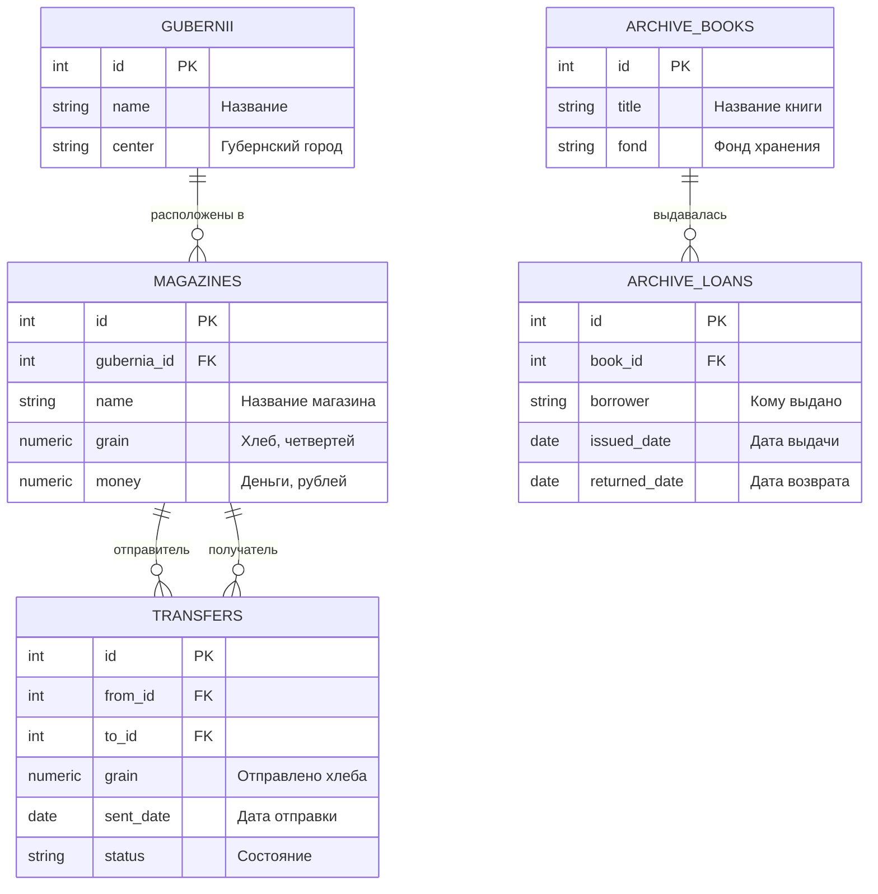

<script setup>
import Conversation from "../../../components/Conversation.vue";
</script>

# Управление транзакциями

## Введение: Война на два фронта

**Лето 1788 года.**

Положение империи тяжёлое как никогда за всё царствование. В **1787 году** Османская империя, не смирившись с потерей Крыма, объявила России войну. Русская армия осаждает Очаков, Суворов держит Кинбурн. А в **июне 1788 года**, воспользовавшись тем, что главные силы ушли на юг, войну объявляет Швеция, и боевые действия разворачиваются под самым Петербургом: канонаду Гогландского сражения слышно в столице.

Империя воюет на два фронта одновременно, и главной задачей государства становится не стратегия, а **снабжение**. Провиантские магазины – склады хлеба, круп и фуража – разбросаны по губерниям. Хлеб перебрасывают с места на место, деньги переводят между казначействами, подводы идут неделями.

И вот тут обнаруживается свойство учёта, о котором в мирное время не задумываются.

<Conversation :phrases="[
    {
        name: 'Гаврила Индексов',
        position: 'right',
        text: 'Варвара Никитична, я третий день не могу свести ведомость. Из Могилёвского магазина списали восемьсот четвертей ржи для Киевского. В Могилёвском списано. В Киевском не принято.'
    },
    {
        name: 'Варвара Схемина',
        position: 'right',
        text: 'Обоз в дороге?'
    },
    {
        name: 'Гаврила Индексов',
        position: 'right',
        text: 'Обоз пришёл месяц назад. Просто писарь списал в одной книге, а записать в другой не успел: его в тот день отправили с депешей. Книги разные, и между ними – ничего. Восемьсот четвертей ржи нет нигде.'
    },
    {
        name: 'Варвара Схемина',
        position: 'right',
        text: 'Значит, запись в двух книгах надо делать так, чтобы она была либо сделана в обеих, либо ни в одной. Середины быть не должно.'
    },
    {
        name: 'Савва Лукич',
        position: 'right',
        text: '(из угла) В приказах это называли «одним почерком». Пока дело не закрыто, писарь из-за стола не встаёт.'
    }
]"/>

Требование, которое сформулировала Варвара Схемина, и есть требование **атомарности транзакции**. Оно же объясняет судьбу утраченной тетради: её выдали в провиантский департамент, записали выдачу и не записали возврат. Запись осталась незакрытой на двадцать лет – ровно как транзакция, которую начали и не завершили.

::: info Что мы изучаем в этом учебном вопросе
**Транзакция** – группа операций, выполняемая как единое целое. Разберём, как ею управлять, что происходит при одновременной работе нескольких пользователей с одними данными, какие при этом возникают аномалии и как от них защищаться.

Это наиболее сложный раздел темы. Он требует понимания того, что база данных обслуживает **много сеансов одновременно**, и что результат работы одного сеанса зависит от того, что в это же время делают другие.
:::

## Рабочая среда: два соединения

Почти все опыты этого занятия требуют **двух одновременных соединений** с базой данных. Иначе ни блокировок, ни аномалий параллельного доступа увидеть невозможно: сеанс не может заблокировать сам себя.

::: warning Это первое, что надо настроить
Не приступайте к заданиям, пока не убедились, что у вас действительно два **независимых** сеанса. Проверка занимает минуту и описана ниже.
:::

### Как открыть два соединения

**В psql** – проще всего. Откройте два окна терминала и в каждом выполните подключение:

```bash
psql -h 10.0.31.10 -p 5432 -U postgres -d postgres
```

Каждый запуск `psql` – отдельный сеанс.

**В pgAdmin** – откройте два окна Query Tool. Выберите базу данных в дереве объектов, затем в меню «Инструменты» выберите «Query Tool», и повторите ещё раз. Каждое окно Query Tool работает в собственном сеансе.

**В DBeaver** – здесь есть ловушка, из-за которой опыты не получаются у большинства.

::: danger Вкладки DBeaver по умолчанию делят одно соединение
По умолчанию все SQL-редакторы, открытые для одного подключения, пользуются **одним и тем же** сеансом. Две вкладки будут вести себя как одно окно: транзакция, начатая в первой, окажется той же самой, что и во второй, и никаких блокировок вы не увидите.

Чтобы развести вкладки по разным сеансам, есть два способа.

Первый: в настройках подключения на вкладке «Метаданные» или «Соединения» включить параметр «Открывать отдельное подключение для каждого редактора» (Separate connection for each editor).

Второй, надёжнее для учебных целей: создать **два разных подключения** к одной и той же базе, назвав их, например, «Сеанс 1» и «Сеанс 2», и работать в редакторах, открытых от разных подключений.

Кроме того, убедитесь, что в DBeaver **выключена автофиксация** (Auto-commit). Если она включена, каждая команда завершается немедленно, и команда `BEGIN` ничего не даст. Переключатель находится на панели инструментов SQL-редактора.
:::

### Проверка

Выполните в каждом сеансе:

```sql
SELECT pg_backend_pid();
```

Функция возвращает идентификатор обслуживающего процесса. **Если числа совпали – у вас один сеанс, а не два.** Вернитесь к настройке.

Убедиться, что сервер видит оба подключения, можно из любого из них:

```sql
SELECT pid, application_name, state, backend_start
FROM pg_stat_activity
WHERE datname = current_database()
ORDER BY backend_start;
```

### Как читать описания опытов

Все опыты с двумя сеансами приводятся в виде **хронограммы** – таблицы, в которой строки идут по времени, а столбцы соответствуют сеансам. Выполнять команды надо строго в порядке строк, переключаясь между окнами.

| Шаг | Сеанс 1 | Сеанс 2 | Что происходит |
| :--- | :--- | :--- | :--- |
| 1 | `BEGIN;` | | Первый сеанс открыл транзакцию |
| 2 | | `BEGIN;` | Второй тоже |
| 3 | `COMMIT;` | | Первый зафиксировал |

Под хронограммой приводятся полные тексты команд для каждого сеанса.

## Учебная база данных

Работаем с провиантскими магазинами, переводами между ними и книгой выдач архива.



::: details Данные для БД

```sql
DROP TABLE IF EXISTS archive_loans, archive_books, transfers, magazines, gubernii CASCADE;

CREATE TABLE gubernii (
    id SERIAL PRIMARY KEY,
    name VARCHAR(60) NOT NULL UNIQUE,
    center VARCHAR(60) NOT NULL
);

INSERT INTO gubernii (name, center) VALUES
('Санкт-Петербургская', 'Санкт-Петербург'),
('Могилёвская',         'Могилёв'),
('Киевская',            'Киев'),
('Таврическая область', 'Симферополь'),
('Воронежская',         'Воронеж');

CREATE TABLE magazines (
    id SERIAL PRIMARY KEY,
    gubernia_id INT REFERENCES gubernii,
    name VARCHAR(60) NOT NULL,
    grain NUMERIC(12, 2) NOT NULL DEFAULT 0 CHECK (grain >= 0),
    money NUMERIC(12, 2) NOT NULL DEFAULT 0 CHECK (money >= 0)
);

INSERT INTO magazines (gubernia_id, name, grain, money) VALUES
(2, 'Могилёвский главный',   8000.00, 12000.00),
(3, 'Киевский главный',      6500.00,  9500.00),
(4, 'Перекопский передовой', 3200.00,  4100.00),
(5, 'Воронежский запасный',  9400.00,  7300.00),
(1, 'Петербургский адмиралтейский', 5100.00, 15000.00);

CREATE TABLE transfers (
    id SERIAL PRIMARY KEY,
    from_id INT REFERENCES magazines,
    to_id INT REFERENCES magazines,
    grain NUMERIC(12, 2) NOT NULL CHECK (grain > 0),
    sent_date DATE NOT NULL DEFAULT current_date,
    status VARCHAR(20) NOT NULL DEFAULT 'в пути'
        CHECK (status IN ('в пути', 'принято', 'утрачено')),
    CHECK (from_id <> to_id)
);

INSERT INTO transfers (from_id, to_id, grain, sent_date, status) VALUES
(1, 2, 800.00, '1788-05-12', 'в пути'),
(4, 3, 450.00, '1788-05-20', 'принято'),
(1, 3, 300.00, '1788-06-02', 'в пути');

CREATE TABLE archive_books (
    id SERIAL PRIMARY KEY,
    title VARCHAR(120) NOT NULL,
    fond VARCHAR(30)
);

INSERT INTO archive_books (title, fond) VALUES
('Книга окладная Поместного приказа',       'Фонд 1'),
('Сказки ревизские первой ревизии',         'Фонд 7'),
('Тетрадь о устроении хранилищ и допусках', 'Фонд 7'),
('Наказы Уложенной комиссии',               'Фонд 12');

CREATE TABLE archive_loans (
    id SERIAL PRIMARY KEY,
    book_id INT REFERENCES archive_books,
    borrower VARCHAR(80) NOT NULL,
    issued_date DATE NOT NULL,
    returned_date DATE
);

INSERT INTO archive_loans (book_id, borrower, issued_date, returned_date) VALUES
(1, 'Вотчинная коллегия',                      '1760-04-02', '1760-05-11'),
(2, 'Сенатская канцелярия',                    '1762-11-20', '1763-02-14'),
(3, 'Военная коллегия, департамент провиантский', '1764-03-12', NULL),
(4, 'Академия наук',                           '1783-10-01', '1783-12-20');

ANALYZE;
```

:::

<Conversation :phrases="[
    {
        name: 'Варвара Схемина',
        position: 'right',
        text: 'Вот она, запись о выдаче. Двенадцатое марта шестьдесят четвёртого, Военная коллегия, департамент провиантский. Графа возврата пуста.'
    },
    {
        name: 'Гаврила Индексов',
        position: 'right',
        text: 'Двадцать четыре года. Начали дело и не закрыли. Ровно та же беда, что с восемьюстами четвертями ржи, только тянется дольше.'
    }
]"/>

## Понятие транзакции

### Определение

**Транзакция** – логически неделимая последовательность операций над базой данных, которая переводит её из одного согласованного состояния в другое.

Ключевое слово здесь – **неделимая**. Транзакция, состоящая из десяти команд, с точки зрения всех остальных либо выполнена целиком, либо не выполнена вовсе. Промежуточных состояний для посторонних наблюдателей не существует.

Классический пример – перевод провианта из одного магазина в другой. Он состоит из двух операций:

```sql
UPDATE magazines SET grain = grain - 800 WHERE id = 1;
UPDATE magazines SET grain = grain + 800 WHERE id = 2;
```

Если между ними произойдёт сбой сервера, обрыв связи или ошибка, восемьсот четвертей хлеба исчезнут: списаны в одном месте, не приняты в другом. Именно это и случилось у Гаврилы Индексова, только в роли сбоя выступил писарь, отправленный с депешей.

### Свойства ACID

Требования к транзакционной системе принято обозначать аббревиатурой **ACID** по первым буквам четырёх свойств.

| Свойство | Название | Содержание |
| :--- | :--- | :--- |
| **A** | Атомарность (Atomicity) | Транзакция выполняется полностью или не выполняется вовсе. Частичное применение изменений невозможно |
| **C** | Согласованность (Consistency) | Транзакция переводит базу из одного корректного состояния в другое. Ограничения целостности соблюдаются на границах транзакции |
| **I** | Изолированность (Isolation) | Параллельно выполняемые транзакции не видят промежуточных результатов друг друга. Степень изолированности регулируется |
| **D** | Долговечность (Durability) | Результаты зафиксированной транзакции сохраняются даже при последующем сбое оборудования |

Разберём каждое подробнее, поскольку за формулировками стоят конкретные механизмы.

**Атомарность** обеспечивается тем, что изменения записываются как новые версии строк, а при отмене транзакции эти версии просто помечаются непригодными. Откат не требует обратного применения операций: он требует лишь объявить транзакцию несостоявшейся. Этот механизм мы разбирали в первом учебном вопросе.

**Согласованность** – свойство, за которое отвечает не только СУБД, но и разработчик. СУБД гарантирует соблюдение объявленных ограничений: `NOT NULL`, `CHECK`, внешних ключей. Но правило «сумма хлеба во всех магазинах не меняется при переводе» СУБД не знает, и обеспечить его должен тот, кто пишет транзакцию.

**Изолированность** – единственное из четырёх свойств, степень которого регулируется. Ему посвящена большая часть этого занятия.

**Долговечность** обеспечивается **журналом предзаписи** (WAL, Write-Ahead Log). Перед тем как изменить страницу данных, сервер записывает в журнал сведения о предстоящем изменении и сбрасывает журнал на диск. При фиксации транзакции гарантированно записанным на диск является именно журнал, а не сами страницы данных: их сервер запишет позже, в удобный момент. Если произойдёт сбой, при следующем запуске сервер прочитает журнал и доведёт до конца всё, что было зафиксировано.

::: info Почему журнал быстрее
Запись в журнал последовательна: данные дописываются в конец файла. Запись страниц данных случайна: изменённые страницы разбросаны по всему файлу таблицы.

Последовательная запись на порядок быстрее случайной даже на твердотельных накопителях. Поэтому отложить случайную запись и гарантировать только последовательную – принципиальное инженерное решение, лежащее в основе долговечности.
:::

### Начало и завершение транзакции

Транзакция начинается командой:

```sql
BEGIN;
```

Равносильная форма, предусмотренная стандартом SQL:

```sql
START TRANSACTION;
```

Завершить транзакцию можно двумя способами. **Зафиксировать** изменения:

```sql
COMMIT;
```

или **отменить** их:

```sql
ROLLBACK;
```

::: info Неявные транзакции
Любая команда, выполненная **вне** явной транзакции, всё равно выполняется в транзакции – просто созданной автоматически и завершаемой сразу после команды. Этот режим называется **автофиксацией** (autocommit).

Отсюда следует, что команда

```sql
UPDATE magazines SET grain = grain - 800 WHERE id = 1;
```

атомарна сама по себе: если она затронула тысячу строк и на девятьсот первой возникла ошибка, не изменится ни одна.

Отсюда же следует, что отменить выполненную без `BEGIN` команду невозможно: она уже зафиксирована.
:::

### Транзакционный DDL

У PostgreSQL есть свойство, редкое среди реляционных СУБД и чрезвычайно полезное на практике.

::: tip Команды определения данных тоже транзакционны
В большинстве СУБД команды `CREATE TABLE`, `ALTER TABLE`, `DROP TABLE` вызывают неявную фиксацию: отменить их нельзя. В PostgreSQL они **участвуют в транзакции наравне с остальными**.

Проверим:

```sql
BEGIN;

CREATE TABLE ddl_test (id INT);

ROLLBACK;

SELECT to_regclass('ddl_test') IS NULL AS таблицы_нет;
```

Результат – `true`: таблицы нет, создание отменено.

Практическая ценность огромна. Сценарий изменения схемы данных, состоящий из двадцати команд `ALTER TABLE`, можно обернуть в одну транзакцию: либо применятся все изменения, либо база останется в прежнем состоянии. Не нужно писать сценарий отката.

Исключения существуют. Вне транзакции обязаны выполняться `CREATE DATABASE`, `DROP DATABASE`, `CREATE TABLESPACE`, `VACUUM`, `CREATE INDEX CONCURRENTLY` и `ALTER SYSTEM`. Причина общая: эти команды работают с объектами файловой системы или с состоянием всего кластера, где откат невозможен.
:::

### Точки сохранения

Иногда требуется отменить не всю транзакцию, а её часть. Для этого служат **точки сохранения**.

```sql
SAVEPOINT имя_точки;
```

Возврат к точке:

```sql
ROLLBACK TO SAVEPOINT имя_точки;
```

Удаление точки за ненадобностью:

```sql
RELEASE SAVEPOINT имя_точки;
```

Возврат к точке сохранения отменяет изменения, сделанные после неё, но **не завершает транзакцию**: она продолжается, и её можно зафиксировать.

::: warning Точки сохранения не бесплатны
Каждая точка сохранения создаёт **подтранзакцию** со своим номером. Сервер вынужден отслеживать их все и учитывать при проверке видимости версий строк.

Пока точек единицы, издержки незаметны. Но цикл, создающий точку сохранения на каждой из сотни тысяч итераций, приводит к резкому падению производительности всего сервера: при превышении порога в 64 подтранзакции на сеанс сведения о них перестают помещаться в разделяемую память, и проверка видимости начинает требовать обращений к диску.

Это известная и неочевидная причина деградации, поэтому точками сохранения пользуются умеренно.
:::

### Ошибка внутри транзакции

Поведение, которое надо знать твёрдо:

::: danger После ошибки транзакция блокируется целиком
Если внутри транзакции команда завершилась ошибкой, транзакция переходит в состояние сбоя. Все последующие команды будут отвергаться с сообщением:

```
ERROR:  current transaction is aborted, commands ignored until end of transaction block
```

Единственное, что можно сделать, – завершить транзакцию. Причём даже команда `COMMIT` в этом состоянии выполнит **откат**.

Это отличается от поведения многих других СУБД, где ошибка одной команды не влияет на остальные. Обойти поведение можно точками сохранения: откат к точке, созданной до ошибочной команды, возвращает транзакцию в рабочее состояние.
:::

### Состояние транзакций в сеансах

Узнать состояние сеансов относительно транзакций позволяет уже знакомое представление:

```sql
SELECT pid,
       state,
       xact_start,
       now() - xact_start AS длительность_транзакции,
       now() - state_change AS в_текущем_состоянии,
       left(query, 50) AS запрос
FROM pg_stat_activity
WHERE datname = current_database()
ORDER BY xact_start NULLS LAST;
```

Напомним значения столбца `state`:

| Значение | Что означает |
| :--- | :--- |
| `active` | Сеанс выполняет запрос |
| `idle` | Сеанс простаивает вне транзакции. Нормальное состояние |
| `idle in transaction` | Сеанс простаивает **внутри открытой транзакции** |
| `idle in transaction (aborted)` | То же, но транзакция уже в состоянии сбоя |

::: danger Состояние idle in transaction
Это главная эксплуатационная опасность, связанная с транзакциями, и теперь мы можем объяснить, почему.

Открытая транзакция удерживает **снимок данных**. Все версии строк, существовавшие на момент её начала, обязаны сохраняться, поскольку теоретически могут ей понадобиться. Следовательно, очистка не может их удалить – **во всей базе данных**, а не только в тех таблицах, которых транзакция касалась.

Кроме того, если транзакция успела что-то изменить, она удерживает блокировки изменённых строк, и другие сеансы будут её ждать.

Транзакция, висящая в этом состоянии сутки, способна за это время раздуть базу вдвое.

Защита – параметр, автоматически обрывающий такие сеансы:

```sql
SHOW idle_in_transaction_session_timeout;
```

По умолчанию он равен нулю, то есть выключен. На рабочем сервере его следует установить, например, в десять минут.
:::

### Задание 3.1. Начало, завершение и откат транзакций

**А)** Откат транзакции.

```sql
BEGIN;

SELECT * FROM magazines WHERE id = 1;

UPDATE magazines SET money = money + 10 WHERE id = 1;

SELECT * FROM magazines WHERE id = 1;

ROLLBACK;

SELECT * FROM magazines WHERE id = 1;
```

Обратите внимание: внутри транзакции второй `SELECT` показывает изменённое значение. Транзакция **видит собственные незафиксированные изменения**, хотя для остальных сеансов их не существует. После отката значение возвращается к исходному.

**Б)** Фиксация транзакции.

```sql
BEGIN;

SELECT * FROM magazines WHERE id = 1;

UPDATE magazines SET money = money + 10 WHERE id = 1;

COMMIT;

SELECT * FROM magazines WHERE id = 1;
```

**В)** Точка сохранения.

```sql
BEGIN;

SELECT money FROM magazines WHERE id = 1;

UPDATE magazines SET money = money - 10 WHERE id = 1;

SAVEPOINT sp_1;

UPDATE magazines SET money = money - 10 WHERE id = 1;

ROLLBACK TO SAVEPOINT sp_1;

COMMIT;

SELECT money FROM magazines WHERE id = 1;
```

Итог: первое уменьшение на 10 зафиксировано, второе отменено возвратом к точке сохранения. Значение уменьшилось на 10, а не на 20.

::: tip Фиксация и откат в графических клиентах
В pgAdmin на панели инструментов окна запросов есть кнопки «Commit» и «Rollback», становящиеся доступными при открытой транзакции. В DBeaver те же действия вынесены на панель SQL-редактора и работают только при выключенной автофиксации.

Пользоваться кнопками удобно, но в учебных целях лучше писать команды явно: так видно, что именно происходит.
:::

## Многоверсионность и снимки данных

Прежде чем разбирать параллельную работу, надо развить представление о многоверсионности, начатое в первом учебном вопросе.

### Номер транзакции

Каждой транзакции, изменяющей данные, сервер присваивает **номер**. Узнать его можно так:

```sql
BEGIN;
SELECT pg_current_xact_id();
COMMIT;
```

Номера выдаются по возрастанию и служат для определения порядка: транзакция с меньшим номером началась раньше.

В первом учебном вопросе мы видели системные столбцы `xmin` и `xmax`, хранящие номера транзакций, создавшей и удалившей версию строки.

### Снимок данных

**Снимок (snapshot)** – зафиксированное представление о том, какие транзакции на некоторый момент уже завершились, а какие ещё выполняются.

```sql
BEGIN;
SELECT pg_current_snapshot();
COMMIT;
```

Результат имеет вид `1578:1583:1580,1581` и читается так: все транзакции с номерами до 1578 завершены, все с номерами от 1583 ещё не начинались, а в промежутке выполняются транзакции 1580 и 1581.

Решая, показывать ли конкретную версию строки, сервер сверяет её `xmin` и `xmax` со снимком:

- версия видна, если создавшая её транзакция по снимку **завершена успешно**, а удаляющей нет либо она по снимку **не завершена**;
- версия не видна, если создавшая транзакция по снимку ещё выполняется или была отменена;
- версия не видна, если удаляющая транзакция по снимку завершена успешно.

::: info Главное следствие
**Момент получения снимка определяет, что транзакция увидит.** Именно в этом и состоит различие между уровнями изоляции:

- на одном уровне новый снимок берётся **перед каждой командой**;
- на другом – **один раз на всю транзакцию**.

Всё остальное вытекает отсюда.
:::

## Аномалии параллельного доступа

Когда несколько транзакций работают с одними данными одновременно, возможны явления, при которых результат отличается от того, какой получился бы при последовательном выполнении. Стандарт SQL выделяет несколько таких аномалий.

### Потерянное обновление

Две транзакции читают одно значение, каждая вычисляет новое на основе прочитанного и записывает. Изменение, сделанное первой, бесследно теряется.

| Шаг | Транзакция 1 | Транзакция 2 | Состояние |
| :--- | :--- | :--- | :--- |
| 1 | Прочитала `money = 100` | | 100 |
| 2 | | Прочитала `money = 100` | 100 |
| 3 | Записала `100 + 10 = 110` | | 110 |
| 4 | | Записала `100 + 5 = 105` | 105 |

Прибавка первой транзакции исчезла. Итог должен был быть 115.

::: tip Как PostgreSQL защищает от потерянного обновления
Если изменение записано как `SET money = money + 10`, потери не произойдёт: вторая транзакция будет ждать завершения первой, а затем перечитает актуальное значение.

Аномалия возникает, когда значение читается приложением, вычисляется в его коде и записывается обратно константой. Защита – либо выполнять арифметику на стороне сервера, либо явно блокировать строку при чтении через `SELECT ... FOR UPDATE`, либо работать на уровне изоляции не ниже повторяемого чтения.
:::

### Грязное чтение

Транзакция читает данные, изменённые другой транзакцией, которая **ещё не зафиксирована** и может быть отменена.

::: info В PostgreSQL грязное чтение невозможно
Благодаря многоверсионности незафиксированная версия строки попросту не видна другим транзакциям: её `xmin` принадлежит незавершённой транзакции.

Уровень изоляции `READ UNCOMMITTED`, при котором стандарт допускает грязное чтение, в PostgreSQL принимается, но ведёт себя точно так же, как `READ COMMITTED`.
:::

### Неповторяемое чтение

Транзакция дважды читает одну и ту же строку и получает разные значения, потому что между чтениями другая транзакция её изменила и зафиксировала.

### Фантомное чтение

Транзакция дважды выполняет один и тот же запрос с условием и во второй раз получает **другой набор строк**: другая транзакция добавила или удалила строки, подходящие под условие.

Отличие от неповторяемого чтения в том, что меняется не значение в известной строке, а состав выборки.

### Аномалия сериализации

Наиболее тонкий случай. Каждая транзакция по отдельности корректна, ни одна не читает незафиксированных данных, но итоговое состояние базы не соответствует **никакому** порядку последовательного выполнения этих транзакций.

Классический пример. В таблице записи двух цветов, поровну. Транзакция 1 перекрашивает все белые в чёрные, транзакция 2 – все чёрные в белые. При любом последовательном порядке все записи окажутся одного цвета. При параллельном выполнении на уровне повторяемого чтения они просто поменяются местами – результат, невозможный ни при каком последовательном выполнении.

### Сводная таблица

| Аномалия | `READ UNCOMMITTED` | `READ COMMITTED` | `REPEATABLE READ` | `SERIALIZABLE` |
| :--- | :--- | :--- | :--- | :--- |
| Грязное чтение | Допускается стандартом, **в PostgreSQL невозможно** | Невозможно | Невозможно | Невозможно |
| Неповторяемое чтение | Возможно | **Возможно** | Невозможно | Невозможно |
| Фантомное чтение | Возможно | **Возможно** | **В PostgreSQL невозможно** | Невозможно |
| Аномалия сериализации | Возможна | Возможна | **Возможна** | Невозможна |

::: info Где PostgreSQL строже стандарта
Таблица содержит два отличия от стандарта SQL, и оба в сторону большей строгости.

**Первое.** Уровень `READ UNCOMMITTED` не реализован как отдельный: он эквивалентен `READ COMMITTED`. Грязное чтение в PostgreSQL недостижимо в принципе.

**Второе.** Стандарт допускает фантомное чтение на уровне `REPEATABLE READ`. В PostgreSQL его нет: транзакция работает с одним снимком на всё время своего существования, поэтому новые строки для неё не появляются.

Проверить уровень изоляции текущей транзакции можно так:

```sql
SHOW transaction_isolation;
```
:::

## Уровни изоляции

### Как задать уровень

Уровень изоляции задаётся при начале транзакции:

```sql
BEGIN ISOLATION LEVEL REPEATABLE READ;
```

либо отдельной командой сразу после начала:

```sql
BEGIN;
SET TRANSACTION ISOLATION LEVEL SERIALIZABLE;
```

Уровень по умолчанию для всех новых транзакций:

```sql
SHOW default_transaction_isolation;
```

Значение по умолчанию – `read committed`. Изменить его можно для сеанса, для роли, для базы данных или для всего сервера.

::: warning Уровень нельзя сменить после первой команды
Задать уровень изоляции можно только до того, как транзакция выполнила первый запрос к данным. Попытка сделать это позже завершится ошибкой.
:::

Кроме уровня изоляции, транзакцию можно объявить **только читающей**:

```sql
BEGIN TRANSACTION READ ONLY;
```

Такая транзакция не сможет изменять данные, зато сервер применит к ней ряд оптимизаций. Для отчётных запросов это полезная привычка.

### READ COMMITTED

Уровень по умолчанию. Его правило:

::: info Правило READ COMMITTED
**Новый снимок данных берётся перед выполнением каждой команды.**

Следствие: каждая команда видит все транзакции, зафиксированные к моменту её начала. Две одинаковые команды внутри одной транзакции могут увидеть разные данные.
:::

Именно это и означает возможность неповторяемого чтения. Проверим опытом.

#### Опыт: неповторяемое чтение

| Шаг | Сеанс 1 | Сеанс 2 | Что происходит |
| :--- | :--- | :--- | :--- |
| 1 | `BEGIN;` | | Открыта транзакция на уровне по умолчанию |
| 2 | `SELECT money FROM magazines WHERE id = 1;` | | Прочитано исходное значение |
| 3 | | `BEGIN;` | |
| 4 | | `UPDATE magazines SET money = money + 10 WHERE id = 1;` | Изменение ещё не видно первому сеансу |
| 5 | | `COMMIT;` | Изменение зафиксировано |
| 6 | `SELECT money FROM magazines WHERE id = 1;` | | **Значение изменилось** |
| 7 | `ROLLBACK;` | | |

Сеанс 1:

```sql
BEGIN;

SELECT money FROM magazines WHERE id = 1;

-- после выполнения сеанса 2:
SELECT money FROM magazines WHERE id = 1;

ROLLBACK;
```

Сеанс 2:

```sql
BEGIN;

UPDATE magazines SET money = money + 10 WHERE id = 1;

COMMIT;
```

Два одинаковых запроса внутри одной транзакции вернули разные значения. Для отчёта, который считает несколько показателей последовательными запросами, это означает, что итоги могут не сойтись между собой.

### REPEATABLE READ

::: info Правило REPEATABLE READ
**Снимок берётся один раз, при выполнении первой команды транзакции, и используется до её завершения.**

Следствие: транзакция видит базу данных такой, какой та была в момент её начала, независимо от того, что делают другие.
:::

#### Опыт: повторяемое чтение

Та же хронограмма, но первый сеанс открывает транзакцию с указанием уровня.

| Шаг | Сеанс 1 | Сеанс 2 | Что происходит |
| :--- | :--- | :--- | :--- |
| 1 | `BEGIN ISOLATION LEVEL REPEATABLE READ;` | | |
| 2 | `SELECT money FROM magazines WHERE id = 1;` | | Зафиксирован снимок |
| 3 | | `BEGIN;` | |
| 4 | | `UPDATE magazines SET money = money - 10 WHERE id = 1;` | |
| 5 | | `COMMIT;` | Изменение зафиксировано |
| 6 | `SELECT money FROM magazines WHERE id = 1;` | | **Значение прежнее** |
| 7 | `ROLLBACK;` | | |

Сеанс 1:

```sql
BEGIN ISOLATION LEVEL REPEATABLE READ;

SELECT money FROM magazines WHERE id = 1;

-- после выполнения сеанса 2:
SELECT money FROM magazines WHERE id = 1;

ROLLBACK;
```

Сеанс 2:

```sql
BEGIN;

UPDATE magazines SET money = money - 10 WHERE id = 1;

COMMIT;
```

Оба чтения вернули одно и то же. Транзакция работает в своей, неизменной картине мира.

::: tip Когда это нужно
Любой отчёт, состоящий из нескольких запросов, должен выполняться на уровне повторяемого чтения. Иначе разные части отчёта будут посчитаны по разным состояниям базы, и итоги не сойдутся.

То же относится к выгрузке данных: утилита `pg_dump` именно поэтому работает в транзакции с повторяемым чтением, иначе резервная копия оказалась бы внутренне противоречивой.
:::

#### Опыт: отсутствие фантомов

Проверим, что на этом уровне не появляются и новые строки.

| Шаг | Сеанс 1 | Сеанс 2 |
| :--- | :--- | :--- |
| 1 | `BEGIN ISOLATION LEVEL REPEATABLE READ;` | |
| 2 | `SELECT count(*) FROM transfers;` | |
| 3 | | `INSERT INTO transfers (from_id, to_id, grain) VALUES (2, 3, 100);` |
| 4 | `SELECT count(*) FROM transfers;` | |
| 5 | `ROLLBACK;` | |

На уровне `READ COMMITTED` второе чтение показало бы на единицу больше. На уровне `REPEATABLE READ` оба чтения дадут одинаковый результат.

### SERIALIZABLE

::: info Правило SERIALIZABLE
Всё, что верно для `REPEATABLE READ`, плюс дополнительная проверка: сервер **отслеживает зависимости между транзакциями по чтению и записи** и отменяет те из них, чей результат не соответствует никакому последовательному порядку выполнения.

Механизм называется сериализуемой изоляцией снимков (SSI, Serializable Snapshot Isolation).
:::

Важнейшее практическое следствие:

::: danger Транзакцию на уровне SERIALIZABLE надо уметь повторить
Сервер не блокирует транзакции заранее, а обнаруживает конфликт при фиксации и **отменяет** одну из участниц с ошибкой:

```
ERROR:  could not serialize access due to read/write dependencies among transactions
DETAIL:  Reason code: Canceled on identification as a pivot, during commit attempt.
HINT:  The transaction might succeed if retried.
```

Подсказка последней строки не формальность: повторный запуск той же транзакции, скорее всего, пройдёт успешно.

Поэтому приложение, работающее на этом уровне, **обязано** содержать цикл повтора транзакции при получении кода ошибки `40001`. Без такого цикла уровень `SERIALIZABLE` применять нельзя.
:::

## Блокировки

Изолированность при чтении обеспечивается снимками и блокировок не требует. Но при **изменении** одних и тех же строк двумя транзакциями одновременно снимков недостаточно: кто-то должен подождать.

### Блокировки строк

Когда транзакция изменяет строку, она устанавливает на неё **исключительную блокировку**, которая удерживается до конца транзакции. Вторая транзакция, попытавшаяся изменить ту же строку, переходит в ожидание.

Чего именно она ждёт, видно в системных представлениях. Пока первая транзакция держит строку, выполните из третьего сеанса:

```sql
SELECT pid,
       state,
       wait_event_type   AS тип_ожидания,
       wait_event        AS событие,
       pg_blocking_pids(pid) AS ждёт_завершения,
       left(query, 45)   AS запрос
FROM pg_stat_activity
WHERE datname = current_database() AND pid <> pg_backend_pid()
ORDER BY pid;
```

Ожидающий сеанс будет выглядеть так:

```
 pid  | state  | тип_ожидания |   событие     | ждёт_завершения |        запрос
------+--------+--------------+---------------+-----------------+-----------------------
 2083 | active | Timeout      | PgSleep       | {}              | SELECT pg_sleep(5);
 2089 | active | Lock         | transactionid | {2083}          | UPDATE magazines ...
```

Функция `pg_blocking_pids(pid)` возвращает массив идентификаторов процессов, завершения которых ждёт указанный сеанс. Это главный инструмент разбора ситуаций «всё висит».

::: tip Запрос дежурного администратора
Этот запрос стоит сохранить: он сразу показывает цепочку ожидания.

```sql
SELECT waiting.pid        AS ждущий,
       waiting.usename    AS кто_ждёт,
       left(waiting.query, 40) AS ждущий_запрос,
       blocking.pid       AS блокирующий,
       blocking.state     AS состояние_блокирующего,
       now() - blocking.xact_start AS его_транзакция_длится,
       left(blocking.query, 40) AS блокирующий_запрос
FROM pg_stat_activity waiting
JOIN LATERAL unnest(pg_blocking_pids(waiting.pid)) AS b(pid) ON true
JOIN pg_stat_activity blocking ON blocking.pid = b.pid
WHERE waiting.datname = current_database();
```

Обратите внимание на столбец «состояние блокирующего». Если там `idle in transaction`, проблема не в тяжёлом запросе, а в брошенной транзакции.
:::

### Представление pg_locks

Более подробную картину даёт системное представление `pg_locks`:

```sql
SELECT pid,
       locktype           AS вид_блокировки,
       relation::regclass AS объект,
       mode               AS режим,
       granted            AS получена
FROM pg_locks
WHERE pid <> pg_backend_pid()
ORDER BY pid, locktype;
```

Типичный вывод во время ожидания:

```
 pid  |   вид_блокировки | объект    |      режим       | получена
------+------------------+-----------+------------------+----------
 2083 | relation         | magazines | RowExclusiveLock | t
 2083 | transactionid    |           | ExclusiveLock    | t
 2089 | relation         | magazines | RowExclusiveLock | t
 2089 | transactionid    |           | ShareLock        | f
 2089 | tuple            | magazines | ExclusiveLock    | t
```

Ключ к чтению – столбец `granted`. Строка со значением `f` показывает, **чего сеанс ждёт**. Здесь сеанс 2089 ждёт разделяемую блокировку на идентификатор транзакции сеанса 2083: именно так в PostgreSQL реализовано ожидание чужой транзакции. Строка остаётся заблокированной ровно до тех пор, пока держащая её транзакция не завершится.

### Блокировки таблиц

Помимо блокировок строк существуют блокировки уровня таблицы. Их восемь режимов, и совместимость между ними определяет, какие операции могут выполняться одновременно.

| Режим | Чем устанавливается | С чем конфликтует |
| :--- | :--- | :--- |
| `ACCESS SHARE` | `SELECT` | Только с `ACCESS EXCLUSIVE` |
| `ROW SHARE` | `SELECT FOR UPDATE` | С `EXCLUSIVE`, `ACCESS EXCLUSIVE` |
| `ROW EXCLUSIVE` | `INSERT`, `UPDATE`, `DELETE` | С `SHARE` и строже |
| `SHARE UPDATE EXCLUSIVE` | `VACUUM`, `ANALYZE`, `CREATE INDEX CONCURRENTLY` | Сама с собой и строже |
| `SHARE` | `CREATE INDEX` | С изменением данных |
| `SHARE ROW EXCLUSIVE` | `CREATE TRIGGER` | Почти со всем |
| `EXCLUSIVE` | `REFRESH MATERIALIZED VIEW CONCURRENTLY` | Со всем, кроме `ACCESS SHARE` |
| `ACCESS EXCLUSIVE` | `ALTER TABLE`, `DROP TABLE`, `VACUUM FULL`, `REINDEX` | Со всем, включая чтение |

Запоминать таблицу наизусть не требуется, но два вывода из неё обязательны.

**Первый.** Обычные операции чтения и изменения данных друг другу не мешают на уровне таблицы: `ACCESS SHARE` и `ROW EXCLUSIVE` совместимы. Конкуренция возникает только за конкретные строки.

**Второй.** Команда `ALTER TABLE` берёт `ACCESS EXCLUSIVE` – блокировку, несовместимую **даже с чтением**.

::: danger Очередь блокировок
Отсюда следует опасный сценарий, с которым сталкивался почти каждый администратор.

Вы выполняете `ALTER TABLE` на нагруженной таблице. Команда не может получить блокировку, потому что таблицу читает долгий отчёт, и встаёт в очередь. Но все последующие запросы, включая простые `SELECT`, встают в очередь **за ней**: сервер не пропускает их вперёд, иначе команда ждала бы вечно.

В результате одна безобидная команда изменения схемы останавливает работу со всей таблицей, хотя сама ещё даже не начала выполняться.

Защита – устанавливать ограничение времени ожидания блокировки перед такими командами:

```sql
SET lock_timeout = '3s';

ALTER TABLE magazines ADD COLUMN note TEXT;

RESET lock_timeout;
```

Если за три секунды блокировку получить не удалось, команда прервётся с ошибкой и очередь рассосётся. Попробовать можно будет позже.
:::

### Взаимоблокировки

**Взаимоблокировка (deadlock)** возникает, когда две транзакции ждут друг друга по кругу: первая удерживает ресурс, нужный второй, и ждёт ресурса, удерживаемого второй.

Разорвать такое ожидание невозможно: оно не закончится само. Поэтому сервер его обнаруживает и принудительно прерывает одну из транзакций.

Поиск взаимоблокировок запускается не сразу, а по истечении времени ожидания:

```sql
SHOW deadlock_timeout;
```

Значение по умолчанию – одна секунда. Такая задержка сделана намеренно: проверка на взаимоблокировку требует обхода графа ожиданий, и выполнять её при каждом обычном ожидании было бы расточительно.

### Задание 3.2. Взаимоблокировки

Воспроизведём взаимоблокировку на двух сеансах.

| Шаг | Сеанс 1 | Сеанс 2 | Что происходит |
| :--- | :--- | :--- | :--- |
| 1 | `BEGIN;` | | |
| 2 | `UPDATE magazines SET money = money + 10 WHERE id = 1;` | | Сеанс 1 заблокировал строку 1 |
| 3 | | `BEGIN;` | |
| 4 | | `UPDATE magazines SET money = money + 10 WHERE id = 2;` | Сеанс 2 заблокировал строку 2 |
| 5 | `UPDATE magazines SET money = money + 5 WHERE id = 2;` | | Сеанс 1 **встал в ожидание**: строка 2 занята |
| 6 | | `UPDATE magazines SET money = money + 5 WHERE id = 1;` | Круг замкнулся. Через секунду сервер обнаруживает взаимоблокировку |
| 7 | | | **Одна из транзакций прерывается с ошибкой** |
| 8 | `COMMIT;` | `COMMIT;` | Уцелевшая фиксируется, прерванная откатывается |

Сеанс 1:

```sql
BEGIN;

UPDATE magazines SET money = money + 10 WHERE id = 1;

-- после шага 4 в сеансе 2:
UPDATE magazines SET money = money + 5 WHERE id = 2;

COMMIT;
```

Сеанс 2:

```sql
BEGIN;

UPDATE magazines SET money = money + 10 WHERE id = 2;

-- после шага 5 в сеансе 1:
UPDATE magazines SET money = money + 5 WHERE id = 1;

COMMIT;
```

Прерванная транзакция получит сообщение:

```
ERROR:  deadlock detected
DETAIL:  Process 1701 waits for ShareLock on transaction 1570; blocked by process 1706.
         Process 1706 waits for ShareLock on transaction 1569; blocked by process 1701.
HINT:  See server log for query details.
CONTEXT:  while updating tuple (0,40) in relation "magazines"
```

::: warning Какая транзакция будет прервана
Распространено представление, что уцелеет та транзакция, которая началась раньше или зафиксировалась первой. **Это неверно.**

Жертву выбирает сервер, и выбирает он тот сеанс, **обнаруживший взаимоблокировку**, то есть тот, у которого первым истекло время `deadlock_timeout`. На практике это зависит от того, в каком порядке сеансы встали в ожидание, и предсказать исход нельзя.

В приведённом опыте прервана была транзакция **первого** сеанса, хотя она началась раньше.

Практический вывод: приложение не должно рассчитывать на то, что уцелеет именно оно. Как и при ошибке сериализации, транзакцию надо уметь повторить.
:::

::: tip Как избежать взаимоблокировок
Единственный надёжный способ – **обращаться к ресурсам в одном и том же порядке во всех частях приложения**.

Если бы оба сеанса в опыте изменяли строки в порядке возрастания идентификатора, взаимоблокировка была бы невозможна: второй просто подождал бы первого на строке 1 и затем спокойно прошёл дальше.

Для перевода средств между счетами это означает: блокировать счета не в порядке «откуда, куда», а в порядке возрастания их номеров, независимо от направления перевода.
:::

Подробности каждой взаимоблокировки сервер записывает в свой журнал, включая тексты обоих запросов. При разборе инцидентов смотреть надо именно туда: сообщение клиенту содержит только идентификаторы процессов.

## Изменение данных на разных уровнях изоляции

Перейдём к наиболее тонкой части. Разберём, как ведут себя **изменяющие** транзакции на каждом из уровней.

### Задание 3.3. Чтение на уровне READ COMMITTED

Выполните опыт из раздела о `READ COMMITTED`, приведённый выше.

| Шаг | Сеанс 1 | Сеанс 2 |
| :--- | :--- | :--- |
| 1 | `BEGIN;` | |
| 2 | `SELECT * FROM magazines WHERE id = 1;` | |
| 3 | | `BEGIN;` |
| 4 | | `UPDATE magazines SET money = money + 10 WHERE id = 1;` |
| 5 | | `COMMIT;` |
| 6 | `SELECT * FROM magazines WHERE id = 1;` | |
| 7 | `ROLLBACK;` | |

Два одинаковых запроса в одной транзакции дают **разные** результаты.

### Задание 3.4. Чтение на уровне REPEATABLE READ

| Шаг | Сеанс 1 | Сеанс 2 |
| :--- | :--- | :--- |
| 1 | `BEGIN ISOLATION LEVEL REPEATABLE READ;` | |
| 2 | `SELECT * FROM magazines WHERE id = 1;` | |
| 3 | | `BEGIN;` |
| 4 | | `UPDATE magazines SET money = money - 10 WHERE id = 1;` |
| 5 | | `COMMIT;` |
| 6 | `SELECT * FROM magazines WHERE id = 1;` | |
| 7 | `ROLLBACK;` | |

Два одинаковых запроса дают **одинаковые** результаты. Такое же поведение характерно и для уровня сериализации.

### Задание 3.5. Изменение на уровне READ COMMITTED

**А) Разные строки.**

| Шаг | Сеанс 1 | Сеанс 2 | Что происходит |
| :--- | :--- | :--- | :--- |
| 1 | `BEGIN;` | | |
| 2 | `UPDATE magazines SET money = money + 10 WHERE id = 1;` | | |
| 3 | | `BEGIN;` | |
| 4 | | `UPDATE magazines SET money = money + 5 WHERE id = 2;` | Ожидания нет: строки разные |
| 5 | `COMMIT;` | | |
| 6 | | `COMMIT;` | |

Изменения обеих транзакций успешно зафиксированы, ни одна не переходила в режим ожидания. Это ожидаемо: конкуренция возникает за конкретные строки, а не за таблицу.

**Б) Одна и та же строка.**

| Шаг | Сеанс 1 | Сеанс 2 | Что происходит |
| :--- | :--- | :--- | :--- |
| 1 | `BEGIN;` | | |
| 2 | `UPDATE magazines SET money = money + 10 WHERE id = 1;` | | Строка заблокирована |
| 3 | | `BEGIN;` | |
| 4 | | `UPDATE magazines SET money = money + 5 WHERE id = 1;` | **Сеанс 2 встал в ожидание** |
| 5 | `COMMIT;` | | Сеанс 2 вышел из ожидания и выполнил изменение |
| 6 | | `COMMIT;` | |

Изменения обеих транзакций зафиксированы. Итоговое значение увеличилось на 15.

::: info Почему прибавка не потерялась
Это тот самый случай, о котором шла речь в разделе о потерянном обновлении.

Когда сеанс 2 вышел из ожидания, значение в строке уже было другим: первая транзакция прибавила 10. На уровне `READ COMMITTED` сервер в этот момент **перечитывает строку заново** и применяет изменение к актуальному значению, а не к тому, что было на момент начала команды.

Это поведение называется «перепроверкой» (EvalPlanQual) и действует только на уровне `READ COMMITTED`. Именно благодаря ему конструкция `SET money = money + 5` безопасна.
:::

**Общий вывод.** На уровне чтения зафиксированных данных любые изменения параллельных транзакций в итоге будут зафиксированы. Параллельное изменение или удаление пересекающегося набора строк переводит вторую транзакцию в состояние ожидания до завершения первой.

### Задание 3.6. Изменение на уровне REPEATABLE READ

**А) Разные строки.**

| Шаг | Сеанс 1 | Сеанс 2 |
| :--- | :--- | :--- |
| 1 | `BEGIN ISOLATION LEVEL REPEATABLE READ;` | |
| 2 | `UPDATE magazines SET money = money + 10 WHERE id = 1;` | |
| 3 | | `BEGIN ISOLATION LEVEL REPEATABLE READ;` |
| 4 | | `UPDATE magazines SET money = money + 5 WHERE id = 2;` |
| 5 | `COMMIT;` | |
| 6 | | `COMMIT;` |

Изменения обеих транзакций успешно зафиксированы, ожидания не возникало.

**Б) Одна и та же строка.**

| Шаг | Сеанс 1 | Сеанс 2 | Что происходит |
| :--- | :--- | :--- | :--- |
| 1 | `BEGIN ISOLATION LEVEL REPEATABLE READ;` | | |
| 2 | `UPDATE magazines SET money = money + 10 WHERE id = 1;` | | |
| 3 | | `BEGIN ISOLATION LEVEL REPEATABLE READ;` | |
| 4 | | `UPDATE magazines SET money = money + 5 WHERE id = 1;` | Сеанс 2 встал в ожидание |
| 5 | `COMMIT;` | | **В сеансе 2 возникает ошибка** |
| 6 | | `ROLLBACK;` | |

Сеанс 2 получает:

```
ERROR:  could not serialize access due to concurrent update
```

::: info Почему здесь ошибка, а на READ COMMITTED её не было
Транзакция на уровне повторяемого чтения обязана видеть базу такой, какой та была в момент её начала. Перечитать изменённую строку она **не имеет права**: это нарушило бы её собственную картину мира.

Но и применить изменение к устаревшей версии нельзя: результат был бы неверен.

Из этого противоречия единственный выход – отменить транзакцию. Поэтому на уровнях выше `READ COMMITTED` механизм перепроверки не работает, и конфликт изменений приводит к ошибке.

Код этой ошибки – `40001`, тот же, что и у ошибки сериализации. Обрабатывать её надо так же: повторять транзакцию.
:::

**Общий вывод.** На уровне повторяемого чтения любые изменения, кроме затрагивающих пересекающийся набор строк, фиксируются одновременно. При пересечении вторая транзакция встаёт в ожидание и затем отменяется, если первая зафиксировалась. Если же первая была отменена, вторая продолжит работу успешно.

### Задание 3.7. Изменение на уровне SERIALIZABLE

Здесь нас ждёт самый поучительный результат занятия, и чтобы его получить, понадобится подготовка.

#### Почему нужна большая таблица

Таблица `magazines` содержит пять строк. Посмотрим, как сервер выполняет на ней отбор по первичному ключу:

```sql
EXPLAIN UPDATE magazines SET money = money + 10 WHERE id = 1;
```

```
 Update on magazines  (cost=0.00..1.07 rows=0 width=0)
   ->  Seq Scan on magazines  (cost=0.00..1.07 rows=1 width=38)
         Filter: (id = 1)
```

**Последовательное сканирование, несмотря на наличие первичного ключа.** Планировщик прав: пять строк умещаются в одну страницу, и прочитать её целиком дешевле, чем обращаться к индексу.

Для опыта нужна таблица, на которой индекс действительно будет использован. Создадим две одинаковые: с первичным ключом и без него.

```sql
DROP TABLE IF EXISTS mag_big, mag_big_noidx;

CREATE TABLE mag_big (id INT PRIMARY KEY, money NUMERIC(12, 2));

INSERT INTO mag_big SELECT n, n * 100 FROM generate_series(1, 50000) AS n;

CREATE TABLE mag_big_noidx AS SELECT * FROM mag_big;

ANALYZE mag_big;
ANALYZE mag_big_noidx;
```

Сравним планы:

```sql
EXPLAIN UPDATE mag_big SET money = money + 10 WHERE id = 1;

EXPLAIN UPDATE mag_big_noidx SET money = money + 10 WHERE id = 1;
```

```
 Update on mag_big
   ->  Index Scan using mag_big_pkey on mag_big
         Index Cond: (id = 1)

 Update on mag_big_noidx
   ->  Seq Scan on mag_big_noidx
         Filter: (id = 1)
```

Теперь у нас есть две таблицы с одинаковыми данными и **разными планами выполнения одной и той же команды**.

#### Опыт первый: доступ по индексу

| Шаг | Сеанс 1 | Сеанс 2 |
| :--- | :--- | :--- |
| 1 | `BEGIN ISOLATION LEVEL SERIALIZABLE;` | |
| 2 | `UPDATE mag_big SET money = money + 10 WHERE id = 1;` | |
| 3 | | `BEGIN ISOLATION LEVEL SERIALIZABLE;` |
| 4 | | `UPDATE mag_big SET money = money + 5 WHERE id = 2;` |
| 5 | | `COMMIT;` |
| 6 | `COMMIT;` | |

Сеанс 1:

```sql
BEGIN ISOLATION LEVEL SERIALIZABLE;

UPDATE mag_big SET money = money + 10 WHERE id = 1;

-- после того как сеанс 2 зафиксировался:
COMMIT;
```

Сеанс 2:

```sql
BEGIN ISOLATION LEVEL SERIALIZABLE;

UPDATE mag_big SET money = money + 5 WHERE id = 2;

COMMIT;
```

**Обе транзакции фиксируются успешно.** Ошибки нет.

#### Опыт второй: последовательное сканирование

Повторим в точности то же самое, заменив имя таблицы.

| Шаг | Сеанс 1 | Сеанс 2 |
| :--- | :--- | :--- |
| 1 | `BEGIN ISOLATION LEVEL SERIALIZABLE;` | |
| 2 | `UPDATE mag_big_noidx SET money = money + 10 WHERE id = 1;` | |
| 3 | | `BEGIN ISOLATION LEVEL SERIALIZABLE;` |
| 4 | | `UPDATE mag_big_noidx SET money = money + 5 WHERE id = 2;` |
| 5 | | `COMMIT;` |
| 6 | `COMMIT;` | **Ошибка сериализации** |

Сеанс 1:

```sql
BEGIN ISOLATION LEVEL SERIALIZABLE;

UPDATE mag_big_noidx SET money = money + 10 WHERE id = 1;

-- после того как сеанс 2 зафиксировался:
COMMIT;
```

Сеанс 2:

```sql
BEGIN ISOLATION LEVEL SERIALIZABLE;

UPDATE mag_big_noidx SET money = money + 5 WHERE id = 2;

COMMIT;
```

Транзакция, фиксирующаяся последней, получает:

```
ERROR:  could not serialize access due to read/write dependencies among transactions
DETAIL:  Reason code: Canceled on identification as a pivot, during commit attempt.
HINT:  The transaction might succeed if retried.
```

::: danger Поведение SERIALIZABLE зависит от плана запроса
Это важнейший вывод всего учебного вопроса, и он редко формулируется явно.

Транзакции изменяли **разные строки**. Данные в таблицах одинаковы, команды одинаковы, уровень изоляции одинаков. Различается только способ, которым сервер нашёл нужную строку.

Объяснение таково. Команда `UPDATE` не только пишет, но и **читает**: прежде чем изменить строку, её надо найти. Механизм SSI отслеживает именно зависимости между транзакциями по чтению и записи.

При доступе по индексу транзакция читает ровно одну строку, и конфликт отмечается только по ней. Две транзакции, работающие с разными строками, не пересекаются, и порядок их выполнения эквивалентен последовательному.

При последовательном сканировании транзакция читает **всю таблицу**, в том числе строку, которую в это же время изменяет другая транзакция. Возникают зависимости «чтение после записи» в обе стороны, они образуют цикл, и сервер обязан его разорвать, отменив одну из участниц.

Отсюда четыре практических следствия.

**Первое.** Описание любого опыта с уровнем `SERIALIZABLE` обязано включать структуру таблицы и план запроса. Без этого результат невоспроизводим.

**Второе.** На уровне `SERIALIZABLE` отсутствие подходящего индекса приводит не к замедлению, а к **лавине ошибок сериализации**. Индексы здесь перестают быть вопросом производительности и становятся вопросом работоспособности.

**Третье.** Размер таблицы влияет на результат. На маленькой таблице планировщик выбирает последовательное сканирование даже при наличии индекса – именно поэтому нам понадобилось пятьдесят тысяч строк. Транзакция, безошибочно работавшая на тестовом стенде с сотней строк, начнёт вести себя иначе на рабочих объёмах, и наоборот.

**Четвёртое.** Отсюда же следует, что на уровне `SERIALIZABLE` нельзя полагаться на опыт, полученный в маленькой тестовой базе. Нагрузочное тестирование должно проводиться на сопоставимых объёмах.
:::

Уберём вспомогательные таблицы:

```sql
DROP TABLE mag_big, mag_big_noidx;
```

**Общий вывод.** На уровне сериализации сервер гарантирует, что результат параллельного выполнения совпадёт с результатом некоторого последовательного. Достигается это ценой отмены транзакций, чьи зависимости образуют недопустимый цикл. Чем шире набор данных, прочитанных транзакцией, тем выше вероятность такой отмены.

## Явные блокировки строк

Иногда требуется заблокировать строку **при чтении**, ещё до того как стало ясно, надо ли её менять. Классический случай: прочитать остаток, проверить достаточность и списать.

```sql
BEGIN;

SELECT grain FROM magazines WHERE id = 1 FOR UPDATE;

-- приложение проверяет, хватает ли хлеба

UPDATE magazines SET grain = grain - 800 WHERE id = 1;

COMMIT;
```

Предложение `FOR UPDATE` устанавливает на прочитанные строки ту же блокировку, что и изменение. Другая транзакция, попытавшаяся изменить или заблокировать эти строки, подождёт.

Существует четыре режима, различающихся строгостью:

| Режим | Назначение |
| :--- | :--- |
| `FOR UPDATE` | Полная блокировка: строку нельзя ни изменить, ни заблокировать |
| `FOR NO KEY UPDATE` | Слабее: допускает изменение неключевых столбцов другими. Устанавливается обычным `UPDATE` |
| `FOR SHARE` | Разделяемая: другие могут читать с блокировкой, но не изменять |
| `FOR KEY SHARE` | Самая слабая: запрещает только удаление и изменение ключа. Используется при проверке внешних ключей |

Два модификатора меняют поведение при занятой строке:

```sql
SELECT grain FROM magazines WHERE id = 1 FOR UPDATE NOWAIT;
```

`NOWAIT` не ждёт, а немедленно завершается ошибкой, если строка занята.

```sql
SELECT id FROM transfers WHERE status = 'в пути'
ORDER BY id FOR UPDATE SKIP LOCKED LIMIT 10;
```

`SKIP LOCKED` пропускает занятые строки и возвращает только свободные.

::: tip Очередь заданий на SKIP LOCKED
Последняя конструкция – стандартный способ построить очередь заданий без внешних средств. Несколько обработчиков одновременно выбирают из таблицы по десять свободных записей, и каждый получает свои: занятые другими пропускаются без ожидания.

Без `SKIP LOCKED` все обработчики выстроились бы в очередь за одной и той же первой строкой.
:::

## Ограничения времени

Четыре параметра позволяют не дать транзакциям висеть бесконечно. Все они задаются в миллисекундах, значение `0` означает «без ограничения».

| Параметр | Что ограничивает | Умолчание |
| :--- | :--- | :--- |
| `statement_timeout` | Время выполнения одной команды | 0 |
| `lock_timeout` | Время ожидания блокировки | 0 |
| `idle_in_transaction_session_timeout` | Время простоя внутри открытой транзакции | 0 |
| `deadlock_timeout` | Задержка перед проверкой на взаимоблокировку | 1000 |

```sql
SELECT name, setting, unit, context
FROM pg_settings
WHERE name IN ('statement_timeout', 'lock_timeout',
               'idle_in_transaction_session_timeout', 'deadlock_timeout');
```

Первые три можно устанавливать на уровне сеанса, транзакции, роли или базы данных:

```sql
SET statement_timeout = '30s';

SET LOCAL lock_timeout = '3s';
```

::: tip Что стоит настроить на рабочем сервере
**`idle_in_transaction_session_timeout`** – обязательно. Значение порядка нескольких минут защищает от брошенных транзакций, раздувающих базу.

**`statement_timeout`** – для ролей, от имени которых работают приложения. Веб-приложению незачем выполнять запрос дольше тридцати секунд: если он столько идёт, пользователь всё равно уже ушёл.

**`lock_timeout`** – перед командами изменения схемы, как разобрано выше.

Устанавливать `statement_timeout` глобально на всём сервере опасно: под ограничение попадут и обслуживающие операции.
:::

## Повтор транзакции

Мы дважды встретили ошибку с кодом `40001`: при конфликте изменений на уровне повторяемого чтения и при обнаружении несериализуемости. К ним примыкает ошибка взаимоблокировки с кодом `40P01`.

Все три объединяет одно свойство: **они не означают, что транзакция написана неверно**. Они означают, что в данный момент её выполнить не удалось, и повторная попытка, скорее всего, окажется успешной.

::: info Правило работы с уровнями выше READ COMMITTED
Приложение, использующее `REPEATABLE READ` или `SERIALIZABLE`, обязано содержать цикл повтора транзакции при получении кодов `40001` и `40P01`.

Требования к такому циклу:

1. **Ограниченное число попыток** – обычно от трёх до пяти, чтобы не зациклиться при постоянном конфликте.
2. **Задержка между попытками**, желательно возрастающая со случайной добавкой: иначе конфликтующие транзакции будут повторяться синхронно и конфликтовать снова.
3. **Повтор транзакции целиком, с самого начала.** Повторять отдельную команду бессмысленно: транзакция уже отменена, и её снимок недействителен.
4. **Идемпотентность по внешним эффектам.** Если транзакция, кроме записи в базу, отправляет письмо или обращается к стороннему сервису, при повторе это произойдёт дважды.
:::

## Задания для самостоятельной работы

Для заданий, помеченных как требующие двух сеансов, подготовьте рабочую среду, как описано в начале занятия.

**Задание 1.** Напишите транзакцию перевода 500 четвертей хлеба из Могилёвского магазина в Киевский. Транзакция должна: списать хлеб с отправителя, зачислить получателю и создать запись в таблице `transfers`. Убедитесь, что отмена транзакции возвращает все три изменения.

**Задание 2.** Напишите транзакцию перевода, в которой отправителю не хватает хлеба. Проверьте, что ограничение `CHECK (grain >= 0)` отвергает операцию и что при этом не изменилось ничего. Приведите текст ошибки.

**Задание 3.** Откройте транзакцию, выполните в ней заведомо ошибочную команду, затем попытайтесь выполнить корректную. Приведите текст сообщения. Повторите опыт, поставив перед ошибочной командой точку сохранения, и покажите, как возврат к ней восстанавливает работоспособность транзакции.

**Задание 4.** Проверьте транзакционность команд определения данных: в одной транзакции создайте таблицу, вставьте в неё строки, затем откатите транзакцию. Убедитесь, что таблицы нет. Затем попробуйте выполнить в транзакции `CREATE DATABASE` и объясните результат.

**Задание 5.** *Два сеанса.* Воспроизведите неповторяемое чтение на уровне `READ COMMITTED`, затем убедитесь, что на уровне `REPEATABLE READ` его нет. Оформите оба опыта хронограммой.

**Задание 6.** *Два сеанса.* Воспроизведите фантомное чтение. На уровне `READ COMMITTED` покажите, что во второй выборке появляются новые строки. На уровне `REPEATABLE READ` покажите, что их нет. Объясните, чем PostgreSQL отличается здесь от требований стандарта SQL.

**Задание 7.** *Два сеанса.* Воспроизведите ожидание блокировки при изменении одной строки. Пока второй сеанс ждёт, из третьего сеанса определите запросом, какой процесс кого блокирует и как долго длится блокирующая транзакция.

**Задание 8.** *Два сеанса.* Воспроизведите взаимоблокировку. Зафиксируйте, какая из транзакций была прервана. Повторите опыт, поменяв сеансы местами, и проверьте, повторился ли исход. Объясните результат.

**Задание 9.** Перепишите сценарий взаимоблокировки так, чтобы она стала невозможна, не меняя состава операций. Объясните, почему ваш вариант безопасен.

**Задание 10.** *Два сеанса.* Воспроизведите ошибку `could not serialize access due to concurrent update` на уровне `REPEATABLE READ`. Затем повторите тот же опыт, но первую транзакцию завершите откатом, а не фиксацией. Объясните, почему во втором случае ошибки нет.

**Задание 11.** *Два сеанса.* Воспроизведите оба опыта задания 3.7: с первичным ключом и без него. Для каждого приведите план команды `UPDATE`, полученный через `EXPLAIN`, и объясните связь между планом и исходом опыта.

**Задание 12.** *Два сеанса.* Смоделируйте очередь заданий: в первом сеансе откройте транзакцию и выберите две записи из `transfers` со статусом «в пути» с `FOR UPDATE`. Во втором сеансе выполните тот же запрос сначала без `SKIP LOCKED`, затем с ним. Опишите разницу.

**Задание 13.** Установите `lock_timeout` в три секунды. Из первого сеанса откройте транзакцию, изменяющую строку, и не завершайте её. Из второго попробуйте изменить ту же строку. Приведите текст ошибки и объясните, чем такое поведение лучше бесконечного ожидания.

**Задание 14.** Напишите запрос, выводящий все сеансы текущей базы, находящиеся в состоянии `idle in transaction` дольше одной минуты, с указанием длительности и последнего запроса. Объясните, почему такие сеансы опасны, и какой параметр защищает от них.

**Задание 15.** В книге выдач `archive_loans` найдите все записи, по которым книга не возвращена. Для каждой вычислите, сколько лет прошло с даты выдачи. Объясните, в чём сходство такой незакрытой записи с незавершённой транзакцией и в чём принципиальное различие.

## Выводы по учебному вопросу

Ведомость по провиантским магазинам удалось свести за два дня. Восемьсот четвертей ржи нашлись: обоз пришёл, хлеб лежал на складе, но запись о приёме так и не была сделана.

<Conversation :phrases="[
    {
        name: 'Гаврила Индексов',
        position: 'right',
        text: 'Екатерина Романовна, я теперь понимаю, что с тетрадью. Это то же самое. Запись о выдаче есть, записи о возврате нет, и двадцать четыре года никто не считал это ошибкой. Ни туда ни сюда.'
    },
    {
        name: 'Варвара Схемина',
        position: 'right',
        text: 'И пока запись не закрыта, книга числится и выданной, и утраченной одновременно. Как строка, которую одна рука уже списала, а другая ещё не приняла.'
    },
    {
        name: 'Екатерина Романовна',
        position: 'left',
        text: 'Тогда закрывайте. Поезжайте в Военную коллегию и затребуйте провиантский департамент за шестьдесят четвёртый год.'
    },
    {
        name: 'Гаврила Индексов',
        position: 'right',
        text: 'Уже пробовал, ваше сиятельство. Не пускают. Говорят, фонд закрытый, нужен допуск по чину, а у меня четырнадцатый класс.'
    },
    {
        name: 'Екатерина Романовна',
        position: 'left',
        text: '(помолчав) Вот оно что. Хорошо. Значит, следующее, чем вы займётесь, – это разбор того, кто и к чему в империи имеет право доступа. Заодно узнаете, какого чина не хватает вам самому.'
    }
]"/>

**Чему мы научились в этом разделе:**

1. **Организовывать работу с двумя сеансами.** Открытие независимых соединений в pgAdmin, DBeaver и psql, особенность DBeaver с общим соединением вкладок, проверка через `pg_backend_pid`.
2. **Понимать суть транзакции.** Определение, свойства ACID и механизмы, которыми обеспечивается каждое из них, роль журнала предзаписи в долговечности.
3. **Управлять транзакциями.** Команды `BEGIN`, `START TRANSACTION`, `COMMIT`, `ROLLBACK`, режим автофиксации, транзакционность команд определения данных и список исключений из неё.
4. **Применять точки сохранения.** Создание, возврат, освобождение, и почему злоупотребление ими приводит к деградации производительности.
5. **Обрабатывать ошибки внутри транзакции.** Переход транзакции в состояние сбоя, невозможность продолжения и выход через точки сохранения.
6. **Понимать механизм снимков.** Номер транзакции, устройство снимка, правила определения видимости версии строки и то, что различие уровней изоляции сводится к моменту получения снимка.
7. **Различать аномалии параллельного доступа.** Потерянное обновление, грязное, неповторяемое и фантомное чтение, аномалия сериализации; сводная таблица по уровням и два отличия PostgreSQL от стандарта в сторону большей строгости.
8. **Выбирать уровень изоляции.** Правила `READ COMMITTED`, `REPEATABLE READ` и `SERIALIZABLE`, способы задания, транзакции только для чтения.
9. **Разбираться с блокировками.** Блокировки строк и таблиц, восемь режимов табличных блокировок, опасность очереди за командой `ALTER TABLE`, наблюдение через `pg_stat_activity`, `pg_blocking_pids` и `pg_locks`.
10. **Понимать взаимоблокировки.** Условия возникновения, механизм обнаружения, непредсказуемость выбора жертвы и единственный надёжный способ профилактики – единый порядок обращения к ресурсам.
11. **Предвидеть поведение изменяющих транзакций.** Перепроверка на уровне `READ COMMITTED` и почему благодаря ей не теряются прибавки; ошибка конфликта изменений на уровне повторяемого чтения; зависимость поведения уровня `SERIALIZABLE` от плана запроса и вытекающая из неё связь индексов с работоспособностью.
12. **Применять явные блокировки.** Четыре режима `FOR UPDATE`, модификаторы `NOWAIT` и `SKIP LOCKED`, построение очереди заданий.
13. **Ограничивать время.** Четыре параметра таймаутов, что из них настраивать на рабочем сервере и почему.
14. **Строить устойчивые приложения.** Коды ошибок `40001` и `40P01`, обязательность цикла повтора и четыре требования к нему.

### Что дальше

Этим учебным вопросом завершается занятие о разработке объектов базы данных. Мы прошли путь от физического устройства хранилища через средства ускорения доступа к правилам совместной работы многих пользователей с одними данными.

Но последняя реплика Гаврилы Индексова обозначила границу, за которую мы ещё не выходили. До сих пор мы работали от имени роли, которой позволено всё. В настоящей системе это не так: у каждого свои права, и значительная часть работы администратора состоит в том, чтобы эти права раздать правильно.

Следующее занятие начинается с **управления доступом к объектам базы данных**: роли и их атрибуты, привилегии на таблицы и отдельные столбцы, групповые роли, передача прав, защита на уровне строк и шифрование данных.
